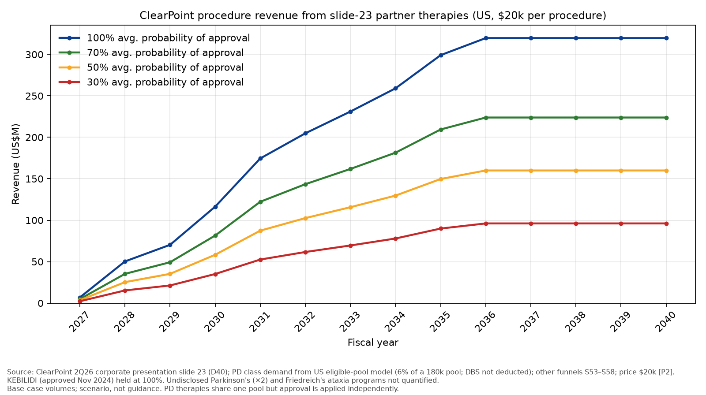

# ClearPoint partners with FDA expedited designations (slide 23, 2Q26 deck) – steady-state procedures and revenue

*Oct 25, 2026. Base case = central estimate; ★ = judgment; all volumes US, $20k per procedure [P2].*

ClearPoint lists more than ten partner programs under FDA expedited review [D40]. **Two lines are in our forecast and valuation: the class of one-time Parkinson's cell/gene therapy procedures (Section 5 of the CLPT report), of which BRT-DA01 (bemdaneprocel) is the first to launch, and AMT-130 (Huntington's).** Because the valuation counts the whole Parkinson's class, the split of that class among the four Parkinson's therapies below (BRT-DA01, AB-1005, ANPD001, RNDP-001) is illustrative only and adds nothing to it. The non-Parkinson's programs other than AMT-130 are not in the forecast or valuation. We show them to size the optionality; Figure 13 of the CLPT report gives a per-share yardstick of about $2.69 for each 1,000 patients a year at $20k [C43]. All volumes are US, at $20k per procedure [P2], and base cases are central estimates.

Figure D1 shows that the quantified programs would reach about 16,000 procedures and $320M of revenue a year by FY2040E if all were approved. Of these, AMT-130 (3,000) is in the forecast, and the Parkinson's class is in the forecast at class demand (11,454 in FY2040E) rather than as the sum of the four Parkinson's rows (9,200).

**Figure D1 – Partners, incidence, steady-state patients and revenue**

| Partner | Therapy | Indication | FDA designation(s) | US incidence / yr | Steady-state patients / yr (base) | Revenue / yr at $20k (US$M) | Plausible approval |
|---|---|---|---|---|---|---|---|
| BlueRock (Bayer) | BRT-DA01 (bemdaneprocel), first of the PD class | Parkinson's disease | Fast Track (2021) [D41]; RMAT (May 2024) [D41] | ~90,000 [A9]; prevalence 1.2M by 2030 [A15] | 5,000 [C54] (FY2040) | 100.0 | H2 2029 [S20] |
| AskBio (Bayer) | AB-1005 (AAV2-GDNF) | Moderate Parkinson's disease | Fast Track (Jul 2024) [D42]; RMAT (Feb 2025) [D42] | ~90,000 (shared PD pool) [A9] | 2,200 [C54] (FY2040) | 44.0 | 2033 ★ (Ph2 completes Aug 2028 [D32]) |
| Kenai | RNDP-001 | Moderate to moderate-severe idiopathic PD | Fast Track [D43] | ~90,000 (shared PD pool) [A9] | 1,000 [C54] (FY2040) | 20.0 | 2034 ★ (Ph1b/2a enrolled Jul 2026 [D43]) |
| Aspen | ANPD001 (sasineprocel) | Parkinson's disease | Fast Track (Oct 2023) [D44]; RMAT (Jul 30, 2026) [D44] | ~90,000 (shared PD pool) [A9] | 1,000 [C54] (FY2040) | 20.0 | 2034 ★ (Ph1/2a ASPIRO [D44]) |
| Undisclosed | – | Parkinson's disease | Not shown on slide | ~90,000 (shared) [A9] | not quantified | – | – |
| Undisclosed | – | Parkinson's disease | Not shown on slide | ~90,000 (shared) [A9] | not quantified | – | – |
| Neurona | NRTX-1001 (rezanecel) | Drug-resistant mesial temporal lobe epilepsy | RMAT (Jun 2024) [D45] | ~10,000–11,000 [A21]; prevalence 143k–191k [A21] | 3,200 [C50] | 64.0 | 2030 ★ (Ph3 primary completion Feb 2029 [D45]) |
| AviadoBio | AVB-101 | Frontotemporal dementia, GRN mutation | Fast Track (Nov 2023); Orphan [D46] | ~140 (derived) [C53]; prevalence ~1,000–1,500 [A23] | 40 [C50] | 0.8 | 2031 ★ (Ph1/2 primary completion Apr 2027 [D46]) |
| Undisclosed | – | Friedreich's ataxia | Not shown on slide | ~70 births (1/50,000 × 3.63M, derived) [A29][A26]; prevalence ~5,000 [A29] | not quantified | – | – |
| uniQure | AMT-130 | Huntington's disease | RMAT (Jun 2024); Breakthrough (Apr 2025) [D47] | ~4,087 [C23] | 3,000 [S30] | 60.0 | 2027 (action date late Apr/early May 2027 [D9]) |
| Siren | SRN-101 | Recurrent high-grade glioma | None found (preclinical/Ph1 not yet recruiting) [D48] – unverified | ~13,450 glioblastoma [A28] | 530 [C50] | 10.6 | 2034 ★ (Ph1 not yet recruiting [D48]) |
| PTC | KEBILIDI / Upstaza | AADC deficiency | Approved Nov 13, 2024 (accelerated); Priority Review, Orphan, RPD voucher [D49]; RMAT/Fast Track unverified | ~40 (derived) [A25][A26] | 14 [C50] | 0.3 | Approved 2024 [D49] |
| REGENXBIO | RGX-121 (clemidsogene lanparvovec) | Hunter syndrome (MPS II, neuronopathic) | Fast Track (2018); RMAT (2023); Orphan; RPD [D50] | ~11 (derived) [A27][A26] | 2 [C50] | <0.1 (0.04) | 2029 ★ (CRL Feb 2026; clinical hold Aug 2026 [D50]) |
| **Total (quantified)** | | | | | **15,986** | **319.7** | |

*Source: slide 23 [D40]; tags as shown. Designations are not on the slide (its title says "10+ Programs Are Already Under FDA Expedited Review"); they come from partner releases. PD therapies share one patient pool (Figure D2a), so their rows are not independent. Steady state = FY2040E. Non-PD rows are flat from FY2036E (epilepsy includes backlog drawdown). The four PD rows together reach 9,200 in FY2040E, below class demand of 11,454, because each later product is limited by its own launch ramp.*

The four Parkinson's therapies share one patient pool, so we allocate one-time class demand (CLPT report, Appendix C) among them rather than size each separately. Each year, one-time class demand = 6% of the eligible pool (DBS not deducted). In this illustration BRT-DA01 keeps a single-product launch ramp to 5,000 (330 → 2,500 → 4,500 → 5,000) [S20], capped at class demand; the cap never binds, as class demand is 10,800–11,800 a year to FY2040E. The remainder (class − bemdaneprocel) is split AB-1005 52% / ANPD001 24% / RNDP-001 24% [S52] ★. Each row is the smaller of its launch ramp (AB-1005 300 → 1,200 → 2,200; ANPD001 and RNDP-001 200 → 600 → 1,000) and its share of demand; with the 180,000 pool the launch ramps bind in every year. Demand not taken up before a product launches is not carried forward ★. FY2040: 5,000 / 2,200 / 1,000 / 1,000. In the forecast and valuation, class volume follows the three-year ramp to class demand and is not split (S62, S64).

**Figure D2a – Funnel: PD class (shared) – eligible-pool model**

| Step | Rate / input | Result | Source |
|---|---|---|---|
| US PD prevalence FY2026 (≥930k in 2020, 1.238M in 2030, log-linear; minimum estimates) | +2.9%/yr | ~1,104,000 | A30, C41 |
| × diagnosed ≥4 yrs and no dementia (0.73 − 0.28) | 45% | ~496,000 | A31, A32, C44 |
| × motor complications ★ | 50% | ~248,000 | S46, A33, A34 |
| × levodopa-responsive idiopathic PD (diagnostic-accuracy proxy) | 80.6% | ~200,000 | A35 |
| × fit for surgery ★ = medically eligible (16% of PD) | 90% | ~180,000 | S47 |
| = eligible pool, start FY2026 (DBS patients included) ★ | | ~180,000 (179,813) | C42, S44 |
| Each year: + entrants (0.124 × pool in FY2026, then +2.9%/yr) − leavers (m = death 5% + dementia 4.45%) − one-time treated | | | A31, A39, C45 |
| Treated from FY2029 = 6% of pool ★ (about 2.7× DBS's 2.2%; none before) = one-time therapy class demand | 6% | FY2029 ~11,800; FY2035 ~10,800; FY2040 ~11,500 | S45, C40, C49 |
| Memo: DBS 3,990 a year, context only, not deducted | 3,990 | – | A10, S44 |

*Source: tags as shown. ★ = judgment call.*

**Figure D2b – Funnel: NRTX-1001**

| Step | Rate / input | Result | Source |
|---|---|---|---|
| DR-MTLE incidence (3.1–3.4/100k × 324M) | 10,500 | 10,500 | A21 |
| × adults in trial age range ★ | 85% | 8,925 | S53 |
| × identified/referred at epilepsy centre ★ | 50% | 4,462 | S53 |
| × willing (non-destructive one-time vs resection/LITT) ★ | 50% | 2,231 | S53 |
| × access/reimbursement ★ | 80% | 1,785 | S53 |
| × share vs resection, LITT, RNS ★ | 70% | 1,250 | S53 |
| + prevalent backlog 143k–191k × same screens (11.9%) ÷ 10 yrs |  | 1,987 | A21, C52 |

*Source: tags as shown. ★ = judgment call.*

**Figure D2c – Funnel: AVB-101**

| Step | Rate / input | Result | Source |
|---|---|---|---|
| FTD incidence ages 45–64, ~3.4/100k × ~83M | 2,800 | 2,800 | A22, C53 |
| × GRN mutation share 5% | 5% | 140 | A23 |
| × genetically diagnosed ★ | 60% | 84.0 | S54 |
| × early-stage, age 30–75 per trial ★ | 70% | 58.8 | S54, A24 |
| × willing ★ | 60% | 35.3 | S54 |
| × access ★ | 80% | 28.2 | S54 |
| × share vs other GRN therapies ★ | 50% | 14.1 | S54 |
| + backlog 1,000–1,500 prevalent × same screens ÷ 5 yrs |  | 25.0 | A23, C53 |

*Source: tags as shown. ★ = judgment call.*

**Figure D2d – Funnel: KEBILIDI**

| Step | Rate / input | Result | Source |
|---|---|---|---|
| US births × 1/90,000 | 40 | 40.3 | A25, A26 |
| × diagnosed ★ | 60% | 24.2 | S55 |
| × eligible per label ★ | 90% | 21.8 | S55 |
| × willing ★ | 80% | 17.4 | S55 |
| × access ★ | 80% | 13.9 | S55 |
| × share (only approved therapy) | 100% | 13.9 | S55 |

*Source: tags as shown. ★ = judgment call.*

**Figure D2e – Funnel: RGX-121**

| Step | Rate / input | Result | Source |
|---|---|---|---|
| Male births × 1/162,000 | 11 | 11.5 | A26, A27 |
| × neuronopathic ~2/3 ★ | 67% | 7.7 | S56 |
| × diagnosed young enough ★ | 70% | 5.4 | S56 |
| × willing ★ | 80% | 4.3 | S56 |
| × access ★ | 80% | 3.4 | S56 |
| × share vs ERT/brain-penetrant ERT ★ | 60% | 2.1 | S56 |

*Source: tags as shown. ★ = judgment call.*

**Figure D2f – Funnel: SRN-101**

| Step | Rate / input | Result | Source |
|---|---|---|---|
| Glioblastoma incidence (CBTRUS) | 13,450 | 13,450 | A28 |
| × recurrence ★ | 90% | 12,105 | S57 |
| × resectable at recurrence ★ | 30% | 3,632 | S57 |
| × willing ★ | 70% | 2,542 | S57 |
| × access ★ | 70% | 1,779 | S57 |
| × share vs other recurrent-GBM options ★ | 30% | 534 | S57 |

*Source: tags as shown. ★ = judgment call.*

Figure D3 shows the ramps, assuming every program is approved.

**Figure D3 – Ramp, procedures by year (100% approval)**

| Therapy | FY2027E | FY2028E | FY2029E | FY2030E | FY2031E | FY2032E | FY2033E | FY2034E | FY2035E | FY2036E | FY2037E | FY2038E | FY2039E | FY2040E |
|---|---|---|---|---|---|---|---|---|---|---|---|---|---|---|
| BRT-DA01 | – | – | 330 | 2,500 | 4,500 | 5,000 | 5,000 | 5,000 | 5,000 | 5,000 | 5,000 | 5,000 | 5,000 | 5,000 |
| AMT-130 | 330 | 2,500 | 3,170 | 3,000 | 3,000 | 3,000 | 3,000 | 3,000 | 3,000 | 3,000 | 3,000 | 3,000 | 3,000 | 3,000 |
| AB-1005 | – | – | – | – | – | – | 300 | 1,200 | 2,200 | 2,200 | 2,200 | 2,200 | 2,200 | 2,200 |
| ANPD001 | – | – | – | – | – | – | – | 200 | 600 | 1,000 | 1,000 | 1,000 | 1,000 | 1,000 |
| RNDP-001 | – | – | – | – | – | – | – | 200 | 600 | 1,000 | 1,000 | 1,000 | 1,000 | 1,000 |
| NRTX-1001 | – | – | – | 300 | 1,200 | 2,200 | 3,200 | 3,200 | 3,200 | 3,200 | 3,200 | 3,200 | 3,200 | 3,200 |
| AVB-101 | – | – | – | – | 10 | 25 | 40 | 40 | 40 | 40 | 40 | 40 | 40 | 40 |
| KEBILIDI | 12 | 14 | 14 | 14 | 14 | 14 | 14 | 14 | 14 | 14 | 14 | 14 | 14 | 14 |
| RGX-121 | – | – | 1 | 2 | 2 | 2 | 2 | 2 | 2 | 2 | 2 | 2 | 2 | 2 |
| SRN-101 | – | – | – | – | – | – | – | 100 | 300 | 530 | 530 | 530 | 530 | 530 |

*Source: S20, S30, S52, S58, C40, C50, C54. In the forecast: AMT-130 and the four PD rows as one class (S62); the PD split is illustrative.*

Figure D4 shows total partner procedure revenue at different average probabilities of approval.

**Figure D4 – Total partner procedure revenue (US$M) by average probability of approval**

| Probability | FY2027E | FY2028E | FY2029E | FY2030E | FY2031E | FY2032E | FY2033E | FY2034E | FY2035E | FY2036E | FY2037E | FY2038E | FY2039E | FY2040E |
|---|---|---|---|---|---|---|---|---|---|---|---|---|---|---|
| 100% | 6.8 | 50.3 | 70.3 | 116.3 | 174.5 | 204.8 | 231.1 | 259.1 | 299.1 | 319.7 | 319.7 | 319.7 | 319.7 | 319.7 |
| 70% | 4.9 | 35.3 | 49.3 | 81.5 | 122.2 | 143.5 | 161.9 | 181.5 | 209.5 | 223.9 | 223.9 | 223.9 | 223.9 | 223.9 |
| 50% | 3.5 | 25.3 | 35.3 | 58.3 | 87.4 | 102.6 | 115.7 | 129.7 | 149.7 | 160.0 | 160.0 | 160.0 | 160.0 | 160.0 |
| 30% | 2.2 | 15.3 | 21.3 | 35.1 | 52.6 | 61.6 | 69.5 | 77.9 | 89.9 | 96.1 | 96.1 | 96.1 | 96.1 | 96.1 |

*Source: Figure D3 × $20k [P2] × probability. KEBILIDI is already approved and held at 100% in every row. Approval probabilities are applied to each therapy independently, although the four Parkinson's therapies share one pool; if one fails, the others could take more of its demand, so the lower rows probably understate PD revenue.*

*Figure D5 – Partner procedure revenue by probability of approval, FY2027E–FY2040E. Source: Figure D4.*

**Limitations.** Demand that arises before a later Parkinson's product launches is not carried forward, which is simple and on the low side. The 52 / 24 / 24 split of non-BlueRock PD demand is a judgment [S52]. Funnel rates for the other indications are judgments [S53]–[S57]. Three undisclosed programs (two Parkinson's, one Friedreich's ataxia) are not quantified.

## Sources (new tags; others as in the CLPT report, Appendix B)
- **D40** ClearPoint Neuro, Corporate Presentation 2Q26 Earnings Call, Aug 3, 2026, slide 23: https://d1io3yog0oux5.cloudfront.net/_e2d8bbba8f3850e103a2f7c8a42a59c6/clearpointneuro/db/77/2924/pdf/ClearPoint+Neuro+Corporate+Presentation+2Q26+Earnings+Call+-+08.03.26.pdf (PDF; text + rendered image read)
- **D41** BlueRock Fast Track: https://www.bluerocktx.com/bluerock-therapeutics-receives-fda-fast-track-designation-for-da01-in-the-treatment-of-advanced-parkinsons-disease/ ; RMAT: https://www.bluerocktx.com/bluerock-therapeutics-receives-fda-regenerative-medicine-advanced-therapy-designation-for-parkinsons-disease-cell-therapy-candidate-bemdaneprocel/
- **D42** AskBio Fast Track, Jul 11, 2024: https://www.askbio.com/askbio-receives-fda-fast-track-and-mhra-innovation-passport-designations-for-ab-1005-investigational-gdnf-gene-therapy-for-parkinsons-disease/ ; RMAT, Feb 19, 2025: https://www.askbio.com/askbio-receives-fda-regenerative-medicine-advanced-therapy-designation-for-parkinsons-disease-investigational-gene-therapy/
- **D43** Kenai, Jul 7, 2026 (enrolment complete; Fast Track): https://www.kenaitx.com/press-release-7-7-26
- **D44** Aspen Fast Track, Oct 19, 2023: https://aspenneuroscience.com/fda-grants-fast-track-designation-to-anpd001-autologous-investigational-cell-therapy-for-the-treatment-of-parkinsons-disease/ ; RMAT, Jul 30, 2026: https://aspenneuroscience.com/aspen-neuroscience-receives-fda-regenerative-medicine-advanced-therapy-rmat-designation-for-sasineprocel-anpd001-to-treat-parkinsons-disease/
- **D45** Neurona RMAT, Jun 18, 2024: https://www.neuronatherapeutics.com/news/press-releases/061824/ ; Phase 3 EPIC NCT05135091 (primary completion 2029-02): https://clinicaltrials.gov/study/NCT05135091
- **D46** AviadoBio Fast Track, Nov 6, 2023: https://aviadobio.com/aviadobio-announces-fda-ind-clearance-and-fast-track-designation-for-avb-101-for-the-treatment-of-frontotemporal-dementia-with-progranulin-grn-mutations/ ; ASPIRE-FTD NCT06064890 (age 30–75 per Practical Neurology; primary completion 2027-04): https://clinicaltrials.gov/study/NCT06064890
- **D47** uniQure RMAT: https://uniqure.gcs-web.com/news-releases/news-release-details/uniqure-receives-fda-regenerative-medicine-advanced-therapy-rmat ; Breakthrough: https://uniqure.gcs-web.com/news-releases/news-release-details/uniqure-announces-fda-breakthrough-therapy-designation-granted
- **D48** NCT07826949, SRN-101 before resection in recurrent HGG (not yet recruiting): https://clinicaltrials.gov/study/NCT07826949
- **D49** FDA, KEBILIDI approval, Nov 13, 2024: https://www.fda.gov/news-events/press-announcements/fda-approves-first-gene-therapy-treatment-aromatic-l-amino-acid-decarboxylase-deficiency
- **D50** REGENXBIO Fast Track: https://ir.regenxbio.com/news-releases/news-release-details/regenxbio-receives-fda-fast-track-designation-rgx-121-gene-0/ ; RMAT: https://ir.regenxbio.com/news-releases/news-release-details/regenxbio-receives-fda-regenerative-medicine-advanced-therapy/ ; regulatory update (CRL): https://ir.regenxbio.com/news-releases/news-release-details/regenxbio-announces-regulatory-update-rgx-121-bla-mps-ii ; 8-K Aug 24, 2026: https://www.sec.gov/Archives/edgar/data/1590877/000119312526363786/rgnx-20260824.htm
- **A21** Drug-resistant MTLE (hippocampal sclerosis) US prevalence 143,000–191,000; incidence 3.1–3.4 per 100,000 a year (×324M ≈ 10,000–11,000). Asadi-Pooya et al., World Neurosurg 2017: https://doi.org/10.1016/j.wneu.2016.12.074 (abstract)
- **A22** FTLD incidence 2.7–4.1 per 100,000 person-years (age 45–64); US prevalence 20,000–30,000. Knopman & Roberts 2011: https://pmc.ncbi.nlm.nih.gov/articles/PMC3208074/
- **A23** GRN mutations ≈5% of FTD: GeneReviews https://www.ncbi.nlm.nih.gov/books/NBK1371/ ; US GRN-FTD prevalence ~1,000–1,500 (derived from A22 × 5%).
- **A24** ASPIRE-FTD enrols age 30–75: https://practicalneurology.com/news/fda-fast-track-designation-and-ind-clearance-granted-to-novel-gene-therapy-for-grn-related-frontotemporal-dementia/2470333/
- **A25** AADC deficiency ≈1 in 90,000 births (US): https://doi.org/10.1002/cns3.20010 (screening-based range 1/64,000–1/766,660: https://doi.org/10.1016/j.ymgme.2024.108148)
- **A26** US births 2024: 3,628,934 (final). CDC NVSS: https://www.cdc.gov/nchs/nvss/births.htm
- **A27** MPS II ≈1 in 162,000 male births (range 0.26–1.4 per 100,000 births). HRSA evidence review: https://www.hrsa.gov/sites/default/files/hrsa/advisory-committees/heritable-disorders/meetings/mps-ii-final-report-3-28-2022.pdf
- **A28** Glioblastoma: 67,250 US cases 2018–2022 ≈ 13,450 a year. CBTRUS 2025: https://academic.oup.com/neuro-oncology/article/27/Supplement_4/iv1/8285946
- **A29** Friedreich's ataxia ~1 in 50,000; ~5,000 US patients. NORD: https://rarediseases.org/rare-diseases/friedreichs-ataxia/
**S52** Residual PD split 52/24/24. Judgment. **S53–S57** Funnel rates in Figures D2b–D2f. Judgment. **S58** Approval years and ramps in Figures D1/D3. Judgment.
- **C54** PD rows = min(launch ramp, share of class demand) in FY2040; class demand = 6% of the eligible pool, DBS not deducted (Figure D2a).
- **C50** Steady state = Table 2 result, rounded (PD to 100s; AVB-101 to 5s). **C52** NRTX-1001 = 10,500 × 0.85 × 0.5 × 0.5 × 0.8 × 0.7 = 1,249 + 167,000 (A21 mid) × 11.9% ÷ 10 = 1,987 → 3,200. **C53** FTD-GRN incidence = ~83M US aged 45–64 (Census, unverified) × 3.4/100k ≈ 2,800 × 5% = 140.
- Carried from the CLPT report (Appendix B): A9, A10, A15, A30–A35, A39, C23, C40, C42, C44, C45, C49, C50, D9, D32, P2, S20, S30, S44–S47, S62.

- **B1–B8 (PD pool model sources)**
  - B1 Marras et al., npj Parkinson's Dis 2018, US PD ≥930,000 (2020), 1,238,000 (2030), minimum estimates: https://doi.org/10.1038/s41531-018-0058-0
  - B2 Macleod et al., Mov Disord 2014, survival falls ~5% per year of follow-up: https://doi.org/10.1002/mds.25898
  - B3 Aarsland et al., Mov Disord 2005, dementia point prevalence 24.5–31.1%: https://doi.org/10.1002/mds.20527 ; Gibson et al., Mov Disord 2024, dementia incidence 4.45/100 person-years: https://doi.org/10.1002/mds.29918
  - B4 Motor complications in 3,343 patients (off periods 35% at 4–6 yrs, 59% at 8–10 yrs): https://pmc.ncbi.nlm.nih.gov/articles/PMC11145112/
  - B5 CamPaIGN 13-year follow-up (fluctuations 54% at 5 yrs): https://pmc.ncbi.nlm.nih.gov/articles/PMC7063985/
  - B6 Rizzo et al., Neurology 2016, clinical-diagnosis accuracy 80.6%: https://doi.org/10.1212/WNL.0000000000002350
  - B7 Venkatraman et al. 2024, 3,990 PD DBS procedures (NIS 2019): https://pmc.ncbi.nlm.nih.gov/articles/PMC10898494/
  - B8 Parkinson's Foundation, ~90,000 new diagnoses/yr; 1.2M by 2030: https://www.parkinson.org/understanding-parkinsons/statistics/prevalence-incidence

## Not verified
- Designations are not printed on slide 23; per-row designations come from partner releases. Siren SRN-101: no FDA designation found. KEBILIDI: RMAT/Fast Track not confirmed (Priority Review/Orphan/RPD confirmed).
- Three undisclosed programs (two PD, one Friedreich's ataxia) – not quantified.
- US population aged 45–64 (~83M) used in C53 is not sourced.
- A21, A22 read from abstracts/search snippets, not full text. ASPIRE-FTD age range from Practical Neurology, not the registry page.
- KEBILIDI current US procedure volumes not disclosed; ramp is judgment.
- PD pool model: motor-complication share (50%), fitness (90%), 6% treated per year (about 2.7× the measured DBS rate of 2.2%) and keeping patients who have had DBS in the pool are judgments; the class is modelled as launching in FY2029, while three of the four products launch in 2033–34.
