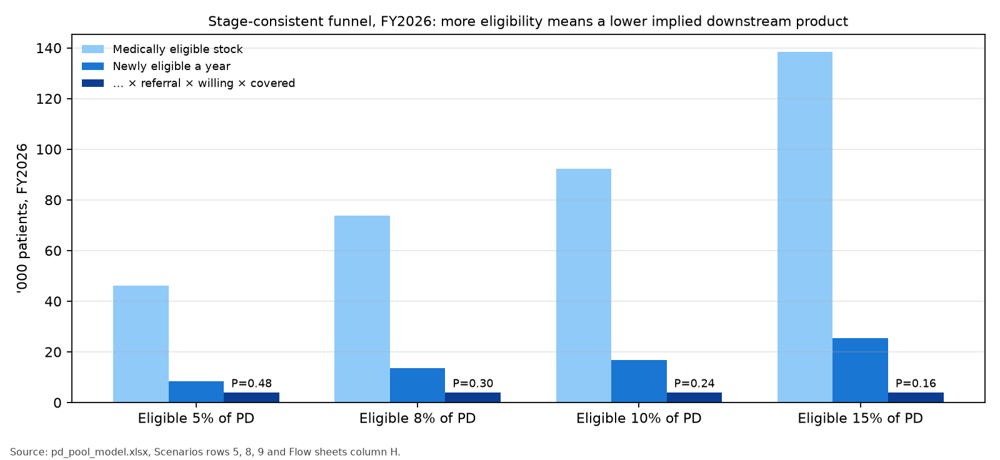
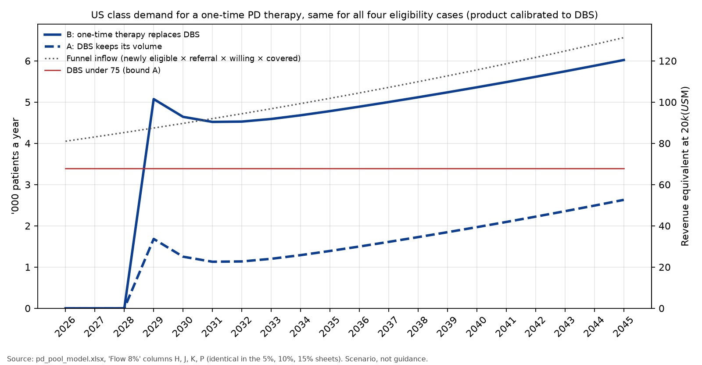
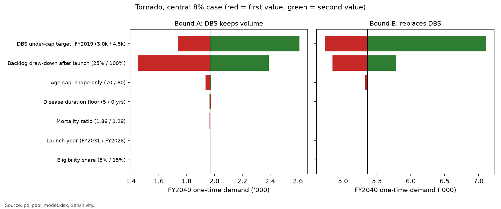

# US pool for a one-time restorative Parkinson's therapy: class-level demand

*ClearPoint Neuro (CLPT) working paper, 24 Oct 2026. Scenario analysis, not guidance. Tags: A = published data, C = calculation, S = judgment (★), P = instruction from David May, D = document. Sources are listed at the end; every number traces to pd_pool_model.xlsx (sheet and cells shown under each table). Counts in tables are in thousands of patients.*

## Summary

- **Question.** How many US patients a year would have a one-time restorative PD procedure at class level if its label looked like DBS's? Not split across the four therapies and before ClearPoint's capacity. Disease-modifying use is excluded (section 7).
- **Funnel.** Medically eligible ⊃ referred ⊃ willing ⊃ covered ⊃ treated. Eligibility is an explicit scenario input. The only calibrated number is the downstream product referral × willing × covered (P), set so that modelled DBS under age 75 matches the 2019 volume (3.4k a year) [A10, S5].
- **Central eligibility: 8% of US PD (point prevalence) ★**, equal to 16.5% of incident patients becoming eligible at some point. At 8%, the implied P is 0.30. That matches an independent judgment of the stages (referral 55% × willing 60% × covered 90% = 0.30).
  - 5% needs P = 0.48, which puts every stage near the top of its range.
  - 15% (Aspen's 150k) needs P = 0.16, near the bottom.
  - This fits David's view: Aspen is optimistic, and 10% is not double the most likely figure.
- **Class demand does not depend on the eligibility level once P is calibrated to DBS.** Eligible × P is pinned by DBS volume, so the four cases give the same demand. They differ only in the P they imply and how plausible it is. For eligibility to raise demand, the new class would need a better downstream funnel than DBS, which is outside scope.
- **Demand.** If DBS keeps its volume (bound A): 1.7k in the launch year (FY2029), 1.1k in FY2032, 2.0k in FY2040. If the therapy replaces DBS (bound B): 5.1k, 4.5k and 5.4k. At $20k per procedure, FY2040 is $39M–107M.
- **Main drivers (tornado, FY2040)**:
  - The DBS volume used for calibration: 3.0k–4.5k gives bound B 4.7k–7.1k.
  - The yearly draw-down of the backlog after launch: bound B 4.8k–5.8k.
  - Eligibility, launch year, age cap, mortality and duration floor each move FY2040 demand by 0.1k or less.

## 1. Label and stage definitions

**Figure 1. Funnel stages and what feeds each one**

| Stage | Definition in this model | Input | Tag |
|---|---|---|---|
| 1 Medically eligible | Levodopa-responsive idiopathic PD, ≥4 yrs, motor complications not adequately controlled (recent-onset included), no dementia, fit, age <75 | Scenario 5 / 8 / 10 / 15% of PD | A [B1], S3 ★, S8 ★ |
| 2 Referred / evaluated | Seen at a DBS-capable centre for assessment | Judgment 30–80% (comparison only) | S9 ★ |
| 3 Willing | Accepts surgery after evaluation | Judgment 40–85%; published 35–43% is consent to referral | A11, A12, A21, S10 ★ |
| 4 Covered | Payer approves | Judgment 80–95% | S4 ★ |
| 2×3×4 product P | Lifetime share of eligible patients who are treated | Calibrated: DBS under 75 ÷ eligible inflow, FY2019 | C |
| 5 Treated | DBS before launch; one-time therapy after launch | Flow model | C |

*Source: pd_pool_model.xlsx, Inputs and Scenarios.*

- **The label does not require patients to be refractory.** Medtronic's label covers levodopa-responsive PD of at least 4 years that is not adequately controlled, including motor complications of recent onset (4 months to 3 years). It has no age cap [B1]. EARLYSTIM showed benefit in patients with early complications (age ≤60, H&Y <3, complications ≤3 years) [B7].
- **Age and prior DBS.** An upper age of 75 is a practice judgment (★ S3). All four restorative trials in ClearPoint's partner set exclude patients who have had DBS [D1–D4], so DBS recipients leave the pool permanently.
- **What each willingness figure measures.** The 35% [A11] and 43.2% [A12] figures are willingness among patients flagged as candidates, before referral. Of patients who complete a full evaluation, 58.7% go on to implant at one US centre [A21].

## 2. Medical eligibility: point prevalence and lifetime fraction

- **How the pool is built.** US diagnoses (90,000 a year [A1]) are spread by age using Hirsch incidence [A3] on Census 2024 population [A17]. They grow 2.6% a year (C1). Each cohort is followed through:
  - survival: SSA 2023 life table [A4] × mortality ratio 1.52 [A5];
  - dementia: 6.0% a year if diagnosed at 65 or older [A6], 4.3% a year if younger [A15];
  - motor complications: 12% a year in years 2–5 and 22% a year after [A7, A15];
  - the label's 4-year floor [B1].
- **Published screens alone.** Applying levodopa response 80.6% [A9], not adequately controlled 70% (★ S1) and fit 90% (★ S2) gives 4.3% of PD in FY2026. That share sets the age mix of the pool. The eligibility scenario then sets the level: published-screen counts are scaled uniformly by g = scenario ÷ 4.3%.
- **Relationship between the two measures.** Point prevalence s ≈ lifetime fraction (LF) × mean years eligible ÷ mean survival from diagnosis. In the cohort, an entrant stays eligible for 6.1 years on average, against 12.0 years of survival after diagnosis. So s ≈ LF × 0.51. The small gap to the scenario value (row 7 below) comes from incidence growth and age mix (C).
- **Olmsted floor.** In Olmsted County, 16% of incident PD developed fluctuations and 29% of those had DBS. That is about 4.8% ever-DBS [A8], so LF ≥ 4.8%. If ever-DBS = LF × P, then LF = 4.8% ÷ P (row 10).
- **What the Olmsted check does and does not show.** The model's ever-DBS share is 4.9% in every case, close to Olmsted's 4.8%. That supports the DBS calibration, but it cannot tell the eligibility cases apart, because P adjusts to offset eligibility.

**Figure 2. Eligibility scenarios and implied downstream product**

| Row | Measure | 5% (clinic studies) | 8% (central ★) | 10% (abstract) | 15% (Aspen 150k) |
|---|---|---|---|---|---|
| 3 | Eligible, point prevalence of US PD | 5.0% | 8.0% | 10.0% | 15.0% |
| 4 | Scale on published screens g | 1.17× | 1.87× | 2.33× | 3.50× |
| 5 | Implied P = referral × willing × covered | 0.48 | 0.30 | 0.24 | 0.16 |
| 6 | Lifetime fraction of incident PD ever eligible | 10.3% | 16.5% | 20.6% | 30.9% |
| 7 | Check: LF × years eligible ÷ survival | 5.3% | 8.4% | 10.5% | 15.8% |
| 8 | Eligible stock, FY2026 ('000) | 46.1 | 73.8 | 92.3 | 138.4 |
| 9 | Newly eligible a year, FY2026 ('000) | 8.4 | 13.5 | 16.9 | 25.3 |
| 10 | Olmsted-implied LF = 4.8% ÷ P | 10.0% | 16.0% | 20.0% | 30.0% |
| 11 | P with DBS target 3.4k / 4.0k / 4.5k | 0.48 / 0.56 / 0.64 | 0.30 / 0.35 / 0.40 | 0.24 / 0.28 / 0.32 | 0.16 / 0.19 / 0.21 |
| 13 | DBS volume implied at judgment P = 0.30 ('000) | 2.1 | 3.4 | 4.2 | 6.3 |
| 14 | Plausibility of P | top of range | central | plausible | bottom of range |

*Source: pd_pool_model.xlsx, Scenarios rows 3–14 (row 11 from pd_pool_model.py, dbs_tests; target 4.0k = all 3,990 treated as under 75). Plausible range for P: 0.10–0.65, central 0.30 (★; referral 30–80%, willing 40–85%, covered 80–95%).*

- **Why 8% is central (★).**
  - It is the only case where the calibrated P (0.30) matches a stage-by-stage judgment (0.30).
  - It lies between the measured clinic studies (Morgante 4.5% flexible, D-DATS 6.6% for any device therapy [B10]) and the 10–15% figures.
  - The 10–15% figures are a survey abstract [A16] and Aspen's unsourced company belief [D5].
- **The 5% case is possible but demanding.**
  - It needs about 80% referral × 65% willing × 92% covered.
  - Aspen itself says only 10–15% of eligible patients are referred [D5]. That claim is unsourced, but it points the other way.
- **The 15% case needs P = 0.16.** That is consistent with poor referral (for example 30% × 60% × 90%), but it sits uneasily with Olmsted's finding that DBS was planned for 78% of untreated early-onset patients with fluctuations [A8].
- **Testing a higher DBS target** (4.5k, for outpatient implants) raises every P by about a third. The central case would then imply P = 0.40, still plausible.

**Figure 3. Central 8% case by age band, FY2026 ('000)**

| Age band | PD prevalent | Alive, no dementia, ≥4 yrs | + motor complications | Eligible (central) | Eligible % of band PD | In funnel (× P) |
|---|---|---|---|---|---|---|
| <50 | 8.8 | 2.5 | 1.2 | 1.1 | 12.5% | 0.3 |
| 50–59 | 39.5 | 14.9 | 9.0 | 8.5 | 21.5% | 2.6 |
| 60–64 | 56.7 | 16.5 | 10.7 | 10.1 | 17.8% | 3.0 |
| 65–69 | 92.9 | 37.8 | 22.4 | 21.2 | 22.9% | 6.4 |
| 70–74 | 154.8 | 52.1 | 34.6 | 32.8 | 21.2% | 9.8 |
| 75–79 | 197.0 | 0.0 | 0.0 | 0.0 | 0.0% | 0.0 |
| 80+ | 373.0 | 0.0 | 0.0 | 0.0 | 0.0% | 0.0 |
| **Total** | **922.8** | **123.7** | **77.8** | **73.8** | **8.0%** | **22.1** |

*Source: pd_pool_model.xlsx, 'Age-band funnel' rows 3–10. 'In funnel' is the stock equivalent and is shown for scale only; the flow model applies P to inflow.*

## 3. Calibration and checks

**Figure 4. Checks**

| Check | Published | Model | Result |
|---|---|---|---|
| US PD prevalent 2020 ('000) | 930.0 minimum [A19] | 792.4 | model 15% low |
| US PD prevalent 2030 ('000) | 1,238.0 [A19] | 1,021.5 | model 17% low |
| DBS under 75, FY2019 ('000) | 3.4 [A10, S5] | 3.4 | matched by construction |
| Ever-DBS share of incident PD | 4.8% all ages [A8] | 4.9% under 75 | consistent |
| Bound B, kf = 100%, FY2045 vs funnel inflow ('000) | identity | 6.6 vs 6.6 | equal |
| xlsx flows vs Python, FY2001–45, all cases | — | max relative difference below 1e-12 | pass |

*Source: pd_pool_model.xlsx, Checks and Summary; LibreOffice recalculation compared with pd_pool_model.json.*

**What the 3,990 covers [A10].** It is weighted NIS discharges in 2019 with a PD diagnosis and a DBS procedure code. That has three consequences:
- **Inpatient only.** Outpatient implants are missed, so true volume is likely higher.
- **All ages.** S5 assumes 85% are under 75; this is unverified.
- **May not be one patient per discharge.** Staged second-side procedures could be counted twice.
The calibration is therefore tested from 3.0k to 4.5k (Figure 2 row 11, Figure 7). The PD prevalence gap against Marras is inherited from the incidence inputs. Marras calls its own figures minimums.

## 4. Yearly flow, FY2026–2045

- **Pool.** Pool(t) = pool(t−1) × (1 − μ) + newly eligible × P − treated. The exit rate μ (death, dementia, ageing past 75) is about 16% a year.
- **Before launch.** DBS treats min(3.4k, pool) each year. Calibrating to FY2019 means DBS absorbs the whole funnel up to 2019. Inflow then grows 2.6% a year while DBS is held flat, so a backlog of willing, covered patients builds, reaching 2.8k by FY2028.
- **After launch (FY2029, ★ S7).**
  - **Bound A**: DBS keeps its volume, and the one-time therapy treats 50% of the remaining pool each year (★ S6).
  - **Bound B**: the one-time therapy takes over DBS's volume and also draws down the backlog at the same rate. B minus A therefore equals the DBS volume.
  - **Tornado anomaly, fixed and explained.** Bound B now moves with DBS volume only because P is calibrated to that volume: more DBS implies a larger funnel. It no longer moves for any other reason.

**Figure 5. Class demand, central 8% case ('000 patients; revenue $M at $20k)**

| FY | Newly eligible | Funnel inflow (× P) | Deaths | Dementia | Aged past 75 | Pool available | A: DBS | A: one-time | A: $M | B: one-time | B: $M | Backlog end, B |
|---|---|---|---|---|---|---|---|---|---|---|---|---|
| 2026 | 13.5 | 4.1 | 1.9 | 2.8 | 7.0 | 5.3 | 3.4 | 0.0 | 0.0 | 0.0 | 0.0 | 1.9 |
| 2027 | 13.9 | 4.2 | 1.9 | 2.9 | 7.2 | 5.7 | 3.4 | 0.0 | 0.0 | 0.0 | 0.0 | 2.4 |
| 2028 | 14.2 | 4.3 | 1.9 | 3.0 | 7.4 | 6.2 | 3.4 | 0.0 | 0.0 | 0.0 | 0.0 | 2.8 |
| 2029 | 14.6 | 4.4 | 2.0 | 3.0 | 7.6 | 6.8 | 3.4 | 1.7 | 33.6 | 5.1 | 101.5 | 1.7 |
| 2030 | 15.0 | 4.5 | 2.0 | 3.1 | 7.8 | 5.9 | 3.4 | 1.3 | 25.0 | 4.6 | 92.9 | 1.3 |
| 2031 | 15.3 | 4.6 | 2.1 | 3.2 | 8.0 | 5.6 | 3.4 | 1.1 | 22.6 | 4.5 | 90.4 | 1.1 |
| 2032 | 15.7 | 4.7 | 2.2 | 3.3 | 8.2 | 5.7 | 3.4 | 1.1 | 22.7 | 4.5 | 90.6 | 1.1 |
| 2034 | 16.6 | 5.0 | 2.3 | 3.4 | 8.6 | 6.0 | 3.4 | 1.3 | 25.8 | 4.7 | 93.6 | 1.3 |
| 2035 | 17.0 | 5.1 | 2.3 | 3.5 | 8.8 | 6.2 | 3.4 | 1.4 | 27.8 | 4.8 | 95.6 | 1.4 |
| 2036 | 17.4 | 5.2 | 2.4 | 3.6 | 9.0 | 6.4 | 3.4 | 1.5 | 30.0 | 4.9 | 97.8 | 1.5 |
| 2038 | 18.3 | 5.5 | 2.5 | 3.8 | 9.5 | 6.8 | 3.4 | 1.7 | 34.5 | 5.1 | 102.4 | 1.7 |
| 2040 | 19.3 | 5.8 | 2.6 | 4.0 | 10.0 | 7.3 | 3.4 | 2.0 | 39.4 | 5.4 | 107.2 | 2.0 |
| 2042 | 20.3 | 6.1 | 2.8 | 4.2 | 10.5 | 7.8 | 3.4 | 2.2 | 44.5 | 5.6 | 112.3 | 2.2 |
| 2045 | 21.9 | 6.6 | 3.0 | 4.5 | 11.4 | 8.7 | 3.4 | 2.6 | 52.6 | 6.0 | 120.4 | 2.6 |

*Source: pd_pool_model.xlsx, 'Flow 8%' rows 29–48 (columns C, H, E–G, N, J, K, M, P, R, Q). Exits are before treatment.*

**Figure 6. Class demand by eligibility case ('000 patients; $M at $20k)**

| Case | Implied P | Eligible FY2026 | Newly eligible FY2026 | Bound | FY2029 | FY2030 | FY2032 | FY2035 | FY2040 | FY2045 | $M FY2040 |
|---|---|---|---|---|---|---|---|---|---|---|---|
| 5% | 0.48 | 46.1 | 8.4 | A | 1.7 | 1.3 | 1.1 | 1.4 | 2.0 | 2.6 | 39.4 |
| 5% | 0.48 | 46.1 | 8.4 | B | 5.1 | 4.6 | 4.5 | 4.8 | 5.4 | 6.0 | 107.2 |
| 8% | 0.30 | 73.8 | 13.5 | A | 1.7 | 1.3 | 1.1 | 1.4 | 2.0 | 2.6 | 39.4 |
| 8% | 0.30 | 73.8 | 13.5 | B | 5.1 | 4.6 | 4.5 | 4.8 | 5.4 | 6.0 | 107.2 |
| 10% | 0.24 | 92.3 | 16.9 | A | 1.7 | 1.3 | 1.1 | 1.4 | 2.0 | 2.6 | 39.4 |
| 10% | 0.24 | 92.3 | 16.9 | B | 5.1 | 4.6 | 4.5 | 4.8 | 5.4 | 6.0 | 107.2 |
| 15% | 0.16 | 138.4 | 25.3 | A | 1.7 | 1.3 | 1.1 | 1.4 | 2.0 | 2.6 | 39.4 |
| 15% | 0.16 | 138.4 | 25.3 | B | 5.1 | 4.6 | 4.5 | 4.8 | 5.4 | 6.0 | 107.2 |

*Source: pd_pool_model.xlsx, Summary rows 3–18 and Scenarios rows 5, 8, 9. Demand is identical across cases because P offsets eligibility.*

**Convergence.** When yearly uptake is 100% (kf = 1, the rerun), bound B equals the funnel inflow every year after launch: 6.6k against 6.6k in FY2045. Bound A equals the inflow minus DBS, 3.2k. At the base kf of 50%, bound B in FY2045 is 6.0k, or 92% of inflow. The gap is patients who leave the pool before they are treated.

## 5. Sensitivity

**Figure 7. One-at-a-time sensitivity, central case: FY2040 one-time demand ('000)**

| Input (first / second value) | Bound A | Bound B | Implied P |
|---|---|---|---|
| Base | 2.0 | 5.4 | 0.30 |
| DBS under-cap target, FY2019 (3.0k / 4.5k) | 1.7 / 2.6 | 4.7 / 7.1 | 0.26 / 0.40 |
| Backlog draw-down after launch (25% / 100%) | 1.5 / 2.4 | 4.8 / 5.8 | 0.30 / 0.30 |
| Age cap, shape only (70 / 80) | 1.9 / 2.0 | 5.3 / 5.4 | 0.27 / 0.31 |
| Disease duration floor (5 / 0 yrs) | 2.0 / 2.0 | 5.4 / 5.4 | 0.31 / 0.30 |
| Mortality ratio (1.86 / 1.29) | 2.0 / 2.0 | 5.4 / 5.4 | 0.32 / 0.28 |
| Launch year (FY2031 / FY2028) | 2.0 / 2.0 | 5.4 / 5.4 | 0.30 / 0.30 |
| Eligibility share (5% / 15%) | 2.0 / 2.0 | 5.4 / 5.4 | 0.48 / 0.16 |

*Source: pd_pool_model.xlsx, Sensitivity. The age cap, mortality and duration floor are rerun through the cohort with the 8% eligibility level held fixed.*

## 6. Judgment inputs (★)

- S8 Eligibility, point prevalence: 8% central; scenarios 5%, 10%, 15%.
- S1 / S2 Not adequately controlled 70% and medically fit 90%. These shape the age mix only; the level comes from S8.
- S3 Age cap 75 (the label has none; tested 70–80).
- S5 Share of DBS patients under 75: 85% (tested via a 3.0k–4.5k target).
- S6 Backlog draw-down after launch: 50% a year (25–100%).
- S7 Launch FY2029 (tested FY2028–31).
- S9–S11 and S4 Referral 55% (30–80%), willing 60% (40–85%), covered 90% (80–95%). Used only to judge whether the calibrated P is plausible.
- The uniform scale g assumes that higher eligibility has the same age and duration mix as the published-screen pool.

## 7. Why DBS-style eligibility understates a disease-modifying therapy's pool (qualitative; excluded from numbers)

- **Which patients qualify.** DBS treats symptoms, so it is offered late, once complications are no longer adequately controlled; for many it is a last resort. A therapy that slowed or reversed degeneration would make most sense early, before motor complications, which the label-style pool here excludes.
- **How willing they are.** The risk–benefit trade-off differs. Patients and neurologists may accept surgery earlier for a durable or disease-modifying benefit, so the 35–43% willingness to accept DBS would not carry over.
- **Why it is excluded.** None of the four partner therapies has shown disease modification, and exPDite-2 and REGENERATE-PD enrol patients with established motor fluctuations [D1, D2]. Any such upside belongs to a separate scenario with its own evidence.

## 8. Not verified or open

- No population-based study applies the label or EARLYSTIM criteria, so all four eligibility levels rest on clinic studies, surveys or company statements.
- The Olmsted figures (16%, 29%, 78%) come from an AAN abstract. 4.8% is our product of the two published figures (C).
- The share of DBS patients under 75, the outpatient share of implants, and double counting of staged procedures in the NIS are all unverified.
- Referral, willingness and coverage are separate judgments. Published figures map to them only loosely: PARADISE (device therapy 'not considered' for 26.6%), Aspen's unsourced 10–15% referral figure, and 58.7% implanted after evaluation [B10, D5, A21].
- DBS volume is held flat at the 2019 level throughout. Before 2019 the model's DBS is capped by the funnel, so it is lower than 3.4k.
- Dementia and motor complications are assumed independent within each age × duration cell. Modelled PD prevalence runs 15–17% below Marras.

## Sources

- **D1** exPDite-2, NCT06944522: https://clinicaltrials.gov/study/NCT06944522
- **D2** REGENERATE-PD, NCT06285643: https://clinicaltrials.gov/study/NCT06285643
- **D3** ASPIRO, NCT06344026: https://clinicaltrials.gov/study/NCT06344026
- **D4** REPLACE, NCT07106021: https://clinicaltrials.gov/study/NCT07106021
- **D5** Aspen Neuroscience S-1, Oct 2026: https://www.sec.gov/Archives/edgar/data/2124080/000119312526419104/na-20261009.htm
- **B1** FDA P960009/S478 (Medtronic DBS indication), Feb 2025: https://www.accessdata.fda.gov/cdrh_docs/pdf/P960009S478B.pdf
- **B7** Schüpbach et al., EARLYSTIM, NEJM 2013: https://www.nejm.org/doi/full/10.1056/NEJMoa1205158
- **B10** Moes et al. 2023 review (Morgante, D-DATS, PARADISE, Malaty): https://pmc.ncbi.nlm.nih.gov/articles/PMC10645650/
- **A1** Parkinson's Foundation statistics: https://www.parkinson.org/understanding-parkinsons/statistics/prevalence-incidence
- **A3** Hirsch et al., Neuroepidemiology 2016: https://doi.org/10.1159/000445751
- **A4** SSA Period Life Table 2023: https://www.ssa.gov/oact/STATS/table4c6.html
- **A5** Macleod et al., Mov Disord 2014: https://doi.org/10.1002/mds.25898
- **A6** Williams-Gray et al., JNNP 2013: https://doi.org/10.1136/jnnp-2013-305277
- **A8** Stang et al., Rochester Epidemiology Project, Neurology 2021 suppl (abstract): https://doi.org/10.1212/WNL.96.15_supplement.4377
- **A9** Rizzo et al., Neurology 2016: https://doi.org/10.1212/WNL.0000000000002350
- **A10** Venkatraman et al., J Neurosurg 2024 (NIS): https://pmc.ncbi.nlm.nih.gov/articles/PMC10898494/
- **A11** DBS, developing world's perspective, MDCP 2023 (35%): https://pmc.ncbi.nlm.nih.gov/articles/PMC10715347/
- **A12** Dinkelbach et al., BMC Neurology 2017 (43.2%): https://doi.org/10.1186/s12883-017-0820-7
- **A15** Hely et al., Mov Disord 2005: https://doi.org/10.1002/mds.20324
- **A16** GMS 2012 abstract (10–15%): https://doi.org/10.3205/12dgnc047
- **A17** US Census Vintage 2024: https://www2.census.gov/programs-surveys/popest/datasets/2020-2024/national/asrh/nc-est2024-agesex-res.csv
- **A19** Marras et al., npj Parkinson's Disease 2018: https://doi.org/10.1038/s41531-018-0058-0
- **A21** Multidisciplinary DBS screening, MDCP 2018 (58.7%): https://pmc.ncbi.nlm.nih.gov/articles/PMC6183455/
- **A7** Ahlskog & Muenter, Mov Disord 2001 (motor fluctuations): https://doi.org/10.1002/mds.1090
- **P** $20k per procedure: instruction from David May.
