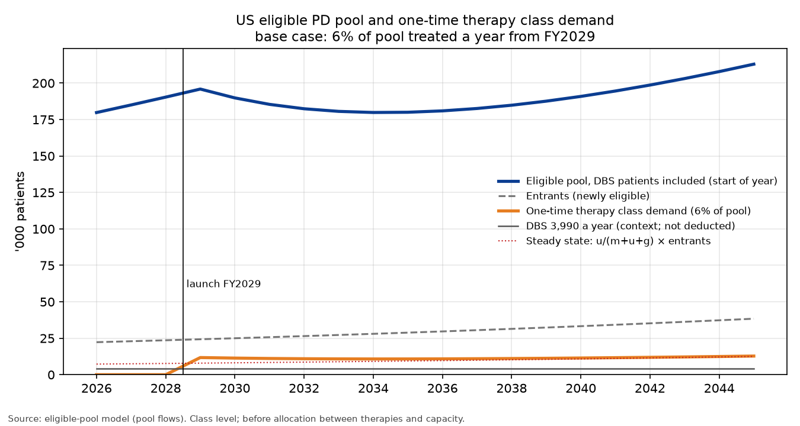

# US patients eligible for a one-time Parkinson's therapy: class demand model

*Class level, base with bull and bear, FY2026–45. Inputs are either published statistics [n] or labelled judgments (★). October 25, 2026.*

## Method

**Starting prevalence.** The model starts from the Parkinson's Foundation prevalence project, which estimates at least 930,000 Americans aged 45 or over with Parkinson's disease (PD) in 2020 and 1,238,000 in 2030 [1].

- I interpolate log-linearly between these two points. That implies growth of 2.9% a year and about 1.10 million patients in FY2026.
- The authors call their figures minimum estimates, because they rely on diagnosed, recorded cases [1].
- The Parkinson's Foundation quotes the same 1.2 million for 2030 [2].

**Medical eligibility.** Eligibility follows the DBS label: levodopa-responsive PD of at least four years' duration, with motor complications, no dementia and fit for surgery. There is no age cap.

- **Duration.** Survival in PD falls by about 5% for each year of follow-up [3]. With prevalence growing 2.9% a year, about 73% of prevalent patients were diagnosed four or more years ago. As a check, the Foundation's roughly 90,000 new diagnoses a year [2] against 1.1 million prevalent cases implies an average of about 12 years lived with the diagnosis, which gives a similar share.
- **Dementia.** A systematic review puts the point prevalence of dementia in PD at 24.5% across all studies and 31.1% in the highest-quality ones [4]; I use 28%. I do not multiply dementia and duration as if they were independent. Dementia is rare in the first years after diagnosis, so I subtract it from the four-year group. That leaves 45% of all patients who have had PD for at least four years and do not have dementia.
- **Motor complications.** I assume half of that group have them. This is a judgment anchored to two cohorts:
  - In 3,343 UK patients, off periods affected 35% at 4–6 years and 59% at 8–10 years [5].
  - A population-based incident cohort found motor fluctuations in 54% by five years [6].
- **Diagnosis.** About 81% are taken to have true, levodopa-responsive idiopathic PD. This is the pooled accuracy of clinical diagnosis against pathology [7]. It is a proxy, not a measured response rate.
- **Fitness.** I assume 90% are fit for neurosurgery. This is a judgment; I found no population figure.

**Patients already treated with DBS stay in the pool.** About 3,990 PD patients receive DBS each year [8]. DBS and a one-time cell or gene therapy are not treated as mutually exclusive, so these patients are not deducted. Every PD cell/gene trial checked excludes prior DBS at entry, but none gives a biological or safety reason [16]; DBS has been added after grafts in small case series [17][18][19], and grafts have been placed in three patients who already had a DBS lead, with adverse events comparable to standard DBS surgery [20] ★. The trial-style exclusion is used only in the bear case.

| Step (FY2026) | Factor | Patients | Basis |
|---|---|---|---|
| US PD prevalence | — | 1,104,000 | Published [1], interpolated |
| Diagnosed ≥4 years and no dementia | 0.73 − 0.28 | 496,000 | Published [3][4], calculated |
| Motor complications | ×0.50 | 248,000 | Judgment anchored to [5][6] |
| Levodopa-responsive idiopathic PD | ×0.81 | 200,000 | Published proxy [7] |
| Fit for surgery | ×0.90 | 180,000 | Judgment |
| **Eligible pool, patients who have had DBS included** ★ | | **180,000** (179,813) | |

**Checks on the eligible share.** Medically eligible patients make up 16% of PD, which agrees with the two published figures near 15%:

- Aspen Neuroscience's filing says roughly half of about 300,000 drug-refractory US patients may be eligible for cell-replacement surgery, about 15% of PD [9].
- A German conference abstract cites 10–15% [10].

Neither states its criteria, so both confirm a share, not a level. Clinic studies give a lower bound:

- 4.5% under flexible criteria in Italian movement-disorder clinics [11].
- 6.6% eligible for referral to any device-aided therapy in a Dutch general hospital [12].

Those studies use stricter, more clinical criteria (including age and severity), so a label-based pool should sit above them.

**Flows.** Each year, closing pool = opening pool + entrants − leavers − treated with a one-time therapy.

- **Leavers.** A share m of the pool leaves each year through death (5% a year [3]) or new dementia (4.45 per 100 person-years [13]). So m = 0.095, and patients stay eligible for about ten years on average.
- **Entrants.** First-year entrants are set so that the pool, untouched, grows at the same 2.9% as prevalence: (m + g) × pool = 22,300 in FY2026. They then grow at 2.9% a year.
- **DBS.** DBS continues alongside at about 3,990 a year. It is shown for context only: it is not deducted from the pool or from one-time demand.
- **Treated.** Nobody receives a one-time therapy before launch in FY2029. From launch, 6% of the opening pool a year is one-time class demand ★.

**Why 6% a year.** The 6% is a judgment anchored on the rate at which eligible patients receive DBS today, not on a published willingness rate.

| Measure | Calculation | Rate |
|---|---|---|
| DBS today, against the eligible pool at the start of FY2026 | 3,990 [8] ÷ 179,800 | 2.2% a year |
| **Assumed one-time therapy uptake from launch** ★ | about 2.7 × 2.2% | **6% a year** |

The judgment is that many more eligible patients would choose a one-time, potentially disease-modifying therapy than choose DBS, which is symptomatic hardware surgery with an implanted stimulator. No published study measures that preference; the multiple is our assumption.

**Three-year ramp ★.** Procedures (class volume) ramp to class demand over three years: one third of demand in FY2029, two thirds in FY2030 and all of it from FY2031. This is David's judgment, on the view that it also gives time for other therapies to get approved. The other quantified Parkinson's therapies are expected in FY2033–34, after the ramp has ended, so the rationale is a judgment rather than a timeline match. The pool is drawn down by full class demand from launch, a simplification that slightly understates the pool in FY2029–30.

**Bull and bear.** The bull keeps the pool and the ramp and treats 8% a year ★; that needs confirming, since a bull reaching 10,000 was asked for earlier, and the 8% bull reaches about 14,300 in FY2031. The bear applies the trial-style exclusion: patients who have had DBS (3,990 ÷ 0.095 ≈ 42,000) are removed, leaving about 138,000, and 6% of that gives class demand of about 8,400 a year. In the forecast the bear launches in 2030 and is limited by a capacity of 4,500 a year, below that demand in every year.

## Results

| FY | 2026 | 2029 | 2030 | 2031 | 2032 | 2035 | 2040 | 2045 |
|---|---|---|---|---|---|---|---|---|
| Pool, start of year (k) | 180 | 196 | 190 | 185 | 182 | 180 | 191 | 213 |
| Entrants (k) | 22.3 | 24.3 | 25.0 | 25.7 | 26.5 | 28.8 | 33.3 | 38.4 |
| Leavers (k) | 17.1 | 18.6 | 18.0 | 17.6 | 17.3 | 17.1 | 18.1 | 20.2 |
| One-time class demand, 6% of pool (k) | – | 11.8 | 11.4 | 11.1 | 10.9 | 10.8 | 11.5 | 12.8 |
| Class volume after three-year ramp (k) | – | 3.9 | 7.6 | 11.1 | 10.9 | 10.8 | 11.5 | 12.8 |
| Implied centres at 150 cases a year | – | 26 | 51 | 74 | 73 | 72 | 76 | 85 |
| DBS, context only (k) | 4.0 | 4.0 | 4.0 | 4.0 | 4.0 | 4.0 | 4.0 | 4.0 |
| Bull, class volume at 8% (k) | – | 5.2 | 9.9 | 14.3 | 13.8 | 13.2 | 13.8 | 15.3 |
| Bear, class demand, prior-DBS excluded (k) | – | 9.0 | 8.7 | 8.5 | 8.4 | 8.3 | 8.8 | 9.8 |

*Centres = procedures ÷ 150 (3 cases a week, 50 weeks), derived. Bear demand is shown with a FY2029 launch; in the forecast the bear launches in 2030 and is capacity-bound at 4,500.*

*Chart: eligible pool, entrants, one-time class demand (6% of the pool), class volume after the three-year ramp, and DBS for context, FY2026–45.*

**Launch.** Class demand is about 11,800 in the launch year, because 6% is applied to a pool that has grown untouched to FY2028. It eases to about 10,800 in FY2033–35 as that backlog is drawn down, then rises with the pool. Under the ramp, volume is about 3,900 in FY2029, 7,600 in FY2030 and equals demand (11,100) from FY2031.

**Centres.** At 3 cases a week, base volume from FY2031 needs about 74 centres for Parkinson's alone (95 in the bull), against the 20–30 centres management talks about. That is an aggressive judgment ★.

**Settling.** The treated count settles at a constant share of entrants, u/(m + u + g) = 0.06/0.184 ≈ 33%. The share of any single group of entrants eventually treated is u/(m + u) = 0.06/0.155 ≈ 39%; the two shares describe different groups.

**Plausibility check.** A judgment funnel gives about 30% treated (referral 0.55 × willing 0.60 × coverage 0.90). Referral and coverage are judgments, and willingness is anchored to published consent and implant rates [14][15]. A 6% treatment rate implies somewhat more lifetime uptake (39%) than that funnel.

**Illustration.** At $20,000 per procedure, FY2040 one-time class volume is worth about $230 million.

## Weak points

1. The motor-complication share and medical fitness are judgments, and together they move the pool more than any published input.
2. The diagnosis factor is a proxy for levodopa response.
3. The dementia midpoint and the assumption that dementia sits almost entirely in patients diagnosed four or more years ago are simplifications.
4. The 5% death rate comes from all PD patients; patients without dementia probably die less often, which would lengthen the time spent in the pool.
5. Keeping patients who have had DBS in the pool is a judgment. If labels copy trial entry rules, the pool is about 138,000 and demand about 8,400 a year, as in the bear.
6. The 3,990 counts inpatient procedures only.
7. Prevalence is a published minimum, so the pool is more likely too low than too high.
8. The 6% treatment rate is a judgment: about 2.7 times the measured DBS rate of 2.2% a year. No published willingness rate supports it, and the FY2029 launch is also an assumption.
9. The three-year ramp is a judgment, and the pool is drawn down by full demand during the ramp.
10. The volume implies about 74 centres (95 in the bull), well above management's 20–30.

## Sources
1. Marras et al. Prevalence of Parkinson's disease across North America. npj Parkinson's Dis 2018. https://doi.org/10.1038/s41531-018-0058-0
2. Parkinson's Foundation. Prevalence & incidence. https://www.parkinson.org/understanding-parkinsons/statistics/prevalence-incidence
3. Macleod et al. Mortality in Parkinson's disease: systematic review and meta-analysis. Mov Disord 2014. https://doi.org/10.1002/mds.25898
4. Aarsland et al. Systematic review of prevalence studies of dementia in PD. Mov Disord 2005. https://doi.org/10.1002/mds.20527
5. Motor complications in Parkinson's disease: results from 3,343 patients followed for up to 12 years. PMC11145112. https://pmc.ncbi.nlm.nih.gov/articles/PMC11145112/
6. Motor complications in Parkinson's disease: 13-year follow-up of the CamPaIGN cohort. PMC7063985. https://pmc.ncbi.nlm.nih.gov/articles/PMC7063985/
7. Rizzo et al. Accuracy of clinical diagnosis of PD. Neurology 2016. https://doi.org/10.1212/WNL.0000000000002350
8. Venkatraman et al. DBS utilization in the US, NIS 2012–19 (Table 1). https://pmc.ncbi.nlm.nih.gov/articles/PMC10898494/
9. Aspen Neuroscience, Form S-1, Oct 2026. https://www.sec.gov/Archives/edgar/data/2124080/000119312526419104/na-20261009.htm
10. Reasons for underutilisation of DBS. GMS abstract 2012. https://doi.org/10.3205/12dgnc047
11. Morgante et al. Parkinsonism Relat Disord 2007. https://pubmed.ncbi.nlm.nih.gov/17347021/
12. Moes et al. (D-DATS). Parkinsonism Relat Disord 2023. https://doi.org/10.1016/j.parkreldis.2023.105359
13. Gibson et al. Risk of dementia in PD: systematic review and meta-analysis. Mov Disord 2024. https://doi.org/10.1002/mds.29918
14. Dinkelbach et al. Willingness to undergo DBS among Parkinson's patients. BMC Neurology 2017 (43.2% consent to referral). https://doi.org/10.1186/s12883-017-0820-7
15. Multidisciplinary DBS screening. Mov Disord Clin Pract 2018 (58.7% of patients evaluated proceeded to implant). https://pmc.ncbi.nlm.nih.gov/articles/PMC6183455/
16. ClinicalTrials.gov eligibility criteria of PD cell/gene trials (bemdaneprocel exPDite-2, AB-1005, AAV2-GDNF, ANPD001, RNDP-001, VY-AADC, CERE-120), read Oct 25, 2026, e.g. https://clinicaltrials.gov/study/NCT06944522
17. Herzog et al. DBS in fetal-graft patients. Mov Disord 2008 (abstract). https://pubmed.ncbi.nlm.nih.gov/18536037/
18. Graff-Radford et al. GPi DBS 11 years after a graft. Arch Neurol 2006 (abstract). https://jamanetwork.com/journals/jamaneurology/fullarticle/791926
19. Pallidal stimulation in graft recipients. npj Parkinson's Dis 2021 (abstract). https://www.nature.com/articles/s41531-021-00183-w
20. MDS abstract, cell-based therapy in patients with an existing DBS system. https://www.mdsabstracts.org/abstract/unilateral-delivery-of-cell-based-therapy-to-the-putamen-and-substantia-nigra-in-patients-with-parkinsons-disease-who-have-an-existing-dbs-system/
