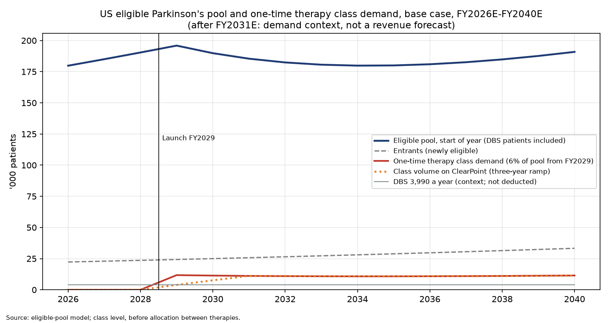
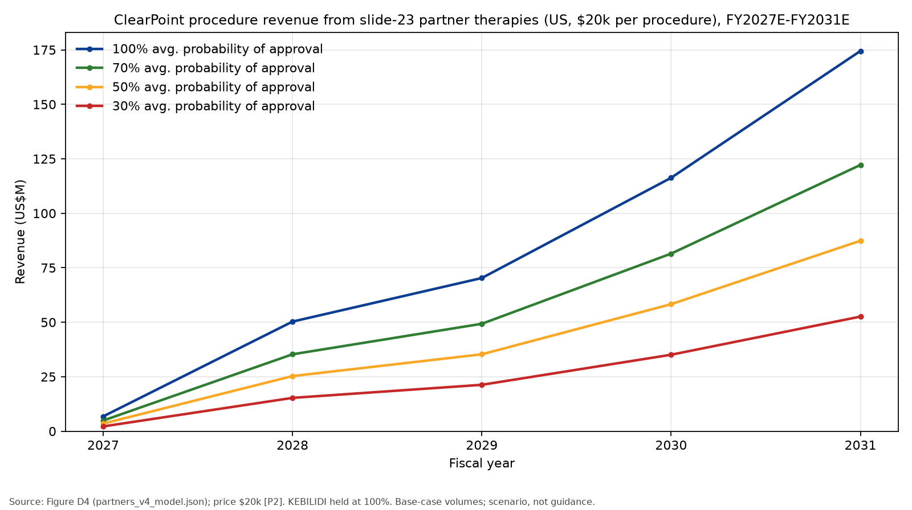

# ClearPoint Neuro (Nasdaq: CLPT)

## Company Update: FY2026E–FY2031E Revenue and EBITDA Forecast

*October 26, 2026. US$ millions unless stated. Scenario forecast: it assumes uniQure's AMT-130 and Bayer/BlueRock's bemdaneprocel are approved, counts every one-time Parkinson's cell/gene therapy procedure as one class delivered on ClearPoint's platform, and prices every procedure at $20k, as requested. AMT-130 volume follows ClearPoint's stated capacity; Parkinson's volume ramps over three years to modelled class demand. The explicit forecast ends at FY2031E; after that only Finagle's valuation fade is shown (Section 7). It includes a Finagle discounted-cash-flow valuation but carries no rating. Every tag resolves in Appendix B. Appendix C sets out the Parkinson's eligible-pool model behind the Parkinson's class line, and Appendix D lists ClearPoint's partner programs; outside the Parkinson's class and AMT-130 they are not in the forecast.*

---

### 1. Summary

**FORECAST UPDATE**

■ **We forecast revenue rising from $49.0M in FY2026E to $320M in FY2030E and $410M in FY2031E [E1][C7].** FY2026E sits on analyst consensus after the August guidance cut to $48.0–52.0M [G2][E1]. The core business follows consensus to $56.6M in FY2027E, then grows 15% a year, the low end of the 15–20% Burnett talks about [E1][G12][S7][S26] ★. Procedure revenue at $20k each [P2] adds $6.6M in FY2027E and $282M in FY2031E [C7]. The CAL preclinical laboratory adds $7.0M in FY2028E, rising to $29.0M in FY2031E on the way to 60% of the $60M+ capacity management cites [G9][S37] ★. Growth peaks at 93% in FY2028E as AMT-130 launches and stays high at 89% in FY2029E as the Parkinson's class launches. It slows to 28.3% in FY2031E, the last explicit year, as the Parkinson's ramp completes [C7]. After FY2031E, the valuation (Section 7) uses Finagle's fade, in which revenue growth falls from 15.0% in FY2032E to about 6.1% in FY2040E [P3][C65].

■ **EBITDA turns positive in FY2028E at $12.0M and reaches $170.8M (a 41.6% margin) in FY2031E [S15][C10].** Procedure revenue carries an assumed 70% gross margin [S23], 10% of revenue for clinical specialists and $2M a year per therapy [S24][S25]. CAL revenue earns the core gross margin less 20% incremental opex [G9][S38] ★. FY2026E and FY2027E stay loss-making at −$23.6M and −$19.5M [C9][S15].

■ **One-time Parkinson's cell/gene therapy procedures (the class, all on ClearPoint's platform) ramp over three years from the FY2029E launch to class demand: about 3,900 in FY2029E, 7,600 in FY2030E and 11,100 in FY2031E [S31][S62][S63][S64][C40] ★.** We size demand for the whole class of one-time Parkinson's cell and gene therapies from published prevalence, label-style eligibility (levodopa-responsive, at least four years since diagnosis, motor complications, no dementia, fit for surgery) and a stock-and-flow pool (Appendix C) [A30][C42]. About 180,000 US patients are medically eligible in FY2026E, 16% of PD [C42]. DBS and one-time therapy are not treated as mutually exclusive: trials exclude patients who have had DBS, but that is an entry rule and we found no biological or safety reason for it, so these patients stay in the pool [S44][A41]–[A43] ★. About 3,990 eligible patients receive DBS each year, 2.2% of the pool [A10][C49]. We assume 6% of the pool a year would receive a one-time, potentially disease-modifying therapy from FY2029E, about 2.7 times the DBS rate. DBS continues alongside and is not deducted [S45] ★. Class demand is about 11,800 in the launch year, eases to about 10,800 in FY2033E–35E as the backlog is drawn down, then rises with the pool to 11,500 in FY2040E [C40]; the post-FY2031E path is demand context only, as the valuation fades revenue growth from FY2032E [P3]. Volume reaches demand in FY2031E. The three-year ramp is David's judgment that it also gives time for other Parkinson's therapies to be approved [S64] ★. Running 11,100 Parkinson's procedures a year needs about 74 centres at 3 cases a week, far beyond the 20–30 centres management talks about, an aggressive judgment [S43][G7] ★. We treat all one-time PD cell/gene procedures as one class on ClearPoint's platform (100% share, David's view) [S62][S63] ★. The bull treats 8% of the pool a year on the same ramp, giving 14,300 procedures in FY2031E [S59][C46] ★; bull revenue by line is in Figure 5b. The bear excludes patients who have had DBS, as trials do (pool about 138,000), and is limited by a capacity ramp after a 2030 approval, reaching 2,500 procedures in FY2031E [S22][S43][C55]. AMT-130 is unchanged at 3,000 a year from FY2030E [S30].

■ **Finagle values the shares at $65.20 in the base case vs. a $9.25 price (derived) [C56][C59].** The bull case gives $88.36 and the bear $14.56 [C57][C58]. After David's rough ×0.90 allowance for dilution from a $25M equity raise, the values are $58.68, $79.52 and $13.10 [C62]. The valuation uses David's balance-sheet assumptions: a further $50M note draw in FY2026E, debt at 2× EBITDA from the first profitable year, 9.2% interest, stock-based compensation of $8M a year until EBITDA turns positive, and a cost of equity of 10.45% (10-year yield plus a 5.5% premium) [P3]. Explicit growth ends at FY2031E; Finagle then fades revenue growth from 15% to 4.95% by FY2040E [P3][C65]. About 86% of base value comes from cash flows after FY2031E and 54% from terminal value (derived) [C60]. These are scenario values, not a target.

Figure 1 shows the procedure line turning losses into profits from FY2028E.

**Figure 1 – Financial summary (base case)**

| US$M | FY2024A | FY2025A | FY2026E | FY2027E | FY2028E | FY2029E | FY2030E | FY2031E |
|---|---|---|---|---|---|---|---|---|
| Revenue | 31.4 | 37.0 | 49.0 | 63.1 | 122.0 | 230.6 | 319.9 | 410.4 |
| Revenue growth | – | 17.8% | 32.5% | 28.9% | 93.2% | 88.9% | 38.7% | 28.3% |
| Gross margin | – | 61.4% | 62.9% | 63.6% | 65.8% | 67.3% | 67.6% | 67.8% |
| EBITDA (before SBC) | – | −15.2 | −23.6 | −19.5 | 12.0 | 71.2 | 120.6 | 170.8 |
| EBITDA growth | – | – | n/m | n/m | n/m | 493.6% | 69.4% | 41.6% |
| EBITDA margin | – | −41.0% | −48.1% | −30.9% | 9.8% | 30.9% | 37.7% | 41.6% |

*Source: A1, A3, C7, C8, C9, C10, C11, E1, S13, S15, S23, S32, S37, S38. EBITDA growth is not meaningful (n/m) on a negative base. FY2024A EBITDA is not built in this forecast.*

### 2. Business Description and Reporting Lines

ClearPoint Neuro sells an MRI- and CT-guided platform for delivering therapies into the brain: frames, cannulae, software and services. Its customers are hospitals (for neurosurgery) and biopharma companies (for cell and gene therapy trials) [A2]. It reports three lines [A2]:

- **Biologics and drug delivery (51% of FY2025A revenue).** Disposables, clinical case support, preclinical services, now run from the CAL (ClearPoint Advanced Laboratories), a 30,000 sq ft preclinical contract-research facility in Torrey Pines, San Diego [D2][G9], and licensing/milestone fees from more than 60 pharma partners, including uniQure and BlueRock [A2][G2]. PTC Therapeutics accounted for 15% of this line in FY2025A [D1]. Revenue is earned per procedure and per service contract. Once a partner product is approved, ClearPoint expects about $12–15k per patient across partners [G5] and $15–25k per typical uniQure procedure [G4]. This forecast prices both approved therapies at $20k per procedure [P2].
- **Neurosurgery navigation and therapy (40%).** Disposables for deep-brain stimulation, laser ablation and biopsy, plus the IRRAflow drainage system added with the IRRAS acquisition in November 2025 [A2][D1]. These are sold directly to hospitals, mostly in the US. The five largest hospitals make up 21% of disposables [D1].
- **Capital equipment and software (8%).** ClearPoint consoles, robotics, the operating-room navigation software and the IRRAflow control units, sold as capital or placed [A2].

Figure 2 shows that biologics and drug delivery is still the largest line, but neurosurgery is gaining share quickly.

**Figure 2 – Revenue by line, FY2025A**

| Line | US$M | Share | YoY |
|---|---|---|---|
| Biologics and drug delivery | 19.0 | 51.5% | 10.0% |
| Neurosurgery navigation and therapy | 14.8 | 40.1% | 44.2% |
| Capital equipment and software | 3.1 | 8.4% | −18.3% |
| **Total** | **37.0** | 100.0% | 17.8% |

*Source: A1, A2, C1; shares derived [C18].*

### 3. Management

Joe Burnett has been President and CEO since November 7, 2017. He joined when the company was still called MRI Interventions and became a director at the same time [D13]. He came from Royal Philips, where he was VP and GM of Neuro Diagnostics and Therapy from March 2016. Before that he was SVP of Image Guided Therapy Devices and GM of Volcano (a Philips company) in 2015–16 [D13]. He spent November 2004–February 2015 at Volcano, ending as EVP/GM of its Coronary & Systems unit. Earlier he was an R&D engineer and product manager at Guidant (1999–2004) [D13]. He holds a BSE in biomedical engineering and an MBA from Duke (Fuqua) [D13].

**Track record.** Revenue grew from $7.38M in 2017 to $37.0M in FY2025A, roughly a fivefold increase over eight years [A6][A1]. Burnett repositioned the company from a neurosurgery tool vendor into a drug-delivery partner for biopharma. That is the strategy this forecast depends on. His capital allocation has relied on equity and structured debt. He closed the IRRAS acquisition in November 2025 for $5.0M in cash plus 1,325,000 shares and an earnout [D1]. He also raised Oberland/TPC notes ($50.2M carried at June 30, 2026), which carry a revenue participation from 2027 [D2]. Execution is mixed. FY2025A revenue landed in the bottom fifth of its original range [C13]. The 2026 range was cut by $4M in August [G2]. On the Q2 call, Burnett said BDD fell about 15% against a one-time order in the prior year, and he announced a commercial reorganization [D3]. In his own framing, he sets out priorities in pillars and gives concrete per-procedure economics [G4][G5]. **Ownership:** we did not verify Burnett's shareholding (no proxy opened), so the record on alignment is thin.

### 4. Key Developments

Figure 3 lists the events that set our assumptions.

**Figure 3 – Key developments**

| Date | Event | Source |
|---|---|---|
| Aug 2025 | BlueRock exPDite-2 Phase 3 (about 102 patients) first patient; primary completion March 2027 | [D10] |
| Sep 2025 | Bayer expects Phase 3 results in 2028–29 (Reuters; snippet only) | [D19] |
| Sep 2025 | uniQure sizes about 6,000 treatable US patients at launch | [G8] |
| Nov 20, 2025 | IRRAS (IRRAflow) acquisition closed | [D1] |
| Mar 17, 2026 | FY2025A revenue $37.0M; 2026 guidance $52.0–56.0M | [A1][D4] |
| Aug 3, 2026 | Q2 2026A revenue $10.9M; guidance cut to $48.0–52.0M; Burnett gives procedure capacity | [A4][G2][G7] |
| Sep 2, 2026 | uniQure submits AMT-130 BLA; with priority review, action date late Apr/early May 2027 | [D9][S8] |

The guidance cut shows slower core growth. The AMT-130 BLA gives a dated path to the procedure line, while bemdaneprocel's later readout pushes it to FY2029E.

### 5. Business Drivers by Line

- **Biologics and drug delivery, neurosurgery, capital equipment.** Trial enrolment (10–15 trials, about 10 readouts in 18 months) and IRRAflow drive FY2026E–FY2027E, with growth of 15% a year from FY2028E (low end of Burnett's 15–20% [G12]) [G2][S1]–[S7][S26].
- **CAL preclinical services (uplift inside biologics and drug delivery).** The CAL is ClearPoint's own preclinical contract-research lab, not a manufacturing plant [D1][D2]. The lease was signed in June 2025, and the last of three phases was handed over on July 13, 2026 [D2]. ClearPoint signed its first GLP (Good Laboratory Practice) statement of work there, worth "multi-million" dollars, and expects to complete it in H1 2027 [G10]. Burnett says the old subleased lab peaked at about $8M a year of preclinical work, and the CAL "could surpass $60 million or so" [G9]. He says one large GLP study could be worth $15–20M [G11]. The Q2 2026 miss was blamed on a slow CAL ramp, and 2026 guidance includes none of the large studies, which should start in H2 2027 [G9][G10]. Management also names CAL as one of the levers that could take 2027 above "high teens" growth [G9]. We model CAL as an uplift on top of the 15% core growth: nothing in FY2027E in the base (consensus already reflects the first contract), then $7M, $14M, $22M and $29M in FY2028E–31E, on a path to 60% of capacity [S37] ★. 60% is a central reading of management's "could surpass $60 million" [G9]. The bull adds $3M in FY2027E and reaches $36M in FY2031E. The bear reaches only $8M [S37]. Revenue is booked as each study stage completes, so actual results will be lumpier than this smooth path [G10].
- **Commercial drug delivery (scenario).** This line is volume-driven, with price fixed at $20k [P2]. Volume is set by centre activation and cases per centre per week, using Burnett's capacity comments [G7]. AMT-130 first works through uniQure's 6,000 treatable pool [G8], then runs at a steady state of 3,000 a year, set as a share of HD incidence [S30]. The Parkinson's volume is the class of one-time Parkinson's cell/gene therapy procedures, not a single product: every such procedure is assumed to use ClearPoint's platform [S62][S63] ★. The first launch is bemdaneprocel (H2 2029E) [S20]. From launch, class volume ramps over three years to class demand: one third of demand in FY2029E, two thirds in FY2030E and all of it from FY2031E; class demand then governs [S31][S64][C40]. Figure 4a shows the ramp.

**Steady-state rationale ★.** *Huntington's:* US incidence is about 4,087 new cases a year (1.22/100k × 335M) [A7][C23]. Adding the UK (0.67/100k × 68M) brings it to about 4,543 [A8][C24]. 3,000 a year is 73% of the US figure, or 66% of US + UK [C25]. That is well above uniQure's 30% treatable share of *prevalent* patients [C21]. We accept it because newly diagnosed patients are, by definition, at the early-manifest stage AMT-130 was studied in, and there is no competing disease-modifying therapy. It is still aggressive, and it would be unreachable if access stays US-only and narrow. *Parkinson's:* see the eligible-pool summary below and Appendix C.

**Parkinson's demand: eligible-pool model ★.** We size demand for the class of one-time Parkinson's cell and gene therapies, not for bemdaneprocel alone, using label-style criteria modelled on DBS rather than trial entry criteria. The model starts from published US prevalence of about 1.10 million in FY2026E [A30][C41] and keeps patients who have had PD for at least four years and do not have dementia (45%) [A31][A32], have motor complications (50%, a judgment anchored to cohort data) [A33][A34][S46], have levodopa-responsive idiopathic PD (81%) [A35] and are fit for surgery (90%) [S47]. That leaves about 180,000 medically eligible patients (179,813), 16% of PD, close to the roughly 15% in two published references [C42][A36][A12]. Patients who have already had DBS stay in the pool. Every Parkinson's cell/gene trial we checked excludes them, but that is a trial-entry rule: no registry entry gives a biological or safety reason, DBS has been added after grafts in small case series, and grafts have been placed in three patients who already had DBS [A41]–[A43][S44] ★. Each year new patients enter, others leave through death or dementia, and from FY2029E 6% of the pool receives a one-time therapy [A31][A39][S45] ★. Nobody receives a one-time therapy before launch, and entrants of (m + g) × the starting pool keep the pool growing at the 2.9% prevalence rate to FY2028E [C45]. The 6% is anchored on today's DBS rate: 3,990 DBS procedures a year are 2.2% of the 180,000 pool [A10][C49]. We assume about 2.7 times as many patients a year would choose a one-time, potentially disease-modifying therapy as choose DBS, which is symptomatic hardware surgery. That multiple is our judgment; no published willingness study supports it [S45]. DBS continues alongside: it is not deducted from one-time demand, and patients who have had DBS remain eligible [S44]. Appendix C gives the full method, sources and weak points.

Figure 4b shows class demand and the three-year ramp to it in the base.

**Figure 4b – One-time Parkinson's therapy class demand and ClearPoint class volume (base case)**

| Patients a year | FY2029E | FY2030E | FY2031E | FY2032E | FY2033E | FY2035E | FY2040E |
|---|---|---|---|---|---|---|---|
| Eligible pool, start of year (DBS patients included) | 196,000 | 190,000 | 185,000 | 182,000 | 181,000 | 180,000 | 191,000 |
| **One-time therapy class demand (6% of pool)** | **11,756** | **11,391** | **11,126** | **10,945** | **10,837** | **10,801** | **11,454** |
| Memo: DBS (context; not deducted) | 3,990 | 3,990 | 3,990 | 3,990 | 3,990 | 3,990 | 3,990 |
| Ramp share of class demand | 1/3 | 2/3 | 100% | 100% | 100% | 100% | 100% |
| Class volume on ClearPoint | 3,919 | 7,594 | 11,126 | 10,945 | 10,837 | 10,801 | 11,454 |
| Implied centres at 3 cases/wk × 50 wks | 26 | 51 | 74 | 73 | 72 | 72 | 76 |

*Source: A10, A30–A35, A39, S31, S43–S45, S62–S64, C40, C42, C45; Appendix C. FY2032E–FY2040E columns are demand and pool context only: the revenue forecast ends at FY2031E, and Finagle extends revenue after FY2031E by its growth fade (Section 7), not by this path. Pool rounded to the nearest thousand. Centres derived.*

*What this implies.* In the base, demand, not capacity, sets volume from FY2031E. Class demand peaks in the launch year, because 6% is applied to a pool that has grown untouched to FY2028E. It then eases by about 8% to FY2034E as that backlog is drawn down, and grows again with prevalence, about 0.8% a year over FY2033E–40E (derived; demand context) [C40]. Under the three-year ramp the launch-year peak is never reached in volume: FY2029E–30E volume is below demand, and from FY2031E volume equals demand. David's reason for three years is that this also gives time for other Parkinson's therapies to be approved [S64] ★. That rationale is a judgment, not a timeline match: bemdaneprocel launches in FY2029E, but the other quantified Parkinson's therapies are not expected until after FY2031E, in 2033–34 (Appendix D), after the ramp has ended. For FY2031E the model therefore has the first product, or the platform generally, meeting all class demand. Because the line is the whole class, no product split is needed (Appendix D shows an illustrative split). *Bull and bear.* The bull keeps the base pool and the three-year ramp and raises the share treated to 8% a year [S59] ★ (Figure 4c). The bear applies the trial-style exclusion: patients who have had DBS (about 42,000, i.e. 3,990 a year ÷ the 0.095 leave rate) are removed, leaving about 138,000, and 6% of that gives class demand of about 8,500 in FY2031E and about 8,400 in FY2032E (demand context) [C55]. Approval slips to 2030, and a capacity ramp gives 330 procedures in FY2030E and 2,500 in FY2031E, below demand in both years [S22][S43].

**Figure 4c – Bull case: class demand with a higher treated share (8%)**

| Patients a year | FY2029E | FY2030E | FY2031E | FY2032E | FY2033E | FY2035E | FY2040E |
|---|---|---|---|---|---|---|---|
| Eligible pool, start of year (DBS patients included) | 196,000 | 186,000 | 178,000 | 173,000 | 169,000 | 166,000 | 172,000 |
| **One-time therapy class demand (bull, 8% of pool)** | **15,674** | **14,875** | **14,272** | **13,833** | **13,530** | **13,250** | **13,792** |
| Class volume on ClearPoint (three-year ramp) | 5,225 | 9,917 | 14,272 | 13,833 | 13,530 | 13,250 | 13,792 |
| Implied centres at 3 cases/wk × 50 wks | 35 | 66 | 95 | 92 | 90 | 88 | 92 |
| Memo: base class volume | 3,919 | 7,594 | 11,126 | 10,945 | 10,837 | 10,801 | 11,454 |

*Source: A30–A35, A39, S21, S59, S62–S64, C45, C46; Appendix C. Same pool inputs as the base; only the treated share changes. Pool rounded to the nearest thousand. Centres derived.*

With 8% treated, the pool settles at a steady 39% of each year's entrants treated, against 33% at 6% (derived) [C46]. 8% is a third above the base rate and about 3.6 times the 2.2% DBS rate [C49]. We chose the smallest change that keeps the bull clearly above the base in every year: a bull defined by a capacity build to 10,000 a year would now sit below the base, which exceeds 10,000 from FY2031E. With the base already on a three-year ramp, the bull differs from it only in the treated share [S59] ★. Bull volume is 14,300 in FY2031E, against 11,100 in the base. Bull class demand is about 13,800 in FY2032E and in FY2040E, against 10,900 and 11,500 in the base (demand context) [C46][C40]. David earlier asked for a bull growing to 10,000 a year; this bull exceeds that, which needs his confirmation [S59].

*Capacity is not the limit in the base or bull.* S20 assumes 4,500 a year per therapy (30 centres × 3 a week × 50 weeks). Burnett's "20–30 centres … 50 to 100 cases a week" [G7] reaches 5,000 a year at the top end. Base Parkinson's volume of about 11,000 a year from FY2031E needs about 74 centres at 3 cases a week, and the bull's 14,300 about 95, on top of AMT-130's 3,000 (about 20 more centres if the networks are separate) (derived) [S43] ★. That is two and a half to three times the top of management's comments. We accept it as an aggressive but bounded judgment: volume is driven by the eligible pool (6% of about 180,000), not by a capacity plan, and the three-year ramp implies adding about 25 centres a year in the base (about 30 in the bull). Limiting the ramp by an explicit build of 25 centres a year would give almost the same path, so we keep the simpler rule [S64]. Burnett's quote may cover all therapies. Launch analogs such as Hemgenix and Roctavian were slow [D22][D23], but those are small rare-disease markets without a surgical delivery network. AMT-130 still follows the S20 capacity ramp: 330 → 2,500 → 3,170 → 3,000 [S32]. The bear remains limited by its 4,500 capacity [S43].

**Figure 4a – Procedures by therapy (base case)**

| Procedures | FY2027E | FY2028E | FY2029E | FY2030E | FY2031E |
|---|---|---|---|---|---|
| AMT-130 | 330 | 2,500 | 3,170 | 3,000 | 3,000 |
| One-time PD therapies (class) | – | – | 3,919 | 7,594 | 11,126 |
| **Total** | **330** | **2,500** | **7,089** | **10,594** | **14,126** |
| Procedure revenue at $20k (US$M) | 6.6 | 50.0 | 141.8 | 211.9 | 282.5 |
| CAL uplift (US$M) | – | 7.0 | 14.0 | 22.0 | 29.0 |
| Binding constraint | AMT capacity | AMT capacity | AMT pool / PD ramp | PD ramp | PD class demand |

*Source: S20, S30–S32, S37, S62–S64, G7, G8, G9, P2. The PD row is the class of one-time Parkinson's cell/gene therapy procedures on ClearPoint's platform; bemdaneprocel is the first launch.*

### 6. Risks

**Company-specific.**

- **Capacity vs. demand.** Our volumes assume ClearPoint's stated capacity is fully used. Gene-therapy launches have often been slow: Hemgenix treated 12 patients in its first year [D22], and Roctavian 3 in 2023 [D23]. Our bear case models this slower path: 270 AMT-130 procedures in FY2028E [S22]. FY2028E revenue is then $54.2M below the base (derived). The bear, which also delays bemdaneprocel and slows core growth, is valued at $14.56 a share [C58].
- **Shared centres.** AMT-130 and the Parkinson's class would compete for the same neurosurgeons and MRI suites; base FY2031E volume of about 14,100 procedures needs about 94 centres at 3 cases a week (derived) [S43]. Base class demand stays about the same after FY2031E (about 10,800–11,500 a year to FY2040E, Figure 4b), so the centre need does not fall (demand context) [C40].
- **Funding and dilution.** Cash was $29.4M at June 30, 2026 vs. $50.2M of notes [D2]. The valuation assumes a further $50M note draw and borrowing at 2× EBITDA from the first profitable year [P3]; the bear's cash still falls to −$98M with no funding modelled [C58]. David's ×0.90 dilution estimate is applied outside the model [C62].
- **Steady-state share of incidence.** The 3,000-a-year AMT-130 figure needs about two-thirds of US + UK new HD diagnoses treated every year [C25] ★. Each 500 fewer procedures takes $10M off revenue (derived).
- **Parkinson's pool and uptake.** Class demand rests on two judgments, the 50% motor-complication share and 90% fitness; on a 6% annual treatment rate, about 2.7 times today's 2.2% DBS rate, which no published willingness study supports; and on keeping patients who have had DBS in the pool [S44]–[S47][C49] ★. Every trial we checked excludes prior DBS; if labels did the same, the pool would be about 138,000 and base class demand about 8,400 a year, as in the bear [A41][C55]. Volume equals class demand from FY2031E, so any shortfall in the pool or in uptake cuts volume directly. Each 1,000 fewer procedures a year takes $20M off revenue (derived) [P2].
- **Centre build.** The base needs about 74 centres for Parkinson's alone from FY2031E, against management's 20–30 [G7][S43] ★. If ClearPoint and its partners cannot staff that many, capacity rather than demand becomes the limit, as in the bear.
- **Platform share (100%).** We assume every one-time Parkinson's cell/gene procedure uses ClearPoint's platform. This is David's judgment [S63] ★. His reasoning: a sponsor with a multi-billion-dollar therapy will not risk its label or approval to save a few thousand dollars on a cannula that was not used in the pivotal trial. The delivery device used in the trial becomes part of the approved procedure, so once a therapy is approved with ClearPoint's system, ClearPoint's share of that therapy stays near 100%.
    - *Trial evidence consistent with this.* Bemdaneprocel's Phase 1 used "a modified cannula (Smart Flow, Clearpoint Neuro)" [D12]. Aspen says ASPIRO (ANPD001) uses the ClearPoint system "for all patients" [D68]. We could not confirm the delivery device for exPDite-2, REGENERATE-PD (AB-1005), RNDP-001 or the NIH AAV2-GDNF Phase 1 from public registry entries [D10]. This evidence fits David's reasoning but does not prove that later approvals will specify ClearPoint.
    - *Brainlab.* Brainlab sells planning and navigation software for catheter placement: iPlan Flow ("a dedicated tool for planning trajectories of intra-cranial catheters", 510(k) K053164) and cranial navigation (K223288, K223552) [D63]. Its "Flexible Catheter" is listed with the FDA under ClearPoint's own 510(k) K123605 (filed as MRI Interventions), which clears the SmartFlow Flex Ventricular Catheter "for injection of Cytarabine or removal of CSF from the ventricles" (product code HCA) [D64]. A 2021 study in diffuse intrinsic pontine glioma (DIPG) used that catheter to infuse brain-stem tissue, outside that ventricular indication, and placed it with the ClearPoint system [D65].
    - *Renishaw / Neurochase.* Neuroinfuse is a bone-anchored transcutaneous port for repeated, intermittent infusions over months or years through several cannulas, with "an MRI compatible application set" [D66]. In the Bristol GDNF trial it gave monthly infusions [D67]. It is investigational and "can only be used in the setting of an approved clinical trial" [D66]. Renishaw agreed to sell neuroinfuse and all of its IP to Neurochase, with transfers due to complete by January 2026 [D69]. Neurochase says the system has been used under humanitarian approval for chemotherapy in children with brain-stem tumours, and it planned a DIPG trial for early 2026 [D69]. We found no record that this trial has started and no regulatory clearance for neuroinfuse. Neurochase's own nFuse system is "for investigational use only. Not approved for clinical use in any geography" [D70].
    - *Conclusion and residual risk.* We found no commercially cleared, MRI-guided intraparenchymal CED cannula designed by either company. ClearPoint's 10-K still says Brainlab and Renishaw "offer systems such as navigational platforms and cannulas useful for drug delivery under MRI. These offerings are competitive with our products." [D1] Two risks remain. First, other navigation platforms: one bemdaneprocel Phase 1 site placed the cannula with "a frame-based stereotactic approach" [D12]. Second, future devices, such as Neurochase's, which is designed to work with existing robots and frames [D70].
    - *Sizing.* Each 1,000 procedures a year lost (about 9% of base FY2031E Parkinson's volume) is about $20M of revenue (derived) [P2].
- **No supply agreement disclosed** with uniQure, BlueRock or the other Parkinson's partners. One bemdaneprocel Phase 1 site used a different, frame-based approach [D12].

**Industry and regulatory.**

- **Approval timing.** Without priority review, or with a request for more data, AMT-130 slips by a year or more. Bayer's 2028–29 readout makes a 2029 bemdaneprocel approval the earliest plausible date [D19].
- **Pricing and reimbursement.** Our $20k per procedure is set by the prompt [P2]. It sits inside management's $15–25k range [G4] but above the $12–15k partner average [G5].

### 7. Forecast

#### How the evidence becomes the numbers

Totals for FY2026E and the FY2027E core come from consensus, because guidance was revised [E1][G2]. The core lines were scaled up by about 7% (H2 2026E) and 4% (FY2027E) to match those totals [C4][C6]. Core growth after FY2027E is our judgment [S7][S26]. The procedure line is a volume build at $20k, added on top: AMT-130 follows a capacity ramp and the Parkinson's class a three-year ramp to class demand [P2][S19][S64]. The CAL uplift is also added on top of core growth [S37]. EBITDA is a cost build, because there is no EBITDA guidance or consensus [C9]. Figure 4 maps each piece of evidence to the assumption it sets.

**Figure 4 – Evidence → assumption → forecast impact**

| Evidence | Assumption | Forecast impact |
|---|---|---|
| Guidance $48.0–52.0M [G2]; consensus $49.0M / $56.6M [E1] | Totals FY2026E and FY2027E core = consensus | Revenue $49.0M FY2026E |
| Guidance excludes commercial drug delivery [G3] | Procedure line added on top [S19] | Double-count risk |
| 15 centres at 1–2/wk; 20–30 centres at 50–100/wk [G7] | AMT-130 ramp 330 → 2,500 → 4,500 cap [S20] ★; PD class needs about 74 centres (base) [S43] ★ | Volumes |
| David: all procedures $20k [P2]; range $15–25k [G4] | $20k | Price |
| About 6,000 treatable at launch [G8]; HD incidence 1.22/100k US, 0.67/100k UK [A7][A8] | Pool used up in FY2029E; then 3,000 a year = 73% of US / 66% of US + UK incidence [S30][C25] ★ | AMT-130 3,170 → 3,000 |
| PD prevalence ≥930,000 (2020) to 1,238,000 (2030) [A30]; mortality, dementia, motor complications, diagnostic accuracy [A31]–[A35]; DBS 3,990 a year [A10]; trials exclude prior DBS, no biological reason found [A41]–[A43] | Medically eligible pool about 180,000, DBS patients included [C42][S44] ★; DBS 2.2% of it a year [C49]; 6% a year one-time from FY2029E (about 2.7× DBS) ★, DBS not deducted → class demand 10,800–11,800 [C40][S45]; all on ClearPoint [S63] ★; three-year ramp to demand [S64] ★ | 3,919 / 7,594 / 11,126 FY2029E–31E (bull 8%: 5,225 → 14,272 [C46]; bear capacity ramp to 2,500 in FY2031E, class demand about 8,500 [C55]) |
| CAL handed over Jul 2026; first GLP contract; capacity >$60M vs. ~$8M [D2][G9][G10] | CAL uplift $7M → $29M FY2028E–31E [S37]; 20% incremental opex [S38] ★ | +$29.0M revenue, +$12.4M EBITDA in FY2031E (derived) [C35] |
| Explicit forecast ends FY2031E (David, Oct 26, 2026) [P3] | Valuation: Finagle's fade from FY2032E, growth (gsnext) 15% fading linearly to Finagle's default by FY2040E [P3][S29] ★ | Finagle revenue growth 15.0% in FY2032E to 6.1% in FY2040E [C65] |
| AMT-130 action date late Apr/early May 2027 [D9] | Launch Q3 2027 [S8] | 330 in FY2027E |
| Bayer readout 2028–29 [D19]; gene-therapy launches slow [D22][D23] | First class launch (bemdaneprocel) H2 2029 [S20]; three-year ramp to class demand [S64] ★ | 3,919 FY2029E, 7,594 FY2030E, 11,126 FY2031E |
| Disposables "high margin" [D1] | Procedure gross margin 70% [S23] ★ | Margin rises to about 68% |
| Specialists and field support needed | 10% of revenue + $2M per therapy [S24][S25] ★ | Procedure opex $32.3M in FY2031E (derived) |
| "cash burn to decrease in the second half" [G6] | Core opex −2% in H2, +6% in FY2027E, +5% after [S14]–[S16] | EBITDA path |

*Source: tags as shown. ★ = judgment call.*

#### Base case

Figure 5 shows the procedure line reaching 61% of revenue in FY2029E and 69% in FY2031E, with CAL at 7% (derived). Growth peaks in FY2028E–29E as AMT-130 and then the Parkinson's class launch, then slows to 28.3% in FY2031E as the Parkinson's ramp completes. The explicit forecast ends at FY2031E. The underlying line model (forecast.json) also carries an FY2032E year, which is not presented; the valuation uses Finagle's fade from FY2032E instead. Figure 5b shows the same view for the bull case.

**Figure 5 – Base case by line**

| US$M | FY2024A | FY2025A | H1 2026A | FY2026E | FY2027E | FY2028E | FY2029E | FY2030E | FY2031E |
|---|---|---|---|---|---|---|---|---|---|
| Biologics and drug delivery | 17.3 | 19.0 | 8.8 | 19.7 | 22.8 | 26.3 | 30.2 | 34.7 | 40.0 |
| Neurosurgery navigation and therapy | 10.3 | 14.8 | 11.4 | 23.7 | 27.5 | 31.7 | 36.4 | 41.9 | 48.2 |
| Capital equipment and software | 3.8 | 3.1 | 2.7 | 5.7 | 6.2 | 7.1 | 8.2 | 9.4 | 10.8 |
| Commercial drug delivery (AMT-130, Parkinson's class) [scenario] | – | – | – | – | 6.6 | 50.0 | 141.8 | 211.9 | 282.5 |
| Preclinical services uplift, CAL GLP facility [scenario] | – | – | – | – | – | 7.0 | 14.0 | 22.0 | 29.0 |
| **Total revenue** | **31.4** | **37.0** | **23.0** | **49.0** | **63.1** | **122.0** | **230.6** | **319.9** | **410.4** |
| Growth | – | 17.8% | 30.0% | 32.5% | 28.9% | 93.2% | 88.9% | 38.7% | 28.3% |
| EBITDA (before SBC) | – | −15.2 | −13.0 | −23.6 | −19.5 | 12.0 | 71.2 | 120.6 | 170.8 |
| EBITDA margin | – | −41.0% | −56.5% | −48.1% | −30.9% | 9.8% | 30.9% | 37.7% | 41.6% |

*Source: A1–A4, C2, C5, C7, C9, C10, S1–S7, S15, S20–S26, S30–S32, S37, S38, P2. CAL revenue is reported inside biologics and drug delivery; it is shown separately here. May not sum due to rounding.*

**Figure 5b – Bull case by line**

| US$M | FY2024A | FY2025A | H1 2026A | FY2026E | FY2027E | FY2028E | FY2029E | FY2030E | FY2031E |
|---|---|---|---|---|---|---|---|---|---|
| Biologics and drug delivery | 17.3 | 19.0 | 8.8 | 20.1 | 23.1 | 27.2 | 32.1 | 37.9 | 44.8 |
| Neurosurgery navigation and therapy | 10.3 | 14.8 | 11.4 | 24.2 | 27.8 | 32.8 | 38.7 | 45.7 | 53.9 |
| Capital equipment and software | 3.8 | 3.1 | 2.7 | 5.8 | 6.2 | 7.3 | 8.7 | 10.2 | 12.1 |
| Commercial drug delivery (AMT-130, Parkinson's class) [scenario] | – | – | – | – | 17.6 | 90.0 | 186.9 | 268.3 | 355.4 |
| Preclinical services uplift, CAL GLP facility [scenario] | – | – | – | – | 3.0 | 10.0 | 18.0 | 27.0 | 36.0 |
| **Total revenue** | **31.4** | **37.0** | **23.0** | **50.0** | **77.7** | **167.4** | **284.4** | **389.2** | **502.1** |
| Growth | – | 17.8% | 30.0% | 35.2% | 55.4% | 115.4% | 69.9% | 36.8% | 29.0% |
| EBITDA (before SBC) | – | −15.2 | −13.0 | −22.9 | −11.3 | 38.8 | 103.0 | 161.5 | 225.0 |
| EBITDA margin | – | −41.0% | −56.5% | −45.9% | −14.5% | 23.2% | 36.2% | 41.5% | 44.8% |

*Source: forecast.json bull scenario: A1–A4, C2, C7, C9, C10, E1 (bull FY2026E consensus), S1–S7, S15, S20, S21, S26, S30–S32, S37, S38, S59, C46, P2. Growth derived. H1 2026A growth as in Figure 5. CAL revenue is reported inside biologics and drug delivery; it is shown separately here. May not sum due to rounding.*

*What differs from the base.* The bull adds about $92M of revenue and $54M of EBITDA in FY2031E (derived), mostly from procedures: AMT-130 settles at 3,500 a year instead of 3,000, and 8% of the Parkinson's pool is treated each year instead of 6%, giving 17,772 procedures against 14,126 [S21][S59][C46]. Core lines grow faster and the CAL reaches $36M instead of $29M, and because extra procedure revenue carries a high margin, the FY2031E EBITDA margin is 44.8% against 41.6% (derived from C10) [S26][S37].

#### Valuation (Finagle)

**Method.** Finagle values equity as free cash flow to equity (FCFE) discounted at the cost of equity [C56][S29]. FCFE is EBITDA less interest, tax, stock-based compensation, capex and working capital, plus net borrowing. It takes our FY2026E–FY2031E revenue and EBITDA as given (six explicit years), on David's instruction to end explicit EBITDA growth at FY2031E [P3]. From FY2032E Finagle sets revenue growth to 15% (gsnext), about half of the FY2031E base growth, and fades it in a straight line to its default terminal growth of 4.95% by FY2040E, year 15 of the horizon [P3][C65]. EBITDA after FY2031E grows at the incremental margin (mc) on each extra dollar of revenue. Terminal reinvestment is set by a 25% return on new invested capital (roict) [P3][C64]. Finagle's terminal value is the FY2040E FCFE grown once at 4.95% and capitalised at the cost of equity less that growth [C56].

The balance-sheet assumptions are David's, set on Oct 26, 2026 [P3]:

- **Debt.** A further $50M draw on the Oberland notes in FY2026E takes debt from $49.077M to $99.077M [P3][D1][D2]. From the first year of positive EBITDA (FY2028E base and bull, FY2031E bear), debt is set to 2.0× EBITDA. David's reference point is Medtronic, which he notes runs at about 2× [P3].
- **Interest.** 9.2% = 8.25% minimum coupon + about 0.7% for the 98% issue price and costs + about 0.25% for the revenue participation [C63][D2]. Using the 11.3% reported effective rate as well would count the discount and costs twice [P3].
- **Stock-based compensation.** Held at $8.0M a year until the first positive-EBITDA year, then moved in a straight line, in dollars, to 5% of FY2040E EBITDA [P3][C56].
- **Cost of equity.** 10.45% = 10-year Treasury yield 4.953% (Yahoo ^TNX, Oct 23, 2026) + Finagle's 5.5% default equity risk premium, with no beta adjustment. David's view is that med-tech betas are low [P3][C56].
- **Distributions.** Finagle's "none" setting treats each year's FCFE as paid out (negative FCFE as a call on shareholders). No buybacks are modelled [P3][S29].
- **Dilution.** David's rough estimate of 10% dilution from a $25M equity raise is applied after Finagle as ×0.90 to value per share [P3][C62].

**Figure 7 – Valuation inputs**

| Input | Bear | Base | Bull | Source |
|---|---|---|---|---|
| FY2031E EBITDA margin (me) | 14.3% | 41.6% | 44.8% | C65 |
| Incremental margin after FY2031E (mc) ★ | 45% | 50% | 55% | S17 |
| FY2032E revenue growth (gsnext) ★ | 15.0% | 15.0% | 15.0% | P3 |
| Horizon (years) / years after explicit | 15 / 9 | 15 / 9 | 15 / 9 | P3 |
| Terminal growth (gt, Finagle default) | 4.95% | 4.95% | 4.95% | C56 |
| Cost of equity (re = 10-year + 5.5% ERP) ★ | 10.45% | 10.45% | 10.45% | P3, C56 |
| Return on new invested capital (roict) ★ | 25% | 25% | 25% | P3, C64 |
| Cost of debt / tax rate ★ | 9.2% / 21% | 9.2% / 21% | 9.2% / 21% | C63, S29 |
| Debt: FY2026E draw / leverage from | +$50M / FY2031E | +$50M / FY2028E | +$50M / FY2028E | P3 |
| Debt-to-EBITDA target ★ | 2.0× | 2.0× | 2.0× | P3 |
| Terminal WACC (Finagle output) | 9.9% | 9.9% | 9.9% | C56–C58 |
| Debt / cash, FY2025A (US$M) | 49.1 / 45.9 | 49.1 / 45.9 | 49.1 / 45.9 | D1 |
| Federal NOL (US$M) | 258.2 | 258.2 | 258.2 | D1 |
| Shares (M) / price (US$) | 30.50 / 9.25 | 30.50 / 9.25 | 30.50 / 9.25 | D2, C59 |

*Source: tags as shown. ★ = judgment call. me is FY2031E EBITDA ÷ revenue from our forecast [C65]. mc reflects procedure gross margin less specialist cost, blended with core [S17].*

**Figure 8a – Revenue growth path, FY2027E–FY2040E (explicit to FY2031E, Finagle fade after)**

| Revenue growth | 2027 | 2028 | 2029 | 2030 | 2031 | 2032 | 2033 | 2034 | 2035 | 2036 | 2037 | 2038 | 2039 | 2040 |
|---|---|---|---|---|---|---|---|---|---|---|---|---|---|---|
| Bear | 16.7% | 21.2% | 31.6% | 33.4% | 51.2% | 15.0% | 13.9% | 12.8% | 11.7% | 10.5% | 9.4% | 8.3% | 7.2% | 6.1% |
| Base | 28.9% | 93.2% | 88.9% | 38.7% | 28.3% | 15.0% | 13.9% | 12.8% | 11.7% | 10.5% | 9.4% | 8.3% | 7.2% | 6.1% |
| Bull | 55.4% | 115.4% | 69.9% | 36.8% | 29.0% | 15.0% | 13.9% | 12.8% | 11.7% | 10.5% | 9.4% | 8.3% | 7.2% | 6.1% |

*Source: C65 (consecutive Finagle revenue). Growth falls by about 1.1 points a year after FY2032E and reaches the 4.95% terminal rate after FY2040E.*

The explicit forecast ends at FY2031E; Finagle's fade begins in FY2032E. All figures from FY2032E onward in this section are Finagle's fade and terminal calculation, not a line forecast [P3][C65].

**Figure 8 – Where the value comes from (US$ per share)**

| | Bear | Base | Bull |
|---|---|---|---|
| PV of FCFE, FY2026E–FY2031E (explicit) | −3.34 | 7.74 | 12.12 |
| PV of FCFE, FY2032E–FY2040E (fade) | 5.97 | 21.06 | 27.92 |
| PV of terminal value (after FY2040E) | 10.42 | 34.89 | 46.81 |
| Opening cash, FY2025A | 1.51 | 1.51 | 1.51 |
| **Value per share** | **14.56** | **65.20** | **88.36** |
| Share from after FY2031E (fade + terminal) | 112.6% | 85.8% | 84.6% |
| Share from terminal value alone | 71.6% | 53.5% | 53.0% |

*Source: C60. Each year's FCFE per share is discounted at 10.45% to FY2025A; terminal value is the remainder after explicit, fade and opening cash, which matches Finagle's own terminal value discounted 15 years. The bear's explicit years are negative, so its post-FY2031E share is above 100%.*

**Figure 9 – Finagle template table, base case, FY2025A–FY2031E (explicit)**

| US$M | FY2025A | FY2026E | FY2027E | FY2028E | FY2029E | FY2030E | FY2031E |
|---|---|---|---|---|---|---|---|
| Revenue | 37.0 | 49.0 | 63.2 | 122 | 231 | 320 | 410 |
| Revenue growth (derived) | – | 32.5% | 28.9% | 93.2% | 88.9% | 38.7% | 28.3% |
| EBITDA | −15.2 | −23.6 | −19.5 | 12.0 | 71.2 | 121 | 171 |
| Stock-based compensation | 8.2 | 8.0 | 8.0 | 8.0 | 9.3 | 10.6 | 11.9 |
| Interest | 2.4 | 4.5 | 9.1 | 9.1 | 10.3 | 13.1 | 22.2 |
| Pre-tax Income | −26.6 | −37.1 | −38.0 | −7.8 | 46.5 | 89.9 | 128 |
| Net Operating Loss (NOL) | 258 | 295 | 333 | 341 | 295 | 205 | 77.1 |
| Cash Taxes | 0.1 | 0.0 | 0.0 | 0.0 | 0.0 | 0.0 | 0.0 |
| Capex | 0.5 | 1.6 | 2.9 | 8.2 | 18.1 | 26.2 | 34.4 |
| MnA | 0.0 | 0.0 | 0.0 | 0.0 | 0.0 | 0.0 | 0.0 |
| dWC | 0.0 | 0.0 | 0.0 | 0.0 | 0.0 | 0.0 | 0.0 |
| dDebt | 0.0 | 50.0 | 0.0 | 13.4 | 30.0 | 98.8 | 100 |
| FCF, 'Owners Earnings' | −26.3 | −37.7 | −39.5 | −13.4 | 33.5 | 70.8 | 102 |
| FCFE | −26.3 | 12.3 | −39.5 | 0.0 | 63.5 | 170 | 203 |
| FCFF | −24.4 | −34.1 | −32.3 | −6.2 | 41.7 | 81.1 | 120 |
| Firm, Intrinsic Value | 1,992 | 2,233 | 2,495 | 2,759 | 3,002 | 3,231 | 3,441 |
| Debt, Market Value | 49.1 | 99.1 | 99.1 | 112 | 142 | 241 | 342 |
| Enterprise Value | 1,992 | 2,233 | 2,495 | 2,759 | 3,002 | 3,231 | 3,441 |
| Equity, Intrinsic Value | 1,943 | 2,134 | 2,396 | 2,647 | 2,860 | 2,989 | 3,099 |
| Cash | 45.9 | 58.2 | 18.7 | 18.7 | 82.2 | 252 | 454 |
| Cost of Capital, WACC | 10.4% | 10.3% | 10.3% | 10.3% | 10.3% | 10.2% | 10.1% |
| Intrinsic Value per Share (US$) | 65.20 | 69.95 | 78.56 | 86.77 | 93.76 | 98.00 | 101.60 |

*Source: C30, C56. Finagle output in its standard company template. dDebt = new borrowing; FCFE = FCF + dDebt. Under "none" distributions, FCFE is paid out each year, so Finagle's cash line is a running total that Finagle does not count again in value.*

**Figure 9 (cont.) – Finagle template table, base case, FY2032E–FY2040E (Finagle fade)**

| US$M | FY2032E | FY2033E | FY2034E | FY2035E | FY2036E | FY2037E | FY2038E | FY2039E | FY2040E |
|---|---|---|---|---|---|---|---|---|---|
| Revenue | 472 | 538 | 606 | 677 | 748 | 819 | 886 | 950 | 1,008 |
| Revenue growth (derived) | 15.0% | 13.9% | 12.8% | 11.7% | 10.5% | 9.4% | 8.3% | 7.2% | 6.1% |
| EBITDA | 202 | 234 | 269 | 304 | 340 | 375 | 409 | 441 | 470 |
| Stock-based compensation | 13.2 | 14.4 | 15.7 | 17.0 | 18.3 | 19.6 | 20.9 | 22.2 | 23.5 |
| Interest | 31.4 | 37.1 | 43.1 | 49.4 | 55.9 | 62.5 | 69.0 | 75.2 | 81.1 |
| Pre-tax Income | 147 | 171 | 196 | 223 | 249 | 275 | 299 | 322 | 343 |
| Net Operating Loss (NOL) | 0.0 | 0.0 | 0.0 | 0.0 | 0.0 | 0.0 | 0.0 | 0.0 | 0.0 |
| Cash Taxes | 14.6 | 35.9 | 41.3 | 46.7 | 52.3 | 57.7 | 62.9 | 67.7 | 72.0 |
| Capex | 40.0 | 45.9 | 52.1 | 58.5 | 65.0 | 71.4 | 77.5 | 83.3 | 88.5 |
| MnA | 0.0 | 0.0 | 0.0 | 0.0 | 0.0 | 0.0 | 0.0 | 0.0 | 0.0 |
| dWC | 0.0 | 0.0 | 0.0 | 0.0 | 0.0 | 0.0 | 0.0 | 0.0 | 0.0 |
| dDebt | 61.6 | 65.5 | 68.6 | 70.6 | 71.3 | 70.5 | 68.0 | 63.7 | 57.7 |
| FCF, 'Owners Earnings' | 102 | 101 | 116 | 132 | 148 | 164 | 179 | 192 | 204 |
| FCFE | 164 | 167 | 185 | 203 | 219 | 234 | 246 | 256 | 262 |
| FCFF | 127 | 130 | 150 | 171 | 192 | 213 | 233 | 252 | 268 |
| Firm, Intrinsic Value | 3,662 | 3,902 | 4,144 | 4,389 | 4,636 | 4,886 | 5,140 | 5,399 | 5,667 |
| Debt, Market Value | 403 | 469 | 537 | 608 | 679 | 750 | 818 | 881 | 939 |
| Enterprise Value | 3,662 | 3,902 | 4,144 | 4,389 | 4,636 | 4,886 | 5,140 | 5,399 | 5,667 |
| Equity, Intrinsic Value | 3,259 | 3,433 | 3,607 | 3,781 | 3,957 | 4,136 | 4,322 | 4,518 | 4,728 |
| Cash | 618 | 785 | 970 | 1,173 | 1,392 | 1,627 | 1,873 | 2,129 | 2,391 |
| Cost of Capital, WACC | 10.1% | 10.1% | 10.0% | 10.0% | 10.0% | 10.0% | 9.9% | 9.9% | 9.9% |
| Intrinsic Value per Share (US$) | 106.84 | 112.55 | 118.25 | 123.96 | 129.72 | 135.61 | 141.70 | 148.12 | 155.01 |

*Source: C30, C56.*

**Figure 10a – Finagle key rows, bull case (FY2025A–FY2031E explicit; FY2032E–FY2040E Finagle fade)**

| US$M | FY2025A | FY2026E | FY2027E | FY2028E | FY2029E | FY2030E | FY2031E |
|---|---|---|---|---|---|---|---|
| Revenue | 37.0 | 50.0 | 77.7 | 167 | 284 | 389 | 502 |
| Revenue growth (derived) | – | 35.2% | 55.4% | 115.4% | 69.9% | 36.8% | 29.0% |
| EBITDA | −15.2 | −22.9 | −11.3 | 38.8 | 103 | 162 | 225 |
| Stock-based compensation | 8.2 | 8.0 | 8.0 | 8.0 | 9.9 | 11.9 | 13.8 |
| Interest | 2.4 | 4.5 | 9.1 | 9.1 | 8.3 | 18.9 | 29.7 |
| Cash Taxes | 0.1 | 0.0 | 0.0 | 0.0 | 0.0 | 0.0 | 13.4 |
| Capex | 0.5 | 1.8 | 4.5 | 13.1 | 24.4 | 34.6 | 45.5 |
| Debt, Market Value | 49.1 | 99.1 | 99.1 | 90.6 | 206 | 323 | 450 |
| FCFE | −26.3 | 12.8 | −32.9 | 0.0 | 176 | 213 | 249 |
| Equity, Intrinsic Value | 2,649 | 2,913 | 3,251 | 3,591 | 3,790 | 3,973 | 4,139 |
| Cash | 45.9 | 58.7 | 25.8 | 25.8 | 201 | 415 | 664 |
| Intrinsic Value per Share (US$) | 88.36 | 95.51 | 106.57 | 117.71 | 124.26 | 130.25 | 135.69 |

| US$M | FY2032E | FY2033E | FY2034E | FY2035E | FY2036E | FY2037E | FY2038E | FY2039E | FY2040E |
|---|---|---|---|---|---|---|---|---|---|
| Revenue | 577 | 658 | 742 | 828 | 915 | 1,001 | 1,085 | 1,163 | 1,233 |
| Revenue growth (derived) | 15.0% | 13.9% | 12.8% | 11.7% | 10.5% | 9.4% | 8.3% | 7.2% | 6.1% |
| EBITDA | 266 | 310 | 357 | 404 | 452 | 500 | 545 | 588 | 627 |
| Stock-based compensation | 15.8 | 17.7 | 19.7 | 21.6 | 23.6 | 25.5 | 27.5 | 29.4 | 31.3 |
| Interest | 41.4 | 49.0 | 57.1 | 65.6 | 74.4 | 83.2 | 91.9 | 100 | 108 |
| Cash Taxes | 41.3 | 48.1 | 55.3 | 62.7 | 70.2 | 77.5 | 84.4 | 90.9 | 96.7 |
| Capex | 52.8 | 60.5 | 68.6 | 77.0 | 85.4 | 93.7 | 102 | 109 | 116 |
| Debt, Market Value | 533 | 621 | 713 | 808 | 904 | 999 | 1,091 | 1,176 | 1,254 |
| FCFE | 198 | 223 | 248 | 272 | 295 | 314 | 331 | 344 | 352 |
| Equity, Intrinsic Value | 4,374 | 4,608 | 4,841 | 5,075 | 5,311 | 5,551 | 5,800 | 6,063 | 6,344 |
| Cash | 862 | 1,085 | 1,334 | 1,606 | 1,901 | 2,215 | 2,546 | 2,890 | 3,242 |
| Intrinsic Value per Share (US$) | 143.39 | 151.05 | 158.71 | 166.37 | 174.10 | 181.99 | 190.15 | 198.76 | 207.98 |

*Source: C30, C57.*

**Figure 10b – Finagle key rows, bear case (FY2025A–FY2031E explicit; FY2032E–FY2040E Finagle fade)**

| US$M | FY2025A | FY2026E | FY2027E | FY2028E | FY2029E | FY2030E | FY2031E |
|---|---|---|---|---|---|---|---|
| Revenue | 37.0 | 48.0 | 56.0 | 67.9 | 89.3 | 119 | 180 |
| Revenue growth (derived) | – | 29.8% | 16.7% | 21.2% | 31.6% | 33.4% | 51.2% |
| EBITDA | −15.2 | −24.7 | −25.2 | −24.5 | −16.4 | −5.5 | 25.8 |
| Stock-based compensation | 8.2 | 8.0 | 8.0 | 8.0 | 8.0 | 8.0 | 8.0 |
| Interest | 2.4 | 4.5 | 9.1 | 9.1 | 9.1 | 9.1 | 9.1 |
| Cash Taxes | 0.1 | 0.0 | 0.0 | 0.0 | 0.0 | 0.0 | 0.0 |
| Capex | 0.5 | 1.3 | 1.9 | 2.7 | 4.3 | 6.4 | 10.8 |
| Debt, Market Value | 49.1 | 99.1 | 99.1 | 99.1 | 99.1 | 99.1 | 101 |
| FCFE | −26.3 | 11.4 | −44.2 | −44.4 | −37.8 | −29.0 | 0.0 |
| Equity, Intrinsic Value | 398 | 428 | 517 | 616 | 718 | 822 | 908 |
| Cash | 45.9 | 57.4 | 13.2 | −31.2 | −69.0 | −98.0 | −98.0 |
| Intrinsic Value per Share (US$) | 14.56 | 14.04 | 16.96 | 20.19 | 23.53 | 26.94 | 29.76 |

| US$M | FY2032E | FY2033E | FY2034E | FY2035E | FY2036E | FY2037E | FY2038E | FY2039E | FY2040E |
|---|---|---|---|---|---|---|---|---|---|
| Revenue | 207 | 236 | 266 | 297 | 328 | 359 | 389 | 417 | 442 |
| Revenue growth (derived) | 15.0% | 13.9% | 12.8% | 11.7% | 10.5% | 9.4% | 8.3% | 7.2% | 6.1% |
| EBITDA | 37.9 | 50.9 | 64.4 | 78.4 | 92.5 | 106 | 120 | 132 | 144 |
| Stock-based compensation | 7.9 | 7.8 | 7.7 | 7.6 | 7.5 | 7.5 | 7.4 | 7.3 | 7.2 |
| Interest | 9.3 | 8.6 | 9.4 | 11.9 | 14.4 | 17.0 | 19.6 | 22.0 | 24.4 |
| Cash Taxes | 0.0 | 0.0 | 0.0 | 0.0 | 0.0 | 0.0 | 0.0 | 3.2 | 21.5 |
| Capex | 12.7 | 14.8 | 17.0 | 19.2 | 21.4 | 23.6 | 25.8 | 27.8 | 29.6 |
| Debt, Market Value | 93.3 | 102 | 129 | 157 | 185 | 213 | 240 | 265 | 288 |
| FCFE | 0.0 | 28.1 | 57.5 | 67.6 | 77.2 | 86.1 | 93.9 | 97.2 | 83.9 |
| Equity, Intrinsic Value | 1,003 | 1,079 | 1,135 | 1,186 | 1,232 | 1,275 | 1,314 | 1,355 | 1,412 |
| Cash | −98.0 | −69.9 | −12.4 | 55.3 | 132 | 219 | 313 | 410 | 494 |
| Intrinsic Value per Share (US$) | 32.87 | 35.39 | 37.20 | 38.87 | 40.40 | 41.80 | 43.09 | 44.41 | 46.30 |

*Source: C30, C58. The bear's SBC falls slightly after FY2031E because 5% of its FY2040E EBITDA ($7.2M) is below $8.0M.*

**Figure 11 – Sensitivity of value per share (US$), one input at a time**

| Change (Finagle rerun) | Bear | Base | Bull |
|---|---|---|---|
| As modelled | 14.56 | 65.20 | 88.36 |
| Cost of equity −1 pt (9.45%) | 19.30 | 81.76 | 110.60 |
| Cost of equity +1 pt (11.45%) | 11.35 | 53.78 | 73.01 |
| Incremental margin (mc) −10 pts | 13.43 | 58.12 | 79.70 |
| Incremental margin (mc) +10 pts | 17.75 | 72.29 | 97.01 |
| gsnext −5 pts (10%) | 11.76 | 52.95 | 71.81 |
| gsnext +5 pts (20%) | 20.39 | 79.86 | 108.16 |
| roict 20% | 13.44 | 61.37 | 83.19 |
| roict 30% | 15.30 | 67.75 | 91.80 |

*Source: C61. Terminal growth unchanged in every run.*

**Figure 12 – Scenarios vs. price**

| | Bear | Base | Bull |
|---|---|---|---|
| Value per share, Finagle (US$) | 14.56 | 65.20 | 88.36 |
| After ×0.90 dilution estimate (US$) | 13.10 | 58.68 | 79.52 |
| Equity value / enterprise value (US$M) | 398.1 / 447.2 | 1,942.9 / 1,992.0 | 2,649.2 / 2,698.3 |
| Price, Oct 23, 2026 (US$) | 9.25 | 9.25 | 9.25 |
| Finagle value vs. price | +57.4% | +604.9% | +855.2% |
| Dilution-adjusted vs. price | +41.6% | +534.4% | +759.7% |

*Source: C56–C59, C62. Analysts' average target is $23.50 (2 analysts) [E2], shown for context only.*

The spread mainly reflects core growth, CAL utilisation, approval timing and Parkinson's volume. On these inputs the $9.25 price is below the bear value, but every case assumes both approvals [P1].

**Reader notes.**

- **Terminal and fade weight.** About 86% of base value (85% bull) comes from cash flows after FY2031E, and about 54% from beyond FY2040E (Figure 8) [C60]. The six explicit years contribute $7.74 of the $65.20 base value.
- **Borrowing in FCFE.** FCFE counts borrowing proceeds, and "none" distributions treat all FCFE as paid out. At 2× EBITDA, base debt rises to $939.0M by FY2040E ($1,253.9M bull, $287.6M bear), and new borrowing is part of each year's FCFE (base FY2040E: $57.7M of $262M) [C56]–[C58]. This is the standard FCFE calculation, not an error; the value depends on lenders funding 2× EBITDA throughout. David notes Medtronic runs at about 2× [P3].
- **Dilution.** The ×0.90 is a flat haircut outside Finagle. The borrowing that an equity raise might replace stays in the model [C62].
- **Bear funding.** The bear's cash reaches −$98.0M in FY2030E–FY2032E with no funding modelled; Finagle treats the shortfall as negative dividends [C58].
- **Oberland terms.** The revenue participation and the prepayment premiums (117.5%–125% early, then a 9.5%–10.5% IRR) are approximated through the 9.2% rate, not modelled separately [C63][D2].
- **Opening debt.** Finagle starts from FY2025A debt of $49.077M (10-K); carrying value at June 30, 2026 was $50.2M [D1][D2].
- **Parkinson's pool.** Value rests on the PD class assumptions: 100% platform share, 50% motor complications and 90% fitness [S63][S44]–[S47] ★.
- **Model warnings.** Finagle's validation warnings and flags are listed verbatim in Appendix E.

---

### Appendix A – Bull and Bear Cases

Figure 6 shows the three cases. Price is fixed at $20k throughout [P2]. The cases vary approval timing, ramp speed, utilisation, core growth and costs.

**Figure 6 – Scenarios**

| | Bear | Base | Bull |
|---|---|---|---|
| AMT-130 FY2027E–31E | 0 / 270 / 1,000 / 1,800 / 2,300 | 330 / 2,500 / 3,170 / 3,000 / 3,000 | 880 / 4,500 / 4,120 / 3,500 / 3,500 |
| One-time PD therapies (class) FY2027E–31E | 0 / 0 / 0 / 330 / 2,500 | 0 / 0 / 3,919 / 7,594 / 11,126 | 0 / 0 / 5,225 / 9,917 / 14,272 |
| One-time PD class demand FY2031E | 8,527 | 11,126 | 14,272 |
| One-time PD class demand FY2032E / FY2033E (demand context) | 8,389 / 8,306 | 10,945 / 10,837 | 13,833 / 13,530 |
| Eligible pool FY2026E / patients who have had DBS | 137,813 / excluded | 179,813 / included | 179,813 / included |
| PD treated share of pool (DBS not deducted) | 6% | 6% | 8% |
| PD volume rule | Capacity ramp (330 / 2,500 FY2030E–31E) toward 4,500; capacity binds | Three-year ramp to class demand | Three-year ramp to class demand |
| ClearPoint share of one-time PD procedures | 100% | 100% | 100% |
| First PD class approval (bemdaneprocel) | 2030 | H2 2029 | H2 2029 |
| CAL uplift FY2027E–31E (US$M) | 0.0 / 2.0 / 4.0 / 6.0 / 8.0 | 0.0 / 7.0 / 14.0 / 22.0 / 29.0 | 3.0 / 10.0 / 18.0 / 27.0 / 36.0 |
| Core FY2026E / FY2027E (consensus) | 48.0 / 56.0 | 49.0 / 56.6 | 50.0 / 57.1 |
| Core growth FY2028E–31E | 8% | 15% | 18% |
| Core opex growth FY2027E / after | 10% / 7% | 6% / 5% | 6% / 5% |
| Revenue FY2026E | 48.0 | 49.0 | 50.0 |
| Revenue FY2027E | 56.0 | 63.1 | 77.7 |
| Revenue FY2028E | 67.9 | 122.0 | 167.4 |
| Revenue FY2029E | 89.3 | 230.6 | 284.4 |
| Revenue FY2030E | 119.1 | 319.9 | 389.2 |
| Revenue FY2031E | 180.2 | 410.4 | 502.1 |
| EBITDA FY2026E | −24.7 | −23.6 | −22.9 |
| EBITDA FY2027E | −25.2 | −19.5 | −11.3 |
| EBITDA FY2028E | −24.5 | 12.0 | 38.8 |
| EBITDA FY2029E | −16.4 | 71.2 | 103.0 |
| EBITDA FY2030E | −5.5 | 120.6 | 161.5 |
| EBITDA FY2031E | 25.8 | 170.8 | 225.0 |
| Finagle value per share (US$) | 14.56 | 65.20 | 88.36 |

*Source: E1, P2, S7, S14–S26, S30–S32, S37, S38, S43–S45, S59, S62–S64, C40, C46, C55–C58.*

In the **bull** case, AMT-130 hits the capacity cap in FY2028E and clears the pool in FY2029E. It then settles at 3,500 a year (86% of US incidence). The Parkinson's class launches in FY2029E and follows the base's three-year ramp, but 8% of the pool is treated each year, so volume is 5,225 / 9,917 / 14,272 in FY2029E–31E [S21][S59][C46] ★. That needs about 95 centres at 3 cases a week by FY2031E, an aggressive build. Core grows 18% and CAL reaches 75% of capacity. The **bear** case is a slow launch in line with gene-therapy precedents [D22][D23]: no AMT-130 revenue in FY2027E, then 270, 1,000, 1,800 and 2,300 procedures in FY2028E–31E. The first Parkinson's class approval slips to 2030, a year after the base, and class volume follows a capacity ramp (330 / 2,500 in FY2030E–31E) toward the bear capacity of 4,500 [S22][S43]. The bear also applies the trial-style exclusion of patients who have had DBS, so the pool is about 138,000 and class demand about 8,500 in FY2031E and about 8,300–8,400 a year in FY2032E–33E (demand context); capacity, not demand, binds in every year to FY2031E [C55]. CAL reaches only $10M, and core costs grow faster. Bear EBITDA turns positive in FY2031E [S22][S37].

### Appendix B – Numbered sources

**Documents**

- **D1** ClearPoint Neuro, Form 10-K for FY2025 (revenue by line, concentration, IRRAS, NOL), filed Mar 2026: https://www.sec.gov/Archives/edgar/data/1285550/000119312526111231/clpt-20251231.htm (HTML; no page numbers)
- **D2** ClearPoint Neuro, Form 10-Q for Q2 2026 (H1 lines, cash, notes, share count), filed Aug 2026: https://www.sec.gov/Archives/edgar/data/1285550/000119312526330842/clpt-20260630.htm (HTML; no page numbers)
- **D3** ClearPoint Neuro, Q2 2026 results release (Ex. 99.1), Aug 3, 2026: https://www.sec.gov/Archives/edgar/data/1285550/000119312526330541/clpt-ex99_1.htm (HTML)
- **D4** ClearPoint Neuro, FY2025 results release (Ex. 99.1), Mar 17, 2026: https://www.sec.gov/Archives/edgar/data/1285550/000119312526110780/clpt-ex99_1.htm (HTML)
- **D5** ClearPoint Neuro, FY2024 results release with 2025 guidance (Ex. 99.1), 2025: https://www.sec.gov/Archives/edgar/data/1285550/000095017025027716/clpt-ex99_1.htm (HTML)
- **D6** Seeking Alpha, ClearPoint Neuro Q2 2026 earnings call transcript, Aug 2026: https://seekingalpha.com/article/4929731-clearpoint-neuro-inc-clpt-q2-2026-earnings-call-transcript (HTML; paywalled; no page numbers)
- **D7** Seeking Alpha, ClearPoint Neuro Q4 2025 earnings call transcript, Mar 17, 2026: https://seekingalpha.com/article/4883372-clearpoint-neuro-inc-clpt-q4-2025-earnings-call-transcript (HTML; paywalled; read via a transcript copy)
- **D8** Equibles, CLPT analyst estimates, captured Sep 30, 2026: https://equibles.com/stocks/clpt/analyst-estimates (HTML)
- **D9** uniQure, Form 8-K (AMT-130 BLA submission), Sep 2, 2026: https://www.sec.gov/Archives/edgar/data/1590560/000110465926104463/qure-20260902x8k.htm; BioPharma Dive coverage of the action date: https://www.biopharmadive.com/news/uniqure-submit-fda-approval-huntingtons-gene-therapy/829400/ (HTML)
- **D10** ClinicalTrials.gov, NCT06944522 (exPDite-2): https://clinicaltrials.gov/study/NCT06944522 (HTML)
- **D11** ClearPoint Neuro, "Congratulates BlueRock Therapeutics on First Patient Dosed with DA01…", Jun 8, 2021: https://ir.clearpointneuro.com/news-events/press-releases/detail/1040/clearpoint-neuro-inc-congratulates-bluerock-therapeutics (HTML)
- **D12** Tabar et al., Nature, "Phase I trial of hES cell-derived dopaminergic neurons for Parkinson's disease", 2025: https://www.nature.com/articles/s41586-025-08845-y (HTML)
- **D13** MRI Interventions, Form 8-K (Burnett appointment and biography), Oct 10, 2017: https://www.sec.gov/Archives/edgar/data/1285550/000153442417000429/f17-1202.htm (HTML)
- **D14** MRI Interventions, Form 10-K for FY2018 (2017 revenue), filed Apr 1, 2019, accession 0001534424-19-000092: https://www.sec.gov/Archives/edgar/data/1285550/000153442419000092/ (filing index; document not opened)
- **D15** Stockanalysis.com, CLPT analyst ratings, viewed Oct 2026: https://stockanalysis.com/stocks/clpt/forecast/ (HTML)
- **D17** uniQure, AMT-130 Pivotal Update (commercial slides), Sept 2025: https://cdn.craft.cloud/fe68e1a2-b284-4f69-ba29-921f065edf17/assets/uploads/AMT-130-Pivotal-Sept-2025_final_09.24.25.pdf (PDF, p.25)
- **D18** Bruzelius et al., "Huntington's Disease in the United States: Variation by demographic and socioeconomic factors", 2019: https://pmc.ncbi.nlm.nih.gov/articles/PMC6579693/ (HTML)
- **D19** Reuters, "Parkinson's disease at forefront of Bayer bet on cell and gene therapies", Sep 25, 2025: https://www.reuters.com/business/healthcare-pharmaceuticals/parkinsons-disease-forefront-bayer-bet-cell-gene-therapies-2025-09-25/ (paywalled; read via search snippet only)
- **D20** Parkinson's Foundation, Statistics: https://www.parkinson.org/understanding-parkinsons/statistics (HTML)
- **D21** Neurology (2021 abstract 4377), "Incidence and Prevalence of Motor Fluctuations and Deep Brain Stimulation in Parkinson's disease": https://www.neurology.org/doi/10.1212/WNL.96.15_supplement.4377 (HTML)
- **D22** ASGCT 2026 abstract via Larvol, reflections on approved gene therapies: https://delta.larvol.com/Products/?ProductId=d32f5525-efb7-4110-a0a8-4eab2ca91fe6 (secondary source)
- **D23** BioPharma Dive, "BioMarin preaches patience amid slow sales for hemophilia gene therapy": https://www.biopharmadive.com/news/biomarin-roctavian-sales-hemophilia-gene-therapy/708321/ (HTML)
- **D27** Clinical survey abstract, "Reasons for underutilisation of Deep Brain Stimulation (DBS) for Parkinson's Disease (PD): a clinical survey", German Society of Neurosurgery 2012 (GMS): https://doi.org/10.3205/12dgnc047 (HTML; abstract only)
- **D29** "How to improve patient education on deep brain stimulation in Parkinson's disease: the CARE Monitor study", BMC Neurology 2017: https://doi.org/10.1186/s12883-017-0820-7 (HTML)
- **D31** AskBio, "AskBio's Viralgen to Supply Commercial-Scale Drug Product for REGENERATE-PD…", Apr 20, 2026: https://www.askbio.com/viralgen-to-supply-commercial-scale-drug-product-for-regenerate-pd-investigational-gene-therapy-trial-parkinsons-disease/ (HTML)
- **D32** ClinicalTrials.gov, NCT06285643 (REGENERATE-PD, AAV2-GDNF): https://clinicaltrials.gov/study/NCT06285643 (HTML)
- **D33** Marras et al., "Prevalence of Parkinson's disease across North America", npj Parkinson's Disease, 2018: https://doi.org/10.1038/s41531-018-0058-0 (HTML)
- **D34** Macleod et al., "Mortality in Parkinson's disease: a systematic review and meta-analysis", Movement Disorders, 2014: https://doi.org/10.1002/mds.25898 (HTML; abstract)
- **D35** Aarsland et al., "A systematic review of prevalence studies of dementia in Parkinson's disease", Movement Disorders, 2005: https://doi.org/10.1002/mds.20527 (HTML; abstract)
- **D36** "Motor complications in Parkinson's disease: results from 3,343 patients followed for up to 12 years": https://pmc.ncbi.nlm.nih.gov/articles/PMC11145112/ (HTML)
- **D37** CamPaIGN cohort, motor complications at 13-year follow-up: https://pmc.ncbi.nlm.nih.gov/articles/PMC7063985/ (HTML)
- **D38** Rizzo et al., "Accuracy of clinical diagnosis of Parkinson disease", Neurology, 2016: https://doi.org/10.1212/WNL.0000000000002350 (HTML; abstract)
- **D39** Aspen Neuroscience, Form S-1, Oct 2026: https://www.sec.gov/Archives/edgar/data/2124080/000119312526419104/na-20261009.htm (HTML; no page numbers)
- **D51** Morgante et al., Parkinsonism and Related Disorders, 2007 (eligibility for DBS in movement-disorder clinics): https://pubmed.ncbi.nlm.nih.gov/17347021/ (abstract)
- **D52** Moes et al. (D-DATS), Parkinsonism and Related Disorders, 2023 (eligibility for device-aided therapies): https://doi.org/10.1016/j.parkreldis.2023.105359 (HTML; abstract)
- **D53** Gibson et al., "Risk of dementia in Parkinson's disease: a systematic review and meta-analysis", Movement Disorders, 2024: https://doi.org/10.1002/mds.29918 (HTML; abstract)
- **D54** Multidisciplinary DBS screening, Movement Disorders Clinical Practice, 2018: https://pmc.ncbi.nlm.nih.gov/articles/PMC6183455/ (HTML)
- **D40** ClearPoint Neuro, Corporate Presentation, 2Q26 earnings call, Aug 3, 2026, slide 23 (partner programs): https://d1io3yog0oux5.cloudfront.net/_e2d8bbba8f3850e103a2f7c8a42a59c6/clearpointneuro/db/77/2924/pdf/ClearPoint+Neuro+Corporate+Presentation+2Q26+Earnings+Call+-+08.03.26.pdf (PDF, slide 23)
- **D41** BlueRock Therapeutics, Fast Track designation for DA01: https://www.bluerocktx.com/bluerock-therapeutics-receives-fda-fast-track-designation-for-da01-in-the-treatment-of-advanced-parkinsons-disease/ ; RMAT designation for bemdaneprocel: https://www.bluerocktx.com/bluerock-therapeutics-receives-fda-regenerative-medicine-advanced-therapy-designation-for-parkinsons-disease-cell-therapy-candidate-bemdaneprocel/ (HTML)
- **D42** AskBio, Fast Track for AB-1005, Jul 11, 2024: https://www.askbio.com/askbio-receives-fda-fast-track-and-mhra-innovation-passport-designations-for-ab-1005-investigational-gdnf-gene-therapy-for-parkinsons-disease/ ; RMAT, Feb 19, 2025: https://www.askbio.com/askbio-receives-fda-regenerative-medicine-advanced-therapy-designation-for-parkinsons-disease-investigational-gene-therapy/ (HTML)
- **D43** Kenai Therapeutics, press release, Jul 7, 2026 (enrolment complete; Fast Track): https://www.kenaitx.com/press-release-7-7-26 (HTML)
- **D44** Aspen Neuroscience, Fast Track for ANPD001, Oct 19, 2023: https://aspenneuroscience.com/fda-grants-fast-track-designation-to-anpd001-autologous-investigational-cell-therapy-for-the-treatment-of-parkinsons-disease/ ; RMAT, Jul 30, 2026: https://aspenneuroscience.com/aspen-neuroscience-receives-fda-regenerative-medicine-advanced-therapy-rmat-designation-for-sasineprocel-anpd001-to-treat-parkinsons-disease/ (HTML)
- **D45** Neurona Therapeutics, RMAT, Jun 18, 2024: https://www.neuronatherapeutics.com/news/press-releases/061824/ ; ClinicalTrials.gov NCT05135091 (EPIC Phase 3, primary completion Feb 2029): https://clinicaltrials.gov/study/NCT05135091 (HTML)
- **D46** AviadoBio, IND clearance and Fast Track for AVB-101, Nov 6, 2023: https://aviadobio.com/aviadobio-announces-fda-ind-clearance-and-fast-track-designation-for-avb-101-for-the-treatment-of-frontotemporal-dementia-with-progranulin-grn-mutations/ ; ClinicalTrials.gov NCT06064890 (ASPIRE-FTD, primary completion Apr 2027): https://clinicaltrials.gov/study/NCT06064890 (HTML)
- **D47** uniQure, RMAT for AMT-130: https://uniqure.gcs-web.com/news-releases/news-release-details/uniqure-receives-fda-regenerative-medicine-advanced-therapy-rmat ; Breakthrough Therapy: https://uniqure.gcs-web.com/news-releases/news-release-details/uniqure-announces-fda-breakthrough-therapy-designation-granted (HTML)
- **D48** ClinicalTrials.gov NCT07826949 (SRN-101 before resection in recurrent high-grade glioma; not yet recruiting): https://clinicaltrials.gov/study/NCT07826949 (HTML)
- **D49** FDA, approval of KEBILIDI for AADC deficiency, Nov 13, 2024: https://www.fda.gov/news-events/press-announcements/fda-approves-first-gene-therapy-treatment-aromatic-l-amino-acid-decarboxylase-deficiency (HTML)
- **D50** REGENXBIO, Fast Track for RGX-121: https://ir.regenxbio.com/news-releases/news-release-details/regenxbio-receives-fda-fast-track-designation-rgx-121-gene-0/ ; RMAT: https://ir.regenxbio.com/news-releases/news-release-details/regenxbio-receives-fda-regenerative-medicine-advanced-therapy/ ; regulatory update (complete response letter): https://ir.regenxbio.com/news-releases/news-release-details/regenxbio-announces-regulatory-update-rgx-121-bla-mps-ii ; Form 8-K, Aug 24, 2026: https://www.sec.gov/Archives/edgar/data/1590877/000119312526363786/rgnx-20260824.htm (HTML)
- **D55** Asadi-Pooya et al., World Neurosurgery, 2017 (drug-resistant mesial temporal lobe epilepsy prevalence and incidence): https://doi.org/10.1016/j.wneu.2016.12.074 (abstract)
- **D56** Knopman and Roberts, 2011 (frontotemporal lobar degeneration incidence and prevalence): https://pmc.ncbi.nlm.nih.gov/articles/PMC3208074/ (HTML)
- **D57** GeneReviews, GRN frontotemporal dementia: https://www.ncbi.nlm.nih.gov/books/NBK1371/ ; Practical Neurology on ASPIRE-FTD (age 30–75): https://practicalneurology.com/news/fda-fast-track-designation-and-ind-clearance-granted-to-novel-gene-therapy-for-grn-related-frontotemporal-dementia/2470333/ (HTML)
- **D58** AADC deficiency birth prevalence: https://doi.org/10.1002/cns3.20010 ; screening-based range: https://doi.org/10.1016/j.ymgme.2024.108148 (HTML)
- **D59** CDC NVSS, US births 2024 (final): https://www.cdc.gov/nchs/nvss/births.htm (HTML)
- **D60** HRSA, MPS II evidence review, Mar 28, 2022: https://www.hrsa.gov/sites/default/files/hrsa/advisory-committees/heritable-disorders/meetings/mps-ii-final-report-3-28-2022.pdf (PDF)
- **D61** CBTRUS Statistical Report, Neuro-Oncology, 2025: https://academic.oup.com/neuro-oncology/article/27/Supplement_4/iv1/8285946 (HTML)
- **D62** NORD, Friedreich's ataxia: https://rarediseases.org/rare-diseases/friedreichs-ataxia/ (HTML)
- **D63** Brainlab, iPlan Flow 510(k) K053164 ("a dedicated tool for planning trajectories of intra-cranial catheters"): https://www.accessdata.fda.gov/cdrh_docs/pdf5/K053164.pdf ; Cranial Navigation K223288: https://www.accessdata.fda.gov/cdrh_docs/pdf22/K223288.pdf (PDF)
- **D64** FDA GUDID, Brainlab Flexible Catheter 19772 (MR Safe; in commercial distribution; premarket submission K123605, MRI Interventions, SmartFlow catheter): https://fda.report/GUDID/04056481006426 ; K123605: https://www.accessdata.fda.gov/cdrh_docs/pdf12/K123605.pdf (HTML/PDF)
- **D65** CED in diffuse intrinsic pontine glioma, J Neurosurg Pediatr, 2021: https://thejns.org/pediatrics/view/journals/j-neurosurg-pediatr/28/1/article-p34.xml (HTML)
- **D66** Renishaw, neuroinfuse flyer: https://www.renishaw.com/resourcecentre/download/flyer-neuroinfuse-intraparenchymal-drug-delivery-system--100797 ; CDNF extension study release: https://www.renishaw.com/en/45590.aspx (HTML)
- **D67** Whone et al., "Randomized trial of intermittent intraputamenal GDNF in Parkinson's disease", Brain, 2019: https://pmc.ncbi.nlm.nih.gov/articles/PMC6391602/ (HTML)
- **D68** Aspen Neuroscience, ASPIRO uses ClearPoint Navigation System and SmartFlow Cannula, Jun 20, 2024: https://aspenneuroscience.com/parkinsons-disease-clinical-trial-uses-intraoperative-mri-to-guide-precision-implantation-of-patients-own-autologous-replacement-neurons/ (HTML)
- **D69** Neurochase, "Neurochase announces acquisition of strategic Renishaw Neuro Solutions' assets" (agreement announced Nov 20, 2025): https://neurochase.com/Blog/neurochase-announces-acquisition-of-strategic-renishaw-neuro-solutions-assets/ (HTML)
- **D71** ClinicalTrials.gov registry entries, eligibility criteria (API v2, full criteria read Oct 25, 2026): https://clinicaltrials.gov/study/NCT06944522 ; https://clinicaltrials.gov/study/NCT06285643 ; https://clinicaltrials.gov/study/NCT07566429 ; https://clinicaltrials.gov/study/NCT01621581 ; https://clinicaltrials.gov/study/NCT04167540 ; https://clinicaltrials.gov/study/NCT06344026 ; https://clinicaltrials.gov/study/NCT07106021 ; https://clinicaltrials.gov/study/NCT01973543 ; https://clinicaltrials.gov/study/NCT03562494 ; https://clinicaltrials.gov/study/NCT00985517
- **D72** Herzog et al., Mov Disord 2008, DBS in fetal-graft patients (abstract): https://pubmed.ncbi.nlm.nih.gov/18536037/
- **D73** Graff-Radford et al., Arch Neurol 2006, GPi DBS for dyskinesia 11 years after a graft (abstract): https://jamanetwork.com/journals/jamaneurology/fullarticle/791926
- **D74** Freed group, npj Parkinson's Dis 2021, pallidal stimulation in graft recipients (abstract): https://www.nature.com/articles/s41531-021-00183-w
- **D75** MDS abstract, cell-based therapy in patients with an existing DBS system: https://www.mdsabstracts.org/abstract/unilateral-delivery-of-cell-based-therapy-to-the-putamen-and-substantia-nigra-in-patients-with-parkinsons-disease-who-have-an-existing-dbs-system/
- **D76** Mov Disord 2015, "Combining cell transplants or gene therapy with DBS" (abstract): https://doi.org/10.1002/mds.26083
- **D70** Neurochase home page (nFuse: "Currently For investigational use only. Not approved for clinical use in any geography"): https://neurochase.com/ ; ASGCT 2026 poster post ("designed to be compatible with existing neurosurgical robots and frames"): https://www.linkedin.com/posts/fearsomedesign_asgct2026-asgct2026-genetherapy-activity-7460266710869213184-F5YQ (HTML)
- **D16** Finagle discounted-cash-flow valuation runs of the base, bull and bear cases and of add-on cases, Oct 25, 2026 (model output, not published; superseded; not used)
- **D77** Finagle discounted-cash-flow valuation runs of the base, bull and bear cases and one-at-a-time sensitivity reruns on P3 inputs, Oct 26, 2026 (model output, not published): run_finagle_v11.py, sensitivity_v11.py
- **D24** Systematic review and meta-analysis of Huntington's disease incidence (regional rates; UK studies incl. Wexler 2016): https://pmc.ncbi.nlm.nih.gov/articles/PMC10086981/ (HTML)
- **D25** Parkinson's Foundation, Prevalence & Incidence: https://www.parkinson.org/understanding-parkinsons/statistics/prevalence-incidence (HTML); Willis et al., npj Parkinson's Disease 2022: https://www.nature.com/articles/s41531-022-00410-y (HTML)
- **D26** Venkatraman et al., J Neurosurg 2024, "Disparities in the treatment of movement disorders using deep brain stimulation" (NIS 2012–19, Table 4): https://pmc.ncbi.nlm.nih.gov/articles/PMC10898494/ (HTML)

**Actuals**

- **A12** "It is estimated that 10–15% of PD-patients are DBS-candidates". D27.
- **A14** "114 (43.2%) patients preselected as eligible for DBS … agreed to show up at a specialized DBS center". D29.
- **A15** "By 2030, an estimated 1.2 million people in the U.S. will be living with Parkinson's." D25.
- **A1** Total revenue $31.390M (FY2024A) and $36.971M (FY2025A). D1.
- **A2** FY2024A/FY2025A disaggregated revenue: BDD 17.310/19.040; NNT 10.285/14.831; CES 3.795/3.100. D1, Note 2/MD&A.
- **A3** FY2025A EBITDA (before SBC) −$15.170M = operating loss −24.164 + D&A 0.814 + SBC 8.180. D1 via Finagle's baseline data.
- **A4** H1 2026A revenue $23.008M: BDD 8.839, NNT 11.439, CES 2.730. H1 2025A $17.700M. D2.
- **A5** H1 2026A operating loss −18.722, D&A 0.236, intangible amortization 1.007, SBC 4.489. D3.
- **A6** 2017 revenue $7,379,525. D14.
- **A7** "the cumulative incidence was 1.22 per 100,000 person-years" (age-adjusted, US insured cohort 2003–2016). D18.
- **A8** UK HD incidence 0.67 per 100,000 (Wexler 2016, as compiled in D24); Europe pooled 0.38. D24.
- **A9** "nearly 90,000 people … diagnosed with Parkinson's disease every year" in the US. D25.
- **A10** DBS for PD in US inpatient discharges: 3,615–4,025 a year 2016–19; 3,990 (1.10% of PD discharges) in 2019. D26, Table 4.
- **A30** At least 930,000 Americans aged 45 or over with PD in 2020 and 1,238,000 in 2030; the authors call these minimum estimates. D33.
- **A31** Survival in PD falls by about 5% for each year of follow-up. D34.
- **A32** Point prevalence of dementia in PD 24.5% across all studies, 31.1% in the highest-quality studies. D35.
- **A33** Off periods affected 35% of patients at 4–6 years and 59% at 8–10 years (3,343 UK patients). D36.
- **A34** Motor fluctuations in 54% of a population-based incident cohort by five years. D37.
- **A35** Pooled accuracy of clinical PD diagnosis against pathology 80.6%. D38.
- **A36** Roughly half of about 300,000 drug-refractory US patients may be eligible for cell-replacement surgery (about 15% of PD). D39.
- **A37** 4.5% of patients eligible for DBS under flexible criteria in Italian movement-disorder clinics. D51.
- **A38** 6.6% eligible for referral to any device-aided therapy in a Dutch general hospital. D52.
- **A39** Dementia incidence in PD 4.45 per 100 person-years. D53.
- **A41** Every PD cell/gene therapy trial checked excludes prior DBS at entry (bemdaneprocel exPDite-2, AB-1005 REGENERATE-PD and Japan, AAV2-GDNF Ph1 and Ph1b, ANPD001 ASPIRO, RNDP-001, VY-AADC01/02, CERE-120); none states a biological or safety reason; RESTORE-1 cites prior surgery that "could complicate the study procedure or negatively impact study evaluations". D71.
- **A42** DBS has been added after cell grafts in small series: 2 patients (D72), 1 patient 11 years after a graft (D73), 3 of 34 graft recipients (D74). Abstracts.
- **A43** Grafts were placed in 3 patients with an existing DBS lead, with adverse events "comparable to standard DBS surgery" (D75); combining cell or gene therapy with DBS is proposed in an expert review (D76). Abstracts.
- **A40** 58.7% of patients evaluated in multidisciplinary DBS screening proceeded to implant. D54. 43.2% of preselected eligible patients agreed to referral to a DBS centre (A14).
- **A21** Drug-resistant MTLE (hippocampal sclerosis): US prevalence 143,000–191,000; incidence 3.1–3.4 per 100,000 a year (× 324M ≈ 10,000–11,000). D55 (abstract).
- **A22** FTLD incidence 2.7–4.1 per 100,000 person-years (age 45–64); US prevalence 20,000–30,000. D56.
- **A23** GRN mutations about 5% of FTD; US GRN-FTD prevalence about 1,000–1,500 (derived from A22 × 5%). D57.
- **A24** ASPIRE-FTD enrols age 30–75. D57 (Practical Neurology).
- **A25** AADC deficiency about 1 in 90,000 births (screening-based range 1/64,000–1/766,660). D58.
- **A26** US births 2024: 3,628,934. D59.
- **A27** MPS II about 1 in 162,000 male births (range 0.26–1.4 per 100,000 births). D60.
- **A28** Glioblastoma: 67,250 US cases 2018–2022, about 13,450 a year. D61.
- **A29** Friedreich's ataxia about 1 in 50,000; about 5,000 US patients. D62.

**Guidance and management statements**

- **G9** Burnett: prior preclinical capacity "$8 million a year or something like that"; the CAL "could surpass $60 million or so at this facility"; "our revenue miss in the quarter … was largely attributed to a delayed ramp of these preclinical CAL services"; "accelerated adoption of GLP studies at the CAL could go faster than" high-teens 2027 growth; added people are "built into that cost structure". D6.
- **G10** First GLP statement of work "in the multi-million dollar range", expected to be fully recognised by end of H1 2027; 2026 guidance "does not include the execution of any of these large studies"; larger studies expected to start "in the second half of next year". D6; D3.
- **G11** "a single study could be in that $15,000,000 to $20,000,000 range" once GLP capability is in place. D7.
- **G12** Burnett: "if we generally can grow in that 15% to 20%, maybe even north of 20% range for the foreseeable future" (D7); 2027 "high teens, I would say if not 20% growth" with CAL as an accelerator (D6).
- **G1** FY2025 revenue guidance $36.0–41.0M. D5.
- **G2** "adjusting our 2026 revenue guidance to between $48.0 - $52.0 million" (original $52.0–56.0M). Also: 10–15 trials enrolling, about 10 readouts in 18 months, CAL, SONOCARE, commercial reorganization. D3.
- **G3** 2026 guidance "does not include any meaningful expected revenue from commercial drug delivery". D7.
- **G4** "$15,000 to $25,000 per procedure" for a typical uniQure procedure. D6.
- **G5** "$12,000 to $15,000 range per patient" across pharma partners. D6.
- **G6** "operational cash burn to decrease in the second half". D3.
- **G7** 15 centres "could be ready to do 1, if not 2 of these procedures a week"; 20–30 centres would mean "50 to 100 cases a week". D6.
- **G8** "~6,000 patients* Initial Treatable Patients at Launch" (*management estimate); "~20,000 patients Diagnosed HD". D17, p.25.

**Estimates**

- **E1** Equibles consensus (2 analysts): FY2026E $49.0M (low 48.0, high 50.0); FY2027E $56.55M (low 56.0, high 57.1). D8.
- **E2** Average price target $23.50, 2 analysts (Lake Street $25, Sep 29, 2026; B. Riley $30, Jun 18, 2026; Stifel Buy). D15.

**Assumptions**

- **P1** Prompt: AMT-130 and bemdaneprocel approved.
- **P2** David (2026-10-23): all procedures $20k, both therapies, all cases; volumes = full use of ClearPoint capacity, ramping, from G7.
- **P3** David (2026-10-26), valuation assumptions: +$50M Oberland draw in 2026 (debt $49.077M → $99.077M); debt 2.0× EBITDA from the first positive-EBITDA year; SBC $8M a year until the first positive-EBITDA year, then linear in dollars to 5% of FY2040E EBITDA; explicit EBITDA growth to FY2031E, gsnext 15% (about half the prior year's sales growth) fading to terminal by FY2040E (year 15); roict 25% (scale lowers capex per dollar of revenue); cost of debt 9.2%; cost of equity = 10-year yield + ERP, no beta (med-tech beta is low); bull treated share 8%; distributions "none", no buybacks; dilution ≈10% for a ~$25M raise, applied as ×0.90.
- **S1–S3** H2 2026E drivers: BDD = H2 2025A × 1.05; NNT = 2 × Q2 2026A × 1.03; CES = H1 run rate. All scaled to consensus.
- **S4–S6** FY2027E growth 12% / 12% / 5%, scaled to consensus.
- **S7** FY2028E core growth 15% (bear 8%, bull 18%): the low end of management's 15–20% (G12) and FY2027E consensus growth (15.4%, E1).
- **S8** AMT-130 approval at the late Apr/early May 2027 action date (D9); launch Q3 2027.
- **S13** Core gross margin held at H1 2026A 62.9%.
- **S14** H2 2026E core cash opex = H1 × 0.98 (bear × 1.00).
- **S15** FY2027E core cash opex = 2 × H2 × 1.06 (bear 1.10). EBITDA = core gross profit + procedure gross profit − core opex − procedure opex.
- **S16** Core cash opex +5% a year FY2028E–30E (bear +7%).
- **S17** Finagle mc 0.50 (bear 0.45, bull 0.55).
- **S19** Consensus excludes procedure revenue.
- **S20** Base ramp per therapy: launch half-year 10 centres × 1.5/wk × 22 wks ≈ 330; first full year 20 × 2.5 × 50 ≈ 2,500; second full year 30 × 3 × 50 ≈ 4,500; then hold. AMT-130 capped by the pool (G8, C22). First PD class approval (bemdaneprocel) H2 2029.
- **S21** Bull: AMT-130 launch half 20 × 2/wk × 22 ≈ 880, then 4,500 cap; PD class: the base three-year ramp to class demand (S64) on bull class demand (C46): 5,225 / 9,917 / 14,272 FY2029E–31E.
- **S22** Bear: AMT-130 0 / 270 / 1,000 / 1,800 / 2,300 FY2027E–31E; first PD class approval 2030, the S20 capacity ramp one year later: 330 / 2,500 FY2030E–31E toward the 4,500 bear capacity (S43); bear class demand (C55) is above volume in every year. Judgment.
- **S23** Procedure gross margin 70% (10-K: disposables "high margin", no percentage given).
- **S24** Clinical specialist cost 10% of procedure revenue.
- **S25** $2.0M a year of fixed field support per launched therapy.
- **S26** Core growth FY2029E–31E 15% (bear 8%, bull 18%); see S7.
- **S28** US population about 335M (approximation, not sourced).
- **S30** AMT-130 steady state 3,000 a year from FY2030E (David, Oct 23, 2026), as a share of HD incidence (bull 3,500).
- **S31** PD class volume: base and bull, three-year ramp from the FY2029E launch (S64): 1/3, 2/3, then 100% of class demand (C40, C46), class demand from FY2031E; bear, capacity ramp toward 4,500 (S22, S43).
- **S32** Explicit window to FY2031E (David, Oct 26, 2026; earlier FY2032E, Oct 23, 2026). Core growth as S26; core opex growth as S16. PD class volume: base and bull see S31 and S64; bear see S22.
- **S37** CAL uplift above core growth (US$M, FY2027E–31E): base 0 / 7 / 14 / 22 / 29 (toward 60% of capacity); bull 3 / 10 / 18 / 27 / 36; bear 0 / 2 / 4 / 6 / 8 (G9–G11). Judgment.
- **S43** PD platform capacity: base and bull not capped; volume follows class demand (S64), implying about 74 (base) and 95 (bull) centres at 3 cases/wk × 50 wks for Parkinson's alone by FY2031E, against Burnett's 20–30 centres × 50–100 cases/wk (G7). Bear capacity ramp toward 4,500 (2,500 in FY2031E). AMT-130 per-therapy cap 4,500 (S20). Aggressive judgment.
- **S44** DBS and one-time therapy are not mutually exclusive: patients who have had DBS stay in the eligible pool, and DBS (3,990 a year, A10) continues alongside and is not deducted from one-time class demand. Trial exclusion of prior DBS is treated as a trial-entry rule (A41–A43). David, Oct 25, 2026: "6% applies to one-time therapy and DBS patients are eligible so I think the pool size should be 180k?" Judgment.
- **S45** From launch in FY2029E, 6% of the opening eligible pool receives a one-time therapy each year (none before). Judgment anchored on the measured DBS rate: about 2.7 times the 2.2% of the 180,000 pool that receives DBS each year (C49), on the view that many more eligible patients would choose a one-time, potentially disease-modifying therapy than symptomatic DBS hardware surgery. No published willingness study supports the multiple. David, Oct 25, 2026: "So we can make it 6% and underpin it on the basis of that 3% (2.9%) receive DBS and we think many more would favour a gene therapy with a disease modifying effect." The 2.9% is 3,990 measured against a pool with prior-DBS patients excluded (137,813; C49); against the 180,000 pool used here the DBS rate is 2.2%. Lifetime uptake 0.06 / (0.095 + 0.06) = 39%, somewhat above a referral × willingness × coverage funnel of about 30% (A14, A40).
- **S46** Half of patients with PD for at least four years and no dementia have motor complications. Judgment anchored to A33 and A34.
- **S47** 90% of otherwise eligible patients are fit for neurosurgery. Judgment; no population figure found.
- **S59** Bull: 8% of the opening eligible pool treated each year from FY2029E (base 6%, S45), on the base three-year ramp; the smallest round change that keeps bull volume above the base in every year. David, Oct 25, 2026, on an earlier bull: "Bull case should show growing to 10k." This bull exceeds 10,000 from FY2030E, to be confirmed by David. Judgment.
- **S62** Class lumping: the PD procedure line is all one-time Parkinson's cell/gene therapy procedures (the class), not one product; volume follows class demand (C40, C46) through the three-year ramp (S64). David, Oct 25, 2026: "And class lumping for the valuation too." Judgment.
- **S63** ClearPoint delivers 100% of one-time Parkinson's cell/gene therapy procedures. David's judgment, Oct 25, 2026: "nobody will risk a multi-billion dollar therapy to save a few thousand on a cannula that wasn't used in the trial". The device used in the pivotal trial becomes part of the approved procedure, so the share stays near 100% for each therapy approved with ClearPoint. Consistent evidence: D12, D68. Devices for other programs not confirmed (D10). Competitor findings: D63–D67, D69, D70. Sizing: about $2.69 a share per 1,000 procedures a year from FY2030E (C43).
- **S64** Three-year ramp to class demand: one-time PD class volume = 1/3 of class demand in FY2029E, 2/3 in FY2030E and 100% from FY2031E (base and bull). David, Oct 25, 2026: "ramp the patient over 3 years up to the demand" and "since that also gives time for other therapies to get approved." The other quantified PD therapies are expected after FY2031E (2033–34, Appendix D), after the ramp ends, so the rationale is a judgment, not a timeline match. Judgment.
- **S48** Superseded (value add-on for earlier runs; not used).
- **S52** Non-BlueRock PD demand split AB-1005 52% / ANPD001 24% / RNDP-001 24% (Appendix D). Judgment.
- **S53–S57** Funnel rates for NRTX-1001, AVB-101, KEBILIDI, RGX-121 and SRN-101 in Figure D2. Judgment.
- **S58** Approval years and ramps for partner programs in Figures D1 and D3: large indications ≈300 → ~1,200 → ~2,200 → steady; one-year ramp for ultra-rare. Judgment.
- **S38** CAL incremental opex 20% of CAL revenue (lease and staff already in core opex, G9); CAL gross margin = core 62.9% (S13). Judgment.
- **S29** Finagle filled inputs: 15-year horizon (FY2040E; Finagle fades gsnext linearly to its default gt at year 15); cost of debt 9.2% (C63); tax 21%; non-operating assets 0; working-capital change 0; distributions "none" (each year's FCFE treated as paid out), no buybacks; debt in target mode at 2.0× EBITDA after the P3 draw. Terminal growth left at the Finagle default.

**Calculations**

- **C1** FY2025A / FY2024A − 1 (A1, A2).
- **C2** H1 2026A EBITDA −12.990 = A5 sum.
- **C3** H2 2026E = E1 − A4 = 25.992.
- **C4** Consensus H2 / unscaled H2 build = 25.992 / 24.26 ≈ 1.07.
- **C5** FY2026E line = A4 + H2E.
- **C6** FY2027E core consensus / unscaled build = 56.55 / 54.48 ≈ 1.04.
- **C7** Total = core (E1, S7, S26) + CAL uplift (S37) + procedure line (P2): 63.150 / 122.033 / 230.567 / 319.886 / 410.426 (FY2027E–31E).
- **C8** Gross margin: 22.692 / 36.971 = 61.4% (FY2025A); H1 2026A 62.9% (D3).
- **C9** FY2026E EBITDA = H1 + H2 revenue × GM − H2 opex = −23.555.
- **C10** EBITDA / revenue.
- **C11** Growth ratios of consecutive EBITDA levels (negative base).
- **C12** FY2031E EBITDA / revenue = 0.416 (bear 0.143, bull 0.448); see C65.
- **C13** (36.971 − 36.0) / (41.0 − 36.0) = 0.19 (G1, A1).
- **C14** Superseded (Oct 25, 2026 run, $54.29 base); see C56.
- **C15** Superseded (Oct 25, 2026 run, $72.68 bull); see C57.
- **C16** Superseded (Oct 25, 2026 run, $16.72 bear); see C58.
- **C17** Superseded; see C59.
- **C18** Line share = line / A1 total.
- **C21** Treatable / diagnosed = 6,000 / 20,000 = 30% (G8).
- **C23** US HD incidence = 335M (S28) × 1.22/100k (A7) = 4,087 a year.
- **C24** US + UK = 4,087 + 68M (S28) × 0.67/100k (A8) = 4,543.
- **C25** 3,000 / 4,087 = 73%; 3,000 / 4,543 = 66% (bull 3,500: 86% / 77%).
- **C27** Superseded; see C60.
- **C28** Superseded; see C61.
- **C29** Superseded (earlier gsnext derivation, Oct 25, 2026); the valuation uses 15% from P3.
- **C33** Steady state / 90,000 (A9): 4,500 = 5.0%; 10,837 = 12.0%; 13,530 = 15.0%.
- **C34** Superseded; see C65.
- **C35** CAL FY2031E EBITDA = 29.0 × (62.9% − 20%) = 12.4 (S13, S37, S38).
- **C40** One-time PD class demand = one-time treated in the eligible-pool model (6% of the opening pool from FY2029E, S45; DBS not deducted, S44): 11,756 / 11,391 / 11,126 / 10,945 (FY2029E–32E); 10,837 (FY2033E); 10,792 (FY2034E); 10,801 (FY2035E); 11,454 (FY2040E); 12,780 (FY2045E). Growth FY2033E–40E 0.8% a year. Appendix C. FY2032E onward is demand context; the valuation does not use it (P3).
- **C46** Bull class demand = pool model (C45 inputs) re-run with 8% treated from FY2029E (S59): 15,674 / 14,875 / 14,272 / 13,833 (FY2029E–32E); 13,530 (FY2033E); 13,250 (FY2035E); 13,792 (FY2040E). Steady-state treated share of entrants 0.08 / (0.095 + 0.08 + 0.029) = 39%.
- **C48** Superseded (Oct 25, 2026 value decomposition on earlier inputs; not used).
- **C49** DBS rate = 3,990 DBS a year (A10) ÷ eligible pool: 179,813 at start FY2026E = 2.2%; 190,401 at start FY2028E = 2.1%. 6% ÷ 2.2% = 2.7. Against a pool excluding prior-DBS patients (137,813) the same 3,990 is 2.9%. Pool model.
- **C41** FY2026E US PD prevalence = log-linear interpolation of 930,000 (2020) and 1,238,000 (2030) (A30): growth 2.9% a year, 1.104M in FY2026E.
- **C42** Eligible pool FY2026E = 1.104M (C41) × (0.729 − 0.28) (A31, A32, C44) × 0.50 (S46) × 0.806 (A35) × 0.90 (S47) = 179,813, 16.3% of PD; patients who have had DBS included (S44).
- **C43** Superseded (Oct 25, 2026 add-on runs on earlier inputs; not used).
- **C44** Share of prevalent patients diagnosed four or more years = exp(−4 × (0.05 + 0.029)) = 0.73, survival loss 5% a year (A31) weighted for 2.9% prevalence growth (C41); cross-check 1.1M prevalent / 90,000 new a year ≈ 12 years lived with diagnosis (A9). Dementia (0.28, midpoint of A32) is subtracted from this group, not multiplied.
- **C45** Leave rate m = 5% death (A31) + 4.45% new dementia (A39) = 0.095 a year; entrants FY2026E = (m + g) × pool = 0.124 × 179,813 = 22,300, growing 2.9% a year; no one-time therapy before launch, so the pool grows at g to FY2028E; pool end = start + entrants − leavers − treated.
- **C50** Partner steady states = Figure D2 funnel results, rounded (PD to 100s; AVB-101 to 5s). **C52** NRTX-1001 = 10,500 × 0.85 × 0.5 × 0.5 × 0.8 × 0.7 = 1,249 + 167,000 (A21 mid) × 11.9% ÷ 10 = 1,987 → 3,200. **C53** FTD-GRN incidence = ~83M US aged 45–64 (unsourced) × 3.4/100k ≈ 2,800 × 5% = 140.
- **C54** Illustrative non-BlueRock PD rows = min(launch ramp, S52 share of class demand C40 less BRT-DA01) each year; all zero to FY2031E because their launches are after FY2031E. Not used in the valuation, which uses the class (S62).
- **C55** Bear class demand = pool model with patients who have had DBS excluded (3,990 ÷ 0.095 ≈ 42,000; pool 137,813, trial-style, A41), 6% treated: 9,010 / 8,731 / 8,527 / 8,389 (FY2029E–32E); 8,306 (FY2033E). Above bear volume through FY2031E (S43); FY2032E–33E are demand context.
- **C56** Finagle base (D77): value per share $65.20 (65.2013, FCFE and DDM equal); equity $1,942.9M; enterprise value $1,992.0M; terminal FCFE $260.1M; terminal value (FY2040E) $4,728.3M; re 10.453% = 4.953% (^TNX, Oct 23, 2026) + 5.5%; gt 4.953%; rd 9.2%; roict 25%; debt peak $939.0M (FY2040E); min cash $18.7M; flags "negative FCFE after year 1".
- **C57** Finagle bull (D77): $88.36 (88.355); equity $2,649.2M; enterprise value $2,698.3M; terminal FCFE $348.9M; debt peak $1,253.9M (FY2040E); flags "negative FCFE after year 1".
- **C58** Finagle bear (D77): $14.56 (14.5577); equity $398.1M; enterprise value $447.2M; terminal FCFE $77.7M; debt peak $287.6M (FY2040E); min cash −$98.0M (FY2030E–32E); flags "negative cash", "negative FCFE after year 1".
- **C59** 65.20 / 9.25 − 1 = 604.9%; 88.36 / 9.25 − 1 = 855.2%; 14.56 / 9.25 − 1 = 57.4%. Price from Finagle's baseline data (Yahoo previous close, Oct 23, 2026).
- **C60** PV split (D77, sensitivity_v11.py): per-share FCFE each year discounted at re to FY2025A; explicit FY2026E–31E = base $7.74 / bull $12.12 / bear −$3.34; fade FY2032E–40E = $21.06 / $27.92 / $5.97; opening cash $45.9M ÷ 30.503M = $1.51; terminal = value − explicit − fade − cash = $34.89 / $46.81 / $10.42 (base check: $4,728.3M ÷ 1.10453^15 ÷ 30.503M ≈ $34.9). Shares: terminal 34.89 / 65.20 = 53.5%, 46.81 / 88.36 = 53.0%, 10.42 / 14.56 = 71.6%; after FY2031E (21.06 + 34.89) / 65.20 = 85.8%, (27.92 + 46.81) / 88.36 = 84.6%, (5.97 + 10.42) / 14.56 = 112.6%.
- **C61** Sensitivities: Finagle reruns of each case (D77) with re ±1 pt, mc ±0.10, gsnext ±5 pts and roict 20% / 30%, one at a time; SBC path rebuilt from each rerun's EBITDA; terminal growth unchanged.
- **C62** Dilution estimate (P3): 65.20 × 0.90 = 58.68; 88.36 × 0.90 = 79.52; 14.56 × 0.90 = 13.10; vs. $9.25: +534.4%, +759.7%, +41.6%.
- **C63** Cost of debt: 8.25% minimum coupon + ≈0.7% (2% issue discount and costs spread over the term) + ≈0.25% (revenue participation 0.375% + 0.15% of net revenue up to $50M from 2027) ≈ 9.2% (D2; P3). Reported effective rate 11.3% at June 30, 2026 (D2) not used, to avoid double counting.
- **C64** Return evidence (roic_evidence.md): EBITDA negative in every year FY2015A–25A, so historical returns are undefined; capex 0.1%–3% of revenue; revenue added per $ of capex 12.5–34. Forecast capex is about 10% of revenue. David's 25% (P3) is within the 20%–50%+ range this supports on physical capital.
- **C65** Growth path = consecutive Finagle revenue (D77); me = FY2031E EBITDA ÷ revenue: base 170.8 / 410.4 = 41.6%, bull 44.8%, bear 14.3%.
- **C30** Finagle template table: Finagle's annual output for each case, laid out row for row as in Finagle's standard company template.

**Not verified**

- D7: Q4 2025 call transcript read via a transcript copy; link unverified.
- D14: 2017 revenue taken from a secondary extract of the filing; document not opened, page unverified.
- Burnett's shareholding: not sourced.
- Consensus treatment of approval revenue (S19): unverified.
- No BlueRock–ClearPoint or uniQure–ClearPoint commercial supply agreement was found.
- D19 (Bayer readout 2028–29): Reuters article paywalled; read via search snippet only.
- S23 procedure gross margin: no disposables margin disclosed.
- S28 US (335M) and UK (68M) populations: approximations, unsourced.
- A8 UK incidence taken from the D24 meta-analysis compilation, primary study not opened.
- A10 DBS counts are inpatient (NIS); outpatient DBS is not captured, so the DBS calibration may understate the surgical market.
- D27: abstract only; full text not opened. A12's 10–15% is a widely quoted estimate, not a US measurement, and its criteria are not stated (likewise A36).
- Zolgensma uptake: not sourced, so not used as an analog.
- G9–G11 quotes read from a transcript copy copies of D6/D7 (Seeking Alpha, paywalled).
- Parkinson's pool (Appendix C): motor-complication share (S46), fitness (S47), the 6% treatment rate (S45, about 2.7 times the DBS rate; the multiple is unsupported by any published study), keeping patients who have had DBS in the pool (S44; trials exclude them, A41; the combination evidence is small case series read as abstracts, A42, A43), the three-year ramp (S64) and the 100% platform share (S63; partly supported: no Brainlab CED cannula found, but Renishaw has an investigational MRI-compatible CED system, D63–D67) are judgments or approximations. Inputs A30–A40 are carried from the pool model's sources and were not re-opened for this report; several (D34, D35, D38, D51–D53) are cited from abstracts.
- C44: the 0.73 share diagnosed four or more years is a model calculation; no source gives it directly.
- Partner programs (Appendix D): designations are not printed on slide 23 (D40) and come from partner releases. Siren SRN-101: no FDA designation found. KEBILIDI: RMAT/Fast Track not confirmed (Priority Review, Orphan and rare pediatric disease voucher confirmed). Three undisclosed programs (two PD, one Friedreich's ataxia) are not quantified. US population aged 45–64 (~83M) in C53 is not sourced. A21 and A22 were read from abstracts or search snippets; the ASPIRE-FTD age range is from Practical Neurology, not the registry. KEBILIDI procedure volumes are not disclosed.

### Appendix C – Parkinson's eligible-pool model

This appendix sets out the model behind Parkinson's demand in the forecast (Section 5, Figure 4b). It works at the level of the class of one-time cell and gene therapies, not any single product, and it is a single central scenario. Each input is either a published statistic or a labelled judgment.

**Starting prevalence.** We start from the Parkinson's Foundation prevalence project, which estimates at least 930,000 Americans aged 45 or over with PD in 2020 and 1,238,000 in 2030 [A30]. Interpolating log-linearly between these points implies growth of 2.9% a year and about 1.10 million patients in FY2026E [C41]. The authors call their figures minimum estimates, because they rely on diagnosed, recorded cases [A30]. The Foundation quotes the same 1.2 million for 2030 [A15].

**Medical eligibility.** Eligibility follows the DBS label rather than trial entry criteria: levodopa-responsive PD of at least four years' duration, with motor complications, no dementia and fit for surgery. There is no age cap.

- *Duration.* Survival in PD falls by about 5% for each year of follow-up [A31]. With prevalence growing 2.9% a year, about 73% of prevalent patients were diagnosed four or more years ago [C44]. As a check, about 90,000 new diagnoses a year [A9] against 1.1 million prevalent cases implies about 12 years lived with the diagnosis on average, which gives a similar share [C44].
- *Dementia.* A systematic review puts the point prevalence of dementia in PD at 24.5% across all studies and 31.1% in the highest-quality ones [A32]; we use 28%. Dementia is rare in the first years after diagnosis, so we subtract it from the four-year group rather than multiply. That leaves 45% of all patients [C44].
- *Motor complications.* We assume half of that group have them [S46] ★. In 3,343 UK patients, off periods affected 35% at 4–6 years and 59% at 8–10 years [A33]. A population-based incident cohort found motor fluctuations in 54% by five years [A34].
- *Diagnosis.* About 81% are taken to have true, levodopa-responsive idiopathic PD, the pooled accuracy of clinical diagnosis against pathology [A35]. It is a proxy, not a measured response rate.
- *Fitness.* We assume 90% are fit for neurosurgery [S47] ★. We found no population figure.

**Patients who have had DBS.** About 3,990 PD patients receive DBS each year [A10]. They stay in the pool. Every one-time-therapy trial we checked excludes prior DBS [A41], but no registry entry gives a biological or safety reason, and DBS has been combined with grafts in both orders in small case series [A42][A43]. We therefore treat the exclusion as a trial-entry rule, not a label rule [S44] ★. The bear applies it: removing the roughly 42,000 living DBS patients (3,990 a year ÷ the 0.095 leave rate) leaves about 138,000 [C55].

Figure C1 shows the funnel from prevalence to the medically eligible pool.

**Figure C1 – Eligible-pool funnel, FY2026E**

| Step | Factor | Patients | Basis |
|---|---|---|---|
| US PD prevalence | – | 1,104,000 | Published, interpolated [A30][C41] |
| Diagnosed ≥4 years and no dementia | 0.73 − 0.28 | 496,000 | Published, calculated [A31][A32][C44] |
| Motor complications ★ | × 0.50 | 248,000 | Judgment anchored to [A33][A34] [S46] |
| Levodopa-responsive idiopathic PD | × 0.81 | 200,000 | Published proxy [A35] |
| Fit for surgery ★ = medically eligible | × 0.90 | 180,000 | Judgment [S47] |
| **Eligible pool (DBS patients included)** | | **180,000** | [C42][S44] |

*Source: tags as shown. ★ = judgment call. May not sum due to rounding.*

**Checks on the eligible share.** Medically eligible patients make up 16% of PD (derived) [C42], which agrees with two published figures near 15%. Aspen Neuroscience's filing says roughly half of about 300,000 drug-refractory US patients may be eligible for cell-replacement surgery, about 15% of PD [A36]. A German conference abstract cites 10–15% [A12]. Neither states its criteria, so both confirm a share, not a level. Clinic studies give a lower bound: 4.5% under flexible criteria in Italian movement-disorder clinics [A37] and 6.6% eligible for referral to any device-aided therapy in a Dutch general hospital [A38]. Those studies use stricter clinical criteria, including age and severity, so a label-based pool should sit above them.

**Flows.** Each year, the closing pool equals the opening pool plus entrants, less leavers and patients treated [C45].

- *Leavers.* A share of the pool leaves each year through death (5% a year) [A31] or new dementia (4.45 per 100 person-years) [A39], 9.5% in total, so patients stay eligible for about ten years on average [C45].
- *Entrants.* First-year entrants are (m + g) × the starting pool, about 22,300 in FY2026E, so that with no one-time therapy the pool grows at the same 2.9% as prevalence to FY2028E; entrants then grow 2.9% a year [C45].
- *Pool growth.* Entrants exceed leavers, so the pool grows unless treatment absorbs the gap.
- *Treated.* No one receives a one-time therapy before launch in FY2029E. From launch, 6% of the opening pool is treated each year [S45] ★, about 2.7 times the 2.2% of the pool that receives DBS each year [C49]. We judge that many more eligible patients would choose a one-time, potentially disease-modifying therapy than symptomatic hardware surgery; no published willingness study measures this. DBS continues alongside at 3,990 a year and is shown for context only: it is not deducted from one-time demand, and patients who have had DBS remain eligible [S44].

Figure C2 shows that one-time treatment jumps at launch as the pre-launch backlog is drawn down, then eases and grows with entrants.

**Figure C2 – Pool model results**

| FY | 2026E | 2029E | 2030E | 2031E | 2032E | 2035E | 2040E |
|---|---|---|---|---|---|---|---|
| Eligible pool, start of year (000s) | 180 | 196 | 190 | 185 | 182 | 180 | 191 |
| Entrants (000s) | 22 | 24 | 25 | 26 | 26 | 29 | 33 |
| One-time therapy class demand (6% of pool, 000s) | – | 11.8 | 11.4 | 11.1 | 10.9 | 10.8 | 11.5 |
| Class demand ÷ entrants | – | 0.48 | 0.46 | 0.43 | 0.41 | 0.37 | 0.34 |
| Memo: DBS (000s; not deducted) | 4.0 | 4.0 | 4.0 | 4.0 | 4.0 | 4.0 | 4.0 |

*Source: A10, A30–A35, A39, S44–S47, C40–C45.*

*Figure C3 – Eligible pool, one-time therapy class demand and class volume (three-year ramp), FY2026E–FY2040E, base case. After FY2031E the chart is demand and pool context; the revenue forecast ends at FY2031E. DBS (3,990 a year) is shown for context and is not deducted. Source: C40–C45.*

**Reading the results.** One-time treatment starts at about 11,800 in the launch year; the high first year comes from the backlog built up before launch [C40]. The pool then shrinks by about 8% over five years and grows again with entrants. Class demand settles at a constant share of entrants, 0.06 / (0.095 + 0.06 + 0.029) ≈ 33% (derived) [C45]. That is a different quantity from the share of any single group of entrants who are eventually treated, 0.06 / (0.095 + 0.06) ≈ 39% (derived), because each year's entrants outnumber the previous year's. There is no second wave. As a plausibility check, a judgment funnel of referral (55%) × willingness (60%) × coverage (90%) gives about 30% treated [S45]; willingness is anchored to published consent and implant rates [A14][A40]. A 6% treatment rate therefore implies somewhat more uptake than that funnel. At $20,000 a patient, FY2031E class demand is worth about $223M (derived) [C40][P2]; FY2040E demand (about 11,500) is context only, not a revenue forecast.

**Weak points.** (1) The motor-complication share and medical fitness are judgments, and together they move the pool more than any published input [S46][S47]. (2) The diagnosis factor is a proxy for levodopa response [A35]. (3) The dementia midpoint, and the assumption that dementia sits almost entirely in patients diagnosed four or more years ago, are simplifications [A32]. (4) The 5% death rate comes from all PD patients; patients without dementia probably die less often, which would lengthen time in the pool [A31]. (5) The pool includes patients who have had DBS, on the assumption that they are eligible for one-time therapy [S44]; every trial so far excludes them [A41], and if labels did too the pool would be about 138,000, as in the bear [C55]. (6) The 3,990 counts inpatient procedures only [A10]. (7) Prevalence is a published minimum, so the pool is more likely too low than too high [A30]. (8) The 6% treatment rate and the FY2029E launch are assumptions [S45]. The 6% rests on the judgment that a one-time therapy would draw about 2.7 times DBS's take-up, which no published willingness study supports [C49]. The often-quoted 2.9% DBS rate is measured against a pool that excludes prior-DBS patients (138,000), not the 180,000 used here [C49]. The bull uses 8% (Figure 4c) [S59]. The model treats the whole class as launching in FY2029E, while other one-time therapies are likely to launch from FY2033E (Appendix D). (9) DBS and one-time therapy are modelled independently; a patient who has both (for example DBS after a graft for residual symptoms) is not counted as an extra ClearPoint procedure, which is on the low side [A42].

### Appendix D – Partner programs

ClearPoint lists more than ten partner programs under FDA expedited review [D40]. **Two lines are in our forecast and valuation: the class of one-time Parkinson's cell/gene therapy procedures (Section 5), of which BRT-DA01 (bemdaneprocel) is the first to launch, and AMT-130 (Huntington's).** Because the valuation counts the whole Parkinson's class, the split of that class among the four Parkinson's therapies below (BRT-DA01, AB-1005, ANPD001, RNDP-001) is illustrative only and adds nothing to it. The non-Parkinson's programs other than AMT-130 are not in the forecast or valuation. We show them to size the optionality, on the same FY2031E horizon as the forecast. All volumes are US, at $20k per procedure [P2], and base cases are central estimates.

Figure D1 shows that the quantified programs would reach about 8,700 procedures and $175M of revenue in FY2031E if all were approved. Of these, AMT-130 (3,000) is in the forecast, and the Parkinson's class is in the forecast at class demand (11,126 in FY2031E) rather than as the BRT-DA01 row alone (4,500); the other Parkinson's programs launch after FY2031E.

**Figure D1 – Partners, incidence, steady-state patients and revenue**

| Partner | Therapy | Indication | FDA designation(s) | US incidence / yr | Patients FY2031E (base) | Revenue FY2031E at $20k (US$M) | Plausible approval |
|---|---|---|---|---|---|---|---|
| BlueRock (Bayer) | BRT-DA01 (bemdaneprocel), first of the PD class | Parkinson's disease | Fast Track (2021) [D41]; RMAT (May 2024) [D41] | ~90,000 [A9]; prevalence 1.2M by 2030 [A15] | 4,500 [S20] | 90.0 | H2 2029 [S20] |
| AskBio (Bayer) | AB-1005 (AAV2-GDNF) | Moderate Parkinson's disease | Fast Track (Jul 2024) [D42]; RMAT (Feb 2025) [D42] | ~90,000 (shared PD pool) [A9] | 0 (launch after FY2031E) [C54] | 0.0 | 2033 ★ (Ph2 completes Aug 2028 [D32]) |
| Kenai | RNDP-001 | Moderate to moderate-severe idiopathic PD | Fast Track [D43] | ~90,000 (shared PD pool) [A9] | 0 (launch after FY2031E) [C54] | 0.0 | 2034 ★ (Ph1b/2a enrolled Jul 2026 [D43]) |
| Aspen | ANPD001 (sasineprocel) | Parkinson's disease | Fast Track (Oct 2023) [D44]; RMAT (Jul 30, 2026) [D44] | ~90,000 (shared PD pool) [A9] | 0 (launch after FY2031E) [C54] | 0.0 | 2034 ★ (Ph1/2a ASPIRO [D44]) |
| Undisclosed | – | Parkinson's disease | Not shown on slide | ~90,000 (shared) [A9] | not quantified | – | – |
| Undisclosed | – | Parkinson's disease | Not shown on slide | ~90,000 (shared) [A9] | not quantified | – | – |
| Neurona | NRTX-1001 (rezanecel) | Drug-resistant mesial temporal lobe epilepsy | RMAT (Jun 2024) [D45] | ~10,000–11,000 [A21]; prevalence 143k–191k [A21] | 1,200 [S58] | 24.0 | 2030 ★ (Ph3 primary completion Feb 2029 [D45]) |
| AviadoBio | AVB-101 | Frontotemporal dementia, GRN mutation | Fast Track (Nov 2023); Orphan [D46] | ~140 (derived) [C53]; prevalence ~1,000–1,500 [A23] | 10 [S58] | 0.2 | 2031 ★ (Ph1/2 primary completion Apr 2027 [D46]) |
| Undisclosed | – | Friedreich's ataxia | Not shown on slide | ~70 births (1/50,000 × 3.63M, derived) [A29][A26]; prevalence ~5,000 [A29] | not quantified | – | – |
| uniQure | AMT-130 | Huntington's disease | RMAT (Jun 2024); Breakthrough (Apr 2025) [D47] | ~4,087 [C23] | 3,000 [S30] | 60.0 | 2027 (action date late Apr/early May 2027 [D9]) |
| Siren | SRN-101 | Recurrent high-grade glioma | None found (preclinical/Ph1 not yet recruiting) [D48] – unverified | ~13,450 glioblastoma [A28] | 0 (launch after FY2031E) | 0.0 | 2034 ★ (Ph1 not yet recruiting [D48]) |
| PTC | KEBILIDI / Upstaza | AADC deficiency | Approved Nov 13, 2024 (accelerated); Priority Review, Orphan, RPD voucher [D49]; RMAT/Fast Track unverified | ~40 (derived) [A25][A26] | 14 [C50] | 0.3 | Approved 2024 [D49] |
| REGENXBIO | RGX-121 (clemidsogene lanparvovec) | Hunter syndrome (MPS II, neuronopathic) | Fast Track (2018); RMAT (2023); Orphan; RPD [D50] | ~11 (derived) [A27][A26] | 2 [C50] | <0.1 (0.04) | 2029 ★ (CRL Feb 2026; clinical hold Aug 2026 [D50]) |
| **Total (quantified)** | | | | | **8,726** | **174.5** | |

*Source: slide 23 [D40]; tags as shown. Designations are not on the slide (its title says "10+ Programs Are Already Under FDA Expedited Review"); they come from partner releases. PD therapies share one patient pool (Figure D2a), so their rows are not independent. Values are FY2031E, the last explicit year, from Figure D3; steady-state funnel sizes for each program are in Figures D2a–D2f. Programs launching after FY2031E show zero.*

The four Parkinson's therapies share one patient pool, so we allocate one-time class demand (Appendix C) among them rather than size each separately. Each year, one-time class demand = 6% of the eligible pool (DBS not deducted). In this illustration BRT-DA01 keeps a single-product launch ramp to 5,000 (330 → 2,500 → 4,500 → 5,000) [S20], capped at class demand; the cap never binds, as class demand is 11,100–11,800 a year in FY2029E–31E. The remainder (class − bemdaneprocel) is split AB-1005 52% / ANPD001 24% / RNDP-001 24% [S52] ★. Each row is the smaller of its launch ramp (AB-1005 300 → 1,200 → 2,200; ANPD001 and RNDP-001 200 → 600 → 1,000) and its share of demand; their launches fall after FY2031E, so they are zero in every explicit year. Demand not taken up before a product launches is not carried forward ★. FY2031E: 4,500 / 0 / 0 / 0. In the forecast and valuation, class volume follows the three-year ramp to class demand and is not split (S62, S64).

**Figure D2a – Funnel: PD class (shared) – eligible-pool model**

| Step | Rate / input | Result | Source |
|---|---|---|---|
| US PD prevalence FY2026 (≥930k in 2020, 1.238M in 2030, log-linear; minimum estimates) | +2.9%/yr | ~1,104,000 | A30, C41 |
| × diagnosed ≥4 yrs and no dementia (0.73 − 0.28) | 45% | ~496,000 | A31, A32, C44 |
| × motor complications ★ | 50% | ~248,000 | S46, A33, A34 |
| × levodopa-responsive idiopathic PD (diagnostic-accuracy proxy) | 80.6% | ~200,000 | A35 |
| × fit for surgery ★ = medically eligible (16% of PD) | 90% | ~180,000 | S47 |
| = eligible pool, start FY2026 (DBS patients included) ★ | | ~180,000 (179,813) | C42, S44 |
| Each year: + entrants (0.124 × pool in FY2026, then +2.9%/yr) − leavers (m = death 5% + dementia 4.45%) − one-time treated | | | A31, A39, C45 |
| Treated from FY2029 = 6% of pool ★ (about 2.7× DBS's 2.2%; none before) = one-time therapy class demand | 6% | FY2029 ~11,800; FY2031 ~11,100; FY2035 ~10,800; FY2040 ~11,500 | S45, C40, C49 |
| Memo: DBS 3,990 a year, context only, not deducted | 3,990 | – | A10, S44 |

*Source: tags as shown. ★ = judgment call.*

**Figure D2b – Funnel: NRTX-1001**

| Step | Rate / input | Result | Source |
|---|---|---|---|
| DR-MTLE incidence (3.1–3.4/100k × 324M) | 10,500 | 10,500 | A21 |
| × adults in trial age range ★ | 85% | 8,925 | S53 |
| × identified/referred at epilepsy centre ★ | 50% | 4,462 | S53 |
| × willing (non-destructive one-time vs resection/LITT) ★ | 50% | 2,231 | S53 |
| × access/reimbursement ★ | 80% | 1,785 | S53 |
| × share vs resection, LITT, RNS ★ | 70% | 1,250 | S53 |
| + prevalent backlog 143k–191k × same screens (11.9%) ÷ 10 yrs |  | 1,987 | A21, C52 |

*Source: tags as shown. ★ = judgment call.*

**Figure D2c – Funnel: AVB-101**

| Step | Rate / input | Result | Source |
|---|---|---|---|
| FTD incidence ages 45–64, ~3.4/100k × ~83M | 2,800 | 2,800 | A22, C53 |
| × GRN mutation share 5% | 5% | 140 | A23 |
| × genetically diagnosed ★ | 60% | 84.0 | S54 |
| × early-stage, age 30–75 per trial ★ | 70% | 58.8 | S54, A24 |
| × willing ★ | 60% | 35.3 | S54 |
| × access ★ | 80% | 28.2 | S54 |
| × share vs other GRN therapies ★ | 50% | 14.1 | S54 |
| + backlog 1,000–1,500 prevalent × same screens ÷ 5 yrs |  | 25.0 | A23, C53 |

*Source: tags as shown. ★ = judgment call.*

**Figure D2d – Funnel: KEBILIDI**

| Step | Rate / input | Result | Source |
|---|---|---|---|
| US births × 1/90,000 | 40 | 40.3 | A25, A26 |
| × diagnosed ★ | 60% | 24.2 | S55 |
| × eligible per label ★ | 90% | 21.8 | S55 |
| × willing ★ | 80% | 17.4 | S55 |
| × access ★ | 80% | 13.9 | S55 |
| × share (only approved therapy) | 100% | 13.9 | S55 |

*Source: tags as shown. ★ = judgment call.*

**Figure D2e – Funnel: RGX-121**

| Step | Rate / input | Result | Source |
|---|---|---|---|
| Male births × 1/162,000 | 11 | 11.5 | A26, A27 |
| × neuronopathic ~2/3 ★ | 67% | 7.7 | S56 |
| × diagnosed young enough ★ | 70% | 5.4 | S56 |
| × willing ★ | 80% | 4.3 | S56 |
| × access ★ | 80% | 3.4 | S56 |
| × share vs ERT/brain-penetrant ERT ★ | 60% | 2.1 | S56 |

*Source: tags as shown. ★ = judgment call.*

**Figure D2f – Funnel: SRN-101**

| Step | Rate / input | Result | Source |
|---|---|---|---|
| Glioblastoma incidence (CBTRUS) | 13,450 | 13,450 | A28 |
| × recurrence ★ | 90% | 12,105 | S57 |
| × resectable at recurrence ★ | 30% | 3,632 | S57 |
| × willing ★ | 70% | 2,542 | S57 |
| × access ★ | 70% | 1,779 | S57 |
| × share vs other recurrent-GBM options ★ | 30% | 534 | S57 |

*Source: tags as shown. ★ = judgment call.*

Figure D3 shows the ramps, assuming every program is approved.

**Figure D3 – Ramp, procedures by year (100% approval)**

| Therapy | FY2027E | FY2028E | FY2029E | FY2030E | FY2031E |
|---|---|---|---|---|---|
| BRT-DA01 | – | – | 330 | 2,500 | 4,500 |
| AMT-130 | 330 | 2,500 | 3,170 | 3,000 | 3,000 |
| AB-1005 | – | – | – | – | – |
| ANPD001 | – | – | – | – | – |
| RNDP-001 | – | – | – | – | – |
| NRTX-1001 | – | – | – | 300 | 1,200 |
| AVB-101 | – | – | – | – | 10 |
| KEBILIDI | 12 | 14 | 14 | 14 | 14 |
| RGX-121 | – | – | 1 | 2 | 2 |
| SRN-101 | – | – | – | – | – |

*Source: S20, S30, S52, S58, C40, C50, C54. In the forecast: AMT-130 and the four PD rows as one class (S62); the PD split is illustrative.*

Figure D4 shows total partner procedure revenue at different average probabilities of approval.

**Figure D4 – Total partner procedure revenue (US$M) by average probability of approval**

| Probability | FY2027E | FY2028E | FY2029E | FY2030E | FY2031E |
|---|---|---|---|---|---|
| 100% | 6.8 | 50.3 | 70.3 | 116.3 | 174.5 |
| 70% | 4.9 | 35.3 | 49.3 | 81.5 | 122.2 |
| 50% | 3.5 | 25.3 | 35.3 | 58.3 | 87.4 |
| 30% | 2.2 | 15.3 | 21.3 | 35.1 | 52.6 |

*Source: Figure D3 × $20k [P2] × probability. KEBILIDI is already approved and held at 100% in every row. Approval probabilities are applied to each therapy independently, although the four Parkinson's therapies share one pool; if one fails, the others could take more of its demand, so the lower rows probably understate PD revenue.*

*Figure D5 – Partner procedure revenue by probability of approval, FY2027E–FY2031E. Source: Figure D4.*

**Limitations.** Demand that arises before a later Parkinson's product launches is not carried forward, which is simple and on the low side. The 52 / 24 / 24 split of non-BlueRock PD demand is a judgment [S52]. Funnel rates for the other indications are judgments [S53]–[S57]. Three undisclosed programs (two Parkinson's, one Friedreich's ataxia) are not quantified.

### Appendix E – Method

We started from FY2025A reported lines and H1 2026A. Because 2026 guidance was revised, totals for FY2026E and the FY2027E core business are set to analyst consensus. Line forecasts come from simple drivers, scaled proportionally to those totals. The core business then grows at assumed rates through FY2030E. A separate procedure line multiplies volume by $20k: AMT-130 follows a centre-capacity ramp built from management's capacity comments, and Parkinson's volume follows the class-demand rule below. AMT-130 is capped by uniQure's treatable-patient estimate, then held at a steady state set as a share of HD incidence (S30). The explicit years run to FY2031E (David, Oct 26, 2026), the first year base and bull Parkinson's volume equals class demand (S32). The underlying line model, forecast.json, still carries FY2032E; that year is not presented, and the valuation uses Finagle's fade from FY2032E. Parkinson's volume is the class of all one-time Parkinson's cell/gene therapy procedures, assumed to be 100% on ClearPoint's platform (S63): in the base and bull a three-year ramp from the FY2029E launch to class demand from the eligible-pool model in Appendix C, then class demand (S31, S44–S47, S62, S64, C40–C45); in the bear a capacity ramp toward 4,500, reaching 2,500 in FY2031E (S22, S43). A CAL preclinical uplift is added to the biologics and drug delivery line (S37, S38). Finagle runs a 20-year horizon so growth fades gradually to its default terminal rate (S29, C29). EBITDA is gross profit (core and procedure margins) less core and procedure operating costs. The forecast was handed to Finagle with the filled inputs listed under S29, for an equity value per share. A separate Finagle rerun values a flat revenue add-on (C43). Bull and bear cases change approval timing, ramp speed, capacity, utilisation, core totals and growth, and costs; the bull also raises the share of the Parkinson's pool treated (S59, C46), and the bear excludes patients who have had DBS from the pool (C55).

#### Finagle validation warnings and flags (verbatim)

validate_case, all three cases: "forecast evidence mentions acquisitions but the case has none, so MnA stays zero"

validate_case, base case only: "average EBITDA growth is 80.2% and there are no acquisitions. If that growth includes acquired EBITDA, use an organic path and book the purchase price with acquisitions, or MnA stays zero."

Finagle flags: base "negative FCFE after year 1"; bull "negative FCFE after year 1"; bear "negative cash", "negative FCFE after year 1".

The forecast has no acquisitions, and the growth comes from new procedure lines, so MnA is correctly zero.
